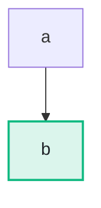

# Solving Graph Problems with Graphity

This is the problem-oriented documentation of [Graphity](https://github.com/kaufco/graphity),
published at https://kaufco.github.io/graphity-doc/. A chapter covers a topic area and has an intro
page and problems. A problem answers one question, with pictures and code. The site is built with
[Starlight](https://starlight.astro.build/) (Astro) into static HTML.

## Prerequisites

- Node.js 22.22 or newer (`.nvmrc` names the version the CI uses). Astro 7.4.2 and later need Node 22.23.4 or newer, which is why `astro` is
  pinned to 7.4.1 for now.
- Once per machine, the headless Chromium that renders the Mermaid diagrams at build time
  (about 126 MB download, 280 MB on disk in `~/.cache/ms-playwright`):

  ```sh
  npx playwright install --only-shell chromium
  ```

  On a fresh Linux machine or CI runner, add `--with-deps` to also install the system libraries.

- The libraries the guide documents, at the versions `languages.json` names: `npm run languages`
  checks them out into `languages/` (see [The libraries](#the-libraries-and-their-languages)).

## Commands

Run them in this directory:

| Command                       | What it does                                                         |
| ----------------------------- | -------------------------------------------------------------------- |
| `npm ci`                      | Installs the exact dependency versions of `package-lock.json`.       |
| `npm run languages`           | Checks out the documented libraries into `languages/`.               |
| `npm run dev`                 | Dev server at http://localhost:4321/graphity-doc/, live reload.     |
| `npm run build`               | Static site in `dist/`.                                              |
| `npm run preview`             | Serves `dist/` at http://localhost:4321/graphity-doc/.              |
| `npm run dev:local-javadoc`   | Like `dev`, with the API links pointing to local copies.             |
| `npm run build:local-javadoc` | Like `build`, with the API links pointing to local copies.           |
| `npm run gaps`                | Lists every `<Gap>`: page, line and text.                            |
| `npm run api-coverage`        | Share of the public API in the `api` frontmatter; what is missing; whether each port's API mapping is complete. |
| `npm run check-javadoc-anchors` | Checks the Java source parser against a locally built Javadoc.     |

Every page, script and style sheet lives under `/graphity-doc/`, which is the path of the published
site (`src/lib/site.mjs`). Instead of `npm run preview`, any static web server works that serves
`dist/` under that path. Opening the HTML files directly (`file://`) does not work: the pages
reference their CSS, scripts and each other with absolute paths (`/graphity-doc/_astro/...`), and
browsers block module scripts from `file://`. The text, the code and the Javadoc links are readable, but the page is
unstyled, both theme variants of each diagram show, and navigation and search do not work.

### The libraries and their languages

The pages show the examples of the libraries and link their API, so the build reads both from the
libraries themselves: Java ([kaufco/graphity](https://github.com/kaufco/graphity)) and its ports to
Rust, TypeScript and C# (kaufco/graphity-rust, -ts and -csharp). From Java it takes the examples in
`graphity-examples` and the sources of the published modules, against which every API reference is
resolved; from each port, its examples and `api-<language>.json`, which maps each Java API reference
to the port's name and API page.

`languages.json` names the libraries the guide documents and the version of each, which is a tag of
its repository; `npm run languages` checks them out into `languages/<language>/` (not versioned) and
replaces a checkout of another version. A language that `languages.json` does not name is not in the
build: the guide shows only released libraries. To build against another checkout, for example while
writing a page for an API that is not released yet, set `GRAPHITY_<LANGUAGE>_ROOT` to its directory
(`GRAPHITY_JAVA_ROOT`, `GRAPHITY_RUST_ROOT`, `GRAPHITY_TS_ROOT`, `GRAPHITY_CSHARP_ROOT`; relative to
this directory, or absolute). The languages and where each keeps its examples are listed in
`src/lib/languages.mjs`.

Java has to be in every build. Each other language in the build is shown in full: every
`<Example>` and `<InCode>` needs its version in that language, and every API reference an entry in its
mapping, or the build fails. The reader picks the language beside the page.

When a new version of a library is released, the guide moves to it by changing the version in
`languages.json`; a build that fails then names the examples or API references that no longer exist.

### API links

The links of `<Api>` and of the `api` frontmatter go to the published API documentation of each
language: `https://kaufco.github.io/graphity/` for Java and the address in `src/lib/languages.mjs`
for the ports. `apiDocs` in `languages.json`, or `GRAPHITY_JAVADOC_URL` and
`GRAPHITY_<LANGUAGE>_API_URL`, override these addresses at build time. To click through without the
published sites, first build the API documentation in each library. For a port, that is the command
its README names. For Java, it is:

```sh
mvn -B -ntp -pl graphity-core,graphity-controlflow,graphity-dot,graphity-mermaid,graphity,graphity-bom -am javadoc:aggregate
```

Then use `npm run dev:local-javadoc` or `npm run build:local-javadoc`. They copy each documentation
to `public/api/<language>/` (not versioned) and point the links there.

### Look

`GRAPHITY_GUIDE_THEME=starlight` builds with Starlight's own look instead of the look of the Graphity
Javadoc (`src/styles/primer.css`), for comparing the two.

### Caches

Rendered diagrams are cached in `node_modules/.cache/graphity-mermaid`. The cache key includes the
source of a diagram, the Mermaid version and configuration, and `src/lib/diagram-layout.js`, which
refines each drawing. `rm -rf node_modules/.cache` clears the cache. The dev server reads the Java
sources once: restart it after changing the API or the examples' region markers.

## Writing pages

Pages are `.md` or `.mdx` files in `src/content/docs/`; components need `.mdx`. The URL comes from the
file name (`sccs/condense-to-dag.mdx` becomes `/sccs/condense-to-dag/`), and the title and the
`description` come from the frontmatter. The order of chapters and problems is set in one place:
`src/lib/structure.mjs`. The sidebar, the numbers in front of the titles, the contents page and the
list on each chapter page (`<ChapterProblems />`) follow from it.

The `description` of a chapter or problem is one full sentence that says what the page does. It is
written only there: the page opens with this sentence, and the contents page and the list of its
chapter show it. The sentence starts with "This chapter" on a chapter and with "You" on a problem,
as in "You build a graph from pairs of node IDs, given in any order and with duplicates." The first
paragraph of a chapter goes on from that sentence and does not repeat it.

At its end, the build checks the finished pages (`src/lib/chapter-check.mjs`; `npm run check-chapters`
after a build) and fails if the contents page or a chapter does not list all its pages, if a list shows
another sentence than the page, or if a page does not open with its sentence.

```mdx
---
title: Condense each cycle into one node to get a DAG
api:
  - Components.sccsOf(Graph)
  - Sccs.condense()
---

import Api from '../../components/Api.astro';
import Example from '../../components/Example.astro';
import Gap from '../../components/Gap.astro';
```

(The import paths are relative to the page.)

### Diagrams

What a picture shows, its marks and colors, its legend and its caption follow [STYLE.md](STYLE.md); read
it before you add or change one. Pictures are ordinary Mermaid code blocks:

````md

````

They are rendered to SVG at build time; no Mermaid JavaScript reaches the browser.
For two diagrams side by side (before and after), put them in `<Compare>`, with a blank line around
each:

````mdx
<Compare before="The rules" after="Their SCCs">

```mermaid
...
```

```mermaid
...
```

</Compare>
````

One legend below the two pictures shows the marks they use, in the columns Input, Context and Output,
under their general names. `legend` gives a mark the name it has on the page:
`legend={{ contextGroup: 'SCC', outputEdge: 'Strong bridge' }}` (the keys are in `src/lib/legend.mjs`). A
single diagram with marks goes into `<Figure>`. A picture that does not follow [STYLE.md](STYLE.md#what-fails-the-build)
fails the build; `npm run check-pictures` makes the same checks without one.

Write colors as hex values. A node with a fill but no `color` gets black or white text, whichever is more
readable. Wide diagrams shrink to at most 70 % of their natural size, then scroll.

### Code from graphity-examples

```mdx
<Example java="Connectivity.java#sccsOf" />
```

The path is relative to `graphity-examples/src/main/java/com/kobayami/graphity/examples/` of the Java
library. The part after `#` names a region marked as for Javadoc's `{@snippet}`:

```java
// @start region="sccsOf"
Sccs sccs = Components.sccsOf(dependencies);
// @end
```

`// @end` closes the innermost region, and `// @end region="name"` a named one. Marker lines of nested
regions are left out, and the common indentation is removed. A missing file or region fails the build,
and so does a region with a line of more than 90 characters: it would wrap at the standard width.
Below the code, the link "Full example" leads to the whole file, in the repository and at the version
that `languages.json` names, with the lines of the region marked.

Each port keeps the same example below its example directory (`src/lib/languages.mjs`), with the same
region name, in the file that the language's naming convention gives. For
`guide/FindingLoops.java`, that is `guide/finding_loops.rs` in Rust, `guide/findingLoops.ts` in
TypeScript and `Guide/FindingLoops.cs` in C#. A prop names another file where a port has one:
`<Example java="guide/FindingLoops.java#loops" rust="guide/loops.rs#loops" />`.

The reader picks the language above "On this page", or in the bar at the top of the page on a narrow
screen (`LanguagePicker`, shown when the build has more than one language). The page then shows each
example in that language, and the names in the text follow:
`<Api>` shows the name of the selected language, and
`<InCode java="-1" rust="None" ts="-1" csharp="-1" />` any other code that differs. Text that holds for
one language only goes into `<InCode>` or is phrased for all of them. Two components cover the rest:

- `<Program name="load" />` shows a program that the examples work on, not code of the library, in
  the selected language, from `src/programs/<name>.<extension>` (`.java`, `.rs`, `.ts`, `.cs`).
- `<PerLanguage>` holds content that differs between the languages as a whole, such as how to add
  the library to a project: one `<div slot="java">`, `<div slot="rust">`, `<div slot="ts">` and
  `<div slot="csharp">`, with Markdown inside, set off by blank lines.

Like `<Example>` and `<InCode>`, both fail the build when a language of the build has no version.

### Links into the Javadoc

```mdx
<Api ref="Components.sccsOf(Graph)" />                 → Components.sccsOf
<Api ref="Loops.of(BiAdjacentGraph, int)" />           → Loops.of (this overload)
<Api ref="Sccs" />                                     → Sccs (the class page)
<Api ref="GraphBuilder()" />                           → new GraphBuilder (constructor)
<Api ref="Sccs.condense()" label="condense" />         → condense
```

Write classes by simple name (nested types as `MermaidWriter.Direction`), parameter types by simple
name as in the source, arrays as `int[]`, varargs as `int...` and type variables as `T[]`. An
inherited method links to the class that declares it. A reference that does not match a public or
protected method of `graphity-core`, `graphity-controlflow`, `graphity-dot` or `graphity-mermaid`
fails the build and names the overloads that exist.

### API used

The frontmatter field `api` lists the API a page uses, in the same syntax. It becomes the "API used"
section at the end of the page and is what `npm run api-coverage` counts. Entries that the coverage
should not count go into `api-coverage-exclusions.txt`.

### Gaps

```mdx
<Gap>Graphity cannot yet condense a cycle and keep the edge labels in one step.</Gap>
```

Marks a use case Graphity does not support yet, shown as "Not in Graphity yet";
`npm run gaps` lists them all.

## How it works

- `src/lib/mermaid.mjs`: a plugin for Astro's Markdown processor Sätteri takes the `mermaid` code
  blocks out of the Markdown tree before Expressive Code highlights code blocks, and renders them in
  Playwright's Chromium with Mermaid; `src/styles/guide.css` shows the variant that matches
  `data-theme` on `<html>`.
- `src/lib/java-api.mjs`: reads the public types and members from the Java sources of the published
  modules and builds the Javadoc anchors (format of the JDK 25 javadoc tool).
- `src/lib/examples.mjs`: region extraction for `<Example>`.
- `src/pages/api-pages.json.ts`: generates `/api-pages.json`. It lists which pages use which class
  or method, with one list per language of the build. Each list names a class or method by its page
  and anchor in the API documentation of that language. The deployment of an API documentation
  reads `/api-pages.json` to link each element back to the guide.
- `src/components/overrides/MarkdownContent.astro` and `src/route-middleware.ts`: the "API used"
  section and its entry in the table of contents.

## Search

The search (Pagefind, which is part of Starlight) indexes the text of the pages in Java: names and
code of the other languages carry `data-pagefind-ignore`, since they would stand side by side with the
Java form in the excerpts of the results. A page has one index entry; a search per language would need
an index per language. Code examples are not indexed at all: an excerpt is plain text in one line.
Diagrams are not indexed either; Pagefind leaves out SVG. So that a method is still found by its name,
"API used" ends with the bare names of its methods in every language, invisible on the page. The index
keeps `DotWriter.nodeFilter` as one word, and `nodeFilter` alone would not find it.

## Publishing

`.github/workflows/site.yml` builds the site for every pull request and every push, with the
libraries of `languages.json`, and fails when a page refers to an example or an API that does not
exist there; it also lists the part of the published API that no page uses (`npm run api-coverage`).
A push to `main` of kaufco/graphity-doc then deploys the site to GitHub Pages. The repository's Pages
source must be "GitHub Actions".

## License

The guide is licensed under the Apache License 2.0, like Graphity itself. See [LICENSE](LICENSE).
