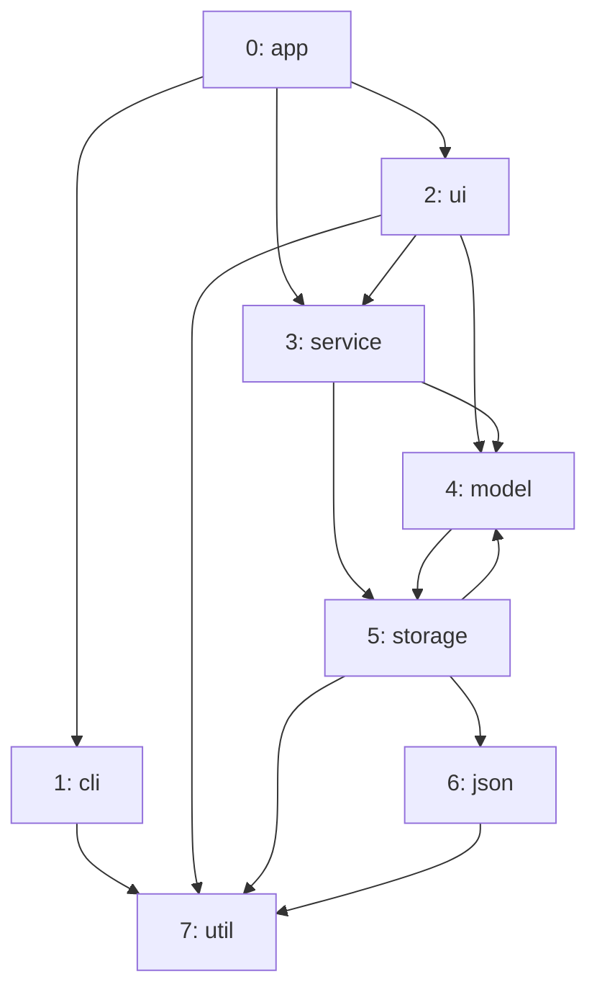

import Example from '../../../components/Example.astro';
import Api from '../../../components/Api.astro';

:::note[In short]
- <Api ref="GraphBuilder()" /> collects nodes and edges in any order.
- <Api ref="GraphBuilder.addNodes(int)" /> adds the nodes.
- <Api ref="GraphBuilder.addEdge(int, int)" /> adds one edge.
- <Api ref="GraphBuilder.build()" /> returns the graph, with duplicate edges merged.
:::

## Problem

You have the edges of a graph as pairs of numbers and want a graph that the algorithms of Graphity
can work on. The pairs come in no particular order, and some of them may come more than once. This
is the usual case when a graph comes from outside the program:

- a file of edges, such as an export from another tool;
- the result of a database query;
- the output of another program or library.

## Example

The example graph models the dependencies between the eight packages of a small program. It has a
node for each package and an edge `p -> q` for each package `q` that `p` uses: `app` uses `cli`,
`ui` and `service`; `ui` uses `service`, `model` and `util`; and so on. The packages are numbered
from 0 to 7, and each dependency is a pair of these numbers. The pair for `ui -> model` happens to
be listed twice. How do these pairs become this graph?

## Solution

A <Api ref="GraphBuilder" /> takes the nodes and the edges, and
<Api ref="GraphBuilder.build()" /> turns them into a graph:

<Example java="guide/BuildingFromEdges.java#fromEdges" />

The builder numbers the nodes from 0 in the order they are added, so the [node
IDs](../../glossary/#node-id) match the positions in `names`. The edges may come in any order.
<Api ref="GraphBuilder.build()" /> sorts them by their [source](../../glossary/#source-and-target)
and then their target, and this order gives each edge its [edge index](../../glossary/#edge-index).
<Api ref="GraphBuilder.build()" /> also merges the duplicate. The result is the graph of the
picture, with 8 nodes and 14 edges.

## Good to know

- **One node at a time.** <Api ref="GraphBuilder.addNode()" /> adds a single node and returns its
  node ID, for when the nodes come one by one.
- **An edge to a node that does not exist** is rejected at the call that adds it, not later in
  <Api ref="GraphBuilder.build()" />.
  See [Build a graph from objects of your own](../build-from-objects/) for what to do if your node
  IDs come from elsewhere and you do not know their count.
- **Many edges.** <Api ref="GraphBuilder.ensureEdgeCapacity(int)" /> reserves the room for the
  edges once, instead of growing step by step. Use it if you know roughly how many edges the
  builder will hold in all. That number includes duplicates: here it is the 15 pairs, not the 14
  edges of the graph.
- **Counts.** <Api ref="Graph.nodeCount()" /> and <Api ref="Graph.edgeCount()" /> return the size
  of a graph, and <Api ref="Graph.isEmpty()" /> tells whether it has no nodes at all.
- **The builder stays usable.** After <Api ref="GraphBuilder.build()" />, you can add more and
  build again; the graph you got before does not change.
- **Edges in batches.** See [Build trees and paths in a few calls](../build-trees-and-paths/) for
  how to add several edges at once, such as all edges of one node or a [path](../../glossary/#path)
  through several nodes.
