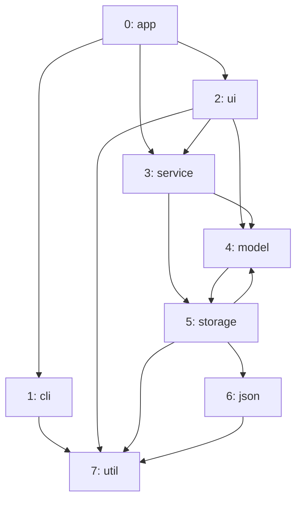

import Example from '../../../components/Example.astro';
import Api from '../../../components/Api.astro';
import InCode from '../../../components/InCode.astro';

:::note[In short]
- Give each object a [node ID](../../glossary/#node-id): its position in a list. Keep the objects
  in an array indexed by node ID.
- A map from your keys to node IDs turns references between objects into edges with
  <Api ref="GraphBuilder.addEdge(int, int)" />.
- For edges whose node IDs come from elsewhere, the methods ending in
  <InCode java="AndNodes" rust="_and_nodes" ts="AndNodes" csharp="AndNodes" />, such as
  <Api ref="GraphBuilder.addEdgePairsAndNodes(int...)" />, add the missing nodes themselves.
:::

## Problem

Your program has objects that refer to each other, and you want to analyze these references as a
graph. Graphity's nodes are numbers, not objects. So you need three things: a numbering of your
objects, a way back from a number to its object, and an edge for each reference. Such objects are
found in:

- a model of a program, with classes and the classes they use;
- a plan, with tasks and the tasks they wait for;
- an organization, with people and the people they report to.

## Example

A small program describes its packages as objects of a type `Package`, each with its name and the
names of the packages it uses:

<Example java="guide/BuildingFromObjects.java#packages" />

The example graph models the dependencies between these packages. It has an edge from each package
to each package it uses. Which node ID does each package get, and how does a node ID lead back to
its package? Each package gets its position in the list:

## Solution

Number the objects in the order of the list, keep each object in an array at its node ID, and
look up the node ID of each reference by name:

<Example java="guide/BuildingFromObjects.java#fromObjects" />

The result is the graph of the picture. A list of edges gives the same graph. See
[Build a graph from a list of edges](../build-from-edges/). The array
<InCode java="packageOf" rust="package_of" ts="packageOf" csharp="packageOf" /> leads from a node
ID back to its object. It is the first column of a table of node data: every further piece of data
about the packages can be another array of the same length. The last line of the code goes both
ways: from the node ID of `app` to its [out-nodes](../../glossary/#out-node-and-in-node) with
<Api ref="Graph.outNodes(int)" />, and from the second out-node back to its object, which is `ui`.

The node IDs may come from elsewhere, numbered in a database or in a file. Then you may not know
how many nodes there are. The methods whose names end in
<InCode java="AndNodes" rust="_and_nodes" ts="AndNodes" csharp="AndNodes" /> add the nodes up to
the highest node ID they see:

<Example java="guide/BuildingFromObjects.java#andNodes" />

The graph has 8 nodes. The nodes 0, 3, 4 and 7 have the four edges. The nodes 1, 2, 5 and 6 have no
edges and fill the gaps between them.

## Good to know

- **A wrong node ID.** Without
  <InCode java="AndNodes" rust="_and_nodes" ts="AndNodes" csharp="AndNodes" />, the builder rejects
  an edge to a node that has not been added, so a wrong node ID fails at once. With it, a node ID
  that is too high adds nodes instead. Use the plain methods when the node count is known. A wrong
  reference also fails at once if your map lookup gives
  <InCode java="-1" rust="NONE" ts="-1" csharp="-1" /> for a key it does not know, or fails for it.
- **Single edges and pairs.** <Api ref="GraphBuilder.addEdgeAndNodes(int, int)" /> adds one edge and
  its missing nodes. <Api ref="GraphBuilder.addEdgePairs(int...)" /> takes the
  [source and target](../../glossary/#source-and-target) of each edge in turn from one array. Data
  from a file often comes this way.
- **Keys other than names** work the same way. You can use any map from your key to the node ID,
  or a field in your object that holds its node ID once it has one.
