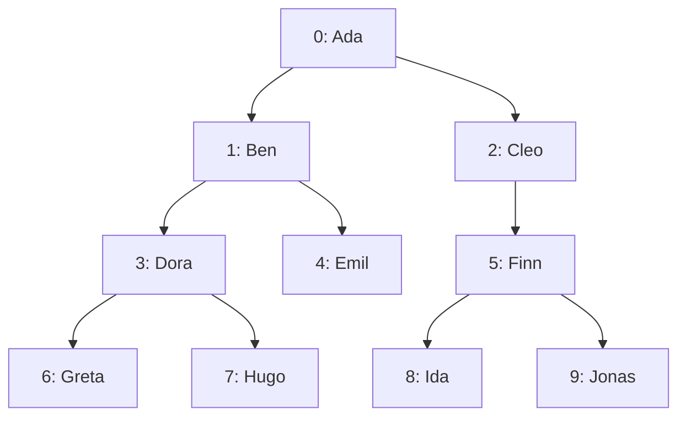
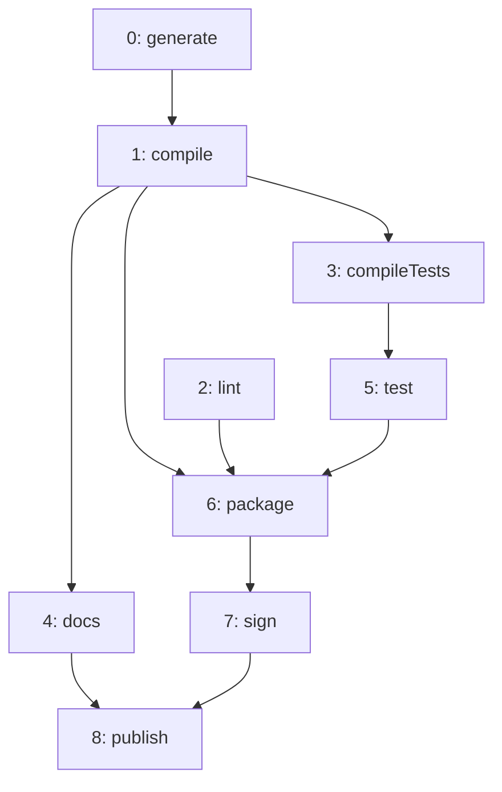

import Example from '../../../components/Example.astro';
import Api from '../../../components/Api.astro';
import InCode from '../../../components/InCode.astro';

:::note[In short]
- <Api ref="GraphBuilder.addChild(int)" /> and <Api ref="GraphBuilder.addChildren(int, int)" /> add
  new nodes, each with an edge from a [parent](../../glossary/#parent-and-child) to it.
- <Api ref="GraphBuilder.addParent(int)" /> and <Api ref="GraphBuilder.addParents(int, int)" /> add
  new nodes, each with an edge from it to a node that exists.
- <Api ref="GraphBuilder.addPath(int...)" /> adds a [path](../../glossary/#path) through several
  nodes.
- <Api ref="GraphBuilder.addOutEdges(int, int...)" /> adds the edges from one node to several
  others.
- <Api ref="GraphBuilder.addInEdges(int, int...)" /> adds the edges from several nodes to one.
:::

## Problem

You want to build a graph of a common shape in a few calls, because adding it edge by edge is
tedious. In a [tree](../../glossary/#tree-and-forest), every new node is the child of a node that
already exists. In a path, each node has an edge to the next. A third shape is a node with edges to
many others. You need this for:

- hierarchies, such as a family tree, the folders of a file system or an organization chart;
- sequences, such as the stages of a pipeline;
- plans in which one step waits for several others, or several steps wait for one.

## Example

The first example graph models a family tree of four generations that records one parent for each
person. It has an edge from each parent to each child: `Ada` has the children `Ben` and `Cleo`;
`Ben` has `Dora` and `Emil`; and so on. The graph is a tree whose
[root node](../../glossary/#root-node) is `Ada`:

The second example graph models the steps that build and publish a small program. It has an edge
`a -> b` if step `b` may start only after step `a`. The steps partly run one after the other and
partly wait for several others: `compile` runs after `generate`; `compileTests`, `docs` and
`package` run after `compile`; `package` also waits for `lint` and `test`; and so on.

How can both be written without listing every edge?

## Solution

<Api ref="GraphBuilder.addChild(int)" /> adds a node with the edge from its parent and returns
the new [node ID](../../glossary/#node-id), so the tree is written from the top, child by child.
<Api ref="GraphBuilder.addChildren(int, int)" /> adds several children of one parent at once. It
returns the node ID of the first child, and the others follow without gaps:

<Example java="guide/BuildingTreesAndPaths.java#tree" />

The result is the family tree of the first picture. Its node IDs follow the order in which the
people were added.

The build steps are made of paths and of nodes with several edges.
<Api ref="GraphBuilder.addPath(int...)" /> adds an edge from each node of a path to the next.
<Api ref="GraphBuilder.addOutEdges(int, int...)" /> adds edges from one node to several others.
<Api ref="GraphBuilder.addInEdges(int, int...)" /> adds edges from several nodes to one. Both take
the one node first and then the others, so
<InCode java="addInEdges(6, 2, 5)" rust="add_in_edges(6, &[2, 5])" ts="addInEdges(6, 2, 5)" csharp="AddInEdges(6, 2, 5)" /> adds `2 -> 6` and `5 -> 6`:

<Example java="guide/BuildingTreesAndPaths.java#path" />

The result is the graph of the second picture, with its ten edges.

## Good to know

- **New parents.** <Api ref="GraphBuilder.addParent(int)" /> and
  <Api ref="GraphBuilder.addParents(int, int)" /> add new nodes, each with an edge from it *to* a
  node that exists. The new nodes become the [in-nodes](../../glossary/#out-node-and-in-node) of
  that node. This fits the ancestors of a person, with two new parents at a time. It also fits
  several new steps that one existing step waits for.
- **Lists from Graphity.** <Api ref="GraphBuilder.addPath(IntList)" />,
  <Api ref="GraphBuilder.addOutEdges(int, IntList)" /> and
  <Api ref="GraphBuilder.addInEdges(int, IntList)" /> take any list of nodes that Graphity returns,
  such as the out-nodes of another graph, without copying it into an array first.
- **Missing nodes.** As for single edges, the path methods and the methods for the edges of one
  node each have a twin ending in
  <InCode java="AndNodes" rust="_and_nodes" ts="AndNodes" csharp="AndNodes" />, such as
  <Api ref="GraphBuilder.addPathAndNodes(int...)" />. The twin adds the missing nodes up to the
  highest node ID it is given, those in between included. The methods for children and parents
  need no twin: they add new nodes anyway.
- **Which way the edges point** is your choice. This guide lets them point from parent to child
  and from the step that runs first to the step that runs after it. Whatever you choose, say it
  once, next to the graph: every result depends on it. The functions of Graphity for trees, such
  as the tree check and the ancestor index, expect edges from parent to child. For a tree stored
  with edges from child to parent, pass them the
  [transposed graph](../../glossary/#transposed-graph).
  See [Find out whether a graph is a tree, a forest or a path](../../trees/shapes/).
