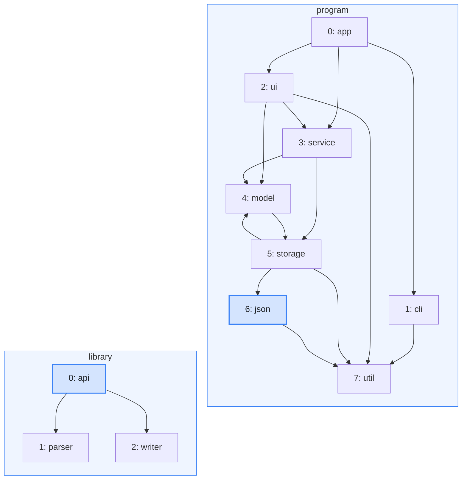
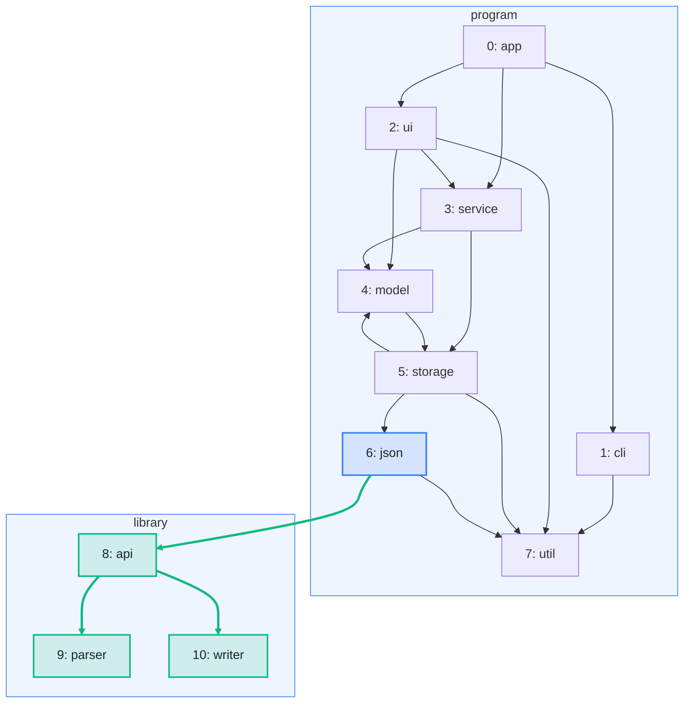

import Example from '../../../components/Example.astro';
import Api from '../../../components/Api.astro';
import Compare from '../../../components/Compare.astro';

:::note[In short]
- <Api ref="GraphBuilder.addGraph(Graph)" /> adds all nodes and edges of a graph to a builder,
  after the nodes the builder already has. It returns the offset of the added
  [node IDs](../../glossary/#node-id).
- In an empty builder, a graph keeps its node IDs. That is how you extend a graph, since a graph
  itself never changes.
:::

## Problem

You have several graphs and want to analyze them as one. The node IDs of each graph start at 0,
so their edges cannot simply be copied into one list. Or you have a graph and want a version of it
with a few more edges. You need this for:

- the dependencies of a program together with those of the libraries it uses;
- the call graphs of several modules, analyzed as one program;
- a graph extended by edges that an analysis found or a user added.

## Example

The first example graph `dependencies` models the dependencies between the eight packages of a small
program. The second example graph `library` models the dependencies between the three packages of a
library for JSON (JavaScript Object Notation): `api`, `parser` and `writer`. Both have an edge from
each package to each package it uses. The package `json` of the program uses the library. Together
they make one graph of eleven packages. In it, the node IDs of the library come after those of the
program, and `json` uses `api`. The frames show which graph each node comes from:

<Compare
  before="The program, the library and the two ends of the edge between them"
  after="The combined graph, with new node IDs and added edges"
  legend={{ inputGroup: 'Added graph', inputNode: 'End of the edge between the graphs', outputNode: 'Node with its new node ID', outputEdge: 'Added edge' }}
>

</Compare>

In the picture after, the nodes of the library are green: the combined graph gives them the new
node IDs 8 to 10. The green edges are the ones it adds to the program: `api -> parser` and
`api -> writer` of the library, and `json -> api` between the two graphs.

## Solution

<Api ref="GraphBuilder.addGraph(Graph)" /> adds each graph after the nodes the builder already
has. It returns the offset: node `v` of the added graph becomes node `offset + v`.

<Example java="guide/CombiningGraphs.java#combine" />

The program comes first into the empty builder, so its node IDs stay as they are. The library
gets the node IDs 8 to 10. The edge between the two graphs uses the offsets. The result is the
graph of the picture after, with 11 nodes and 17 edges.

A graph never changes. To add an edge to it, put it into an empty builder, add the edge and build
a new graph. In the empty builder, its node IDs stay the same:

<Example java="guide/CombiningGraphs.java#extend" />

The new graph has the 8 nodes and 14 edges of the old one, and the edge `ui -> storage`.

## Good to know

- **Data comes along by offset.** The arrays with the data of the nodes of each graph go into one
  array at the same offsets. The names of the library, for example, go to the positions 8 to 10.
- **Edge data needs a lookup.** <Api ref="GraphBuilder.build()" /> numbers the edges anew by
  [source and target](../../glossary/#source-and-target), so an added edge moves the
  [edge indices](../../glossary/#edge-index) of the edges after it. In the new graph,
  `ui -> storage` gets the edge index 6, and `ui -> util` and every edge after it move up by one.
  <Api ref="Graph.edgeIndexOf(int, int)" /> finds the new edge index of each edge.
  See [Keep data on nodes and edges](../keep-data/).
- **Edges of a result.** <Api ref="GraphBuilder.addEdges(Edges)" /> adds the edges that an
  algorithm returned, such as the [bridges](../../glossary/#bridge-and-articulation-point) of a
  graph, to a graph under construction. <Api ref="GraphBuilder.addEdgesAndNodes(Edges)" /> adds
  the missing nodes with them.
- **Removing** nodes or edges is not possible in a builder. Take a
  [subgraph](../../glossary/#subgraph) instead, or build the graph again without them.
  See [Take the subgraph of some nodes](../../transforming/subgraph/) for the first way. See
  [Remove edges to break every cycle](../../order-and-cycles/break-cycles/) for the second.
