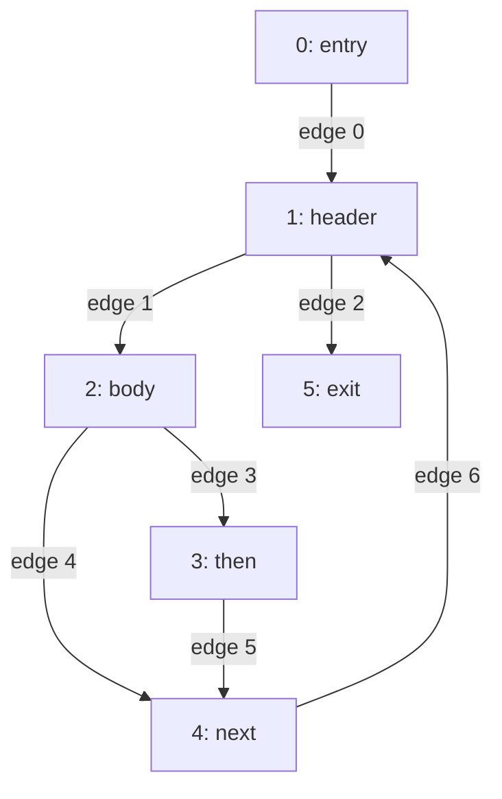

import Example from '../../../components/Example.astro';
import Api from '../../../components/Api.astro';
import Program from '../../../components/Program.astro';
import InCode from '../../../components/InCode.astro';

:::note[In short]
- <Api ref="Graph.of(int[], int[])" /> makes a graph from the two arrays of a
  [CSR layout](../../glossary/#csr-layout) (compressed sparse row): the
  [out-nodes](../../glossary/#out-node-and-in-node) of all nodes, node after node, and where those
  of each node start.
- <Api ref="Csr.outAdjacencyStart(Graph)" /> and <Api ref="Csr.outAdjacency(Graph)" /> give read
  access to these arrays of any graph.
:::

## Problem

You already have a graph as arrays and want to use it without adding its edges one by one. Or you
have a graph and want its arrays, for code of your own that reads every edge. The arrays have the
layout that most graph libraries use inside. One array holds the out-nodes of node 0, then those of
node 1, and so on. A second array holds, for each node, the position in the first array where its
out-nodes start. The arrays come from:

- another graph library or a native library that keeps its graphs this way;
- a file that stores a graph or a sparse matrix in this layout;
- an earlier stage of your own program that already keeps its edges this way.

## Example

The method <InCode java="load" rust="load" ts="load" csharp="Load" /> of a small program reads the
lines of a file and parses each line that is not blank into a note:

<Program name="load" />

The example graph models the control flow of this method and is called a
[control-flow graph](../../glossary/#control-flow-graph). It has a node for each
[basic block](../../glossary/#basic-block). Another tool hands it over as two arrays. One holds the
out-nodes of all blocks: `1, 2, 5, 3, 4, 4, 1`. The other holds the position where the out-nodes
of each block start: `0, 1, 3, 5, 6, 7, 7`.

The second array has one entry more than there are blocks. Its last entry is the number of edges,
and it marks where the out-nodes of the last block end. `exit` has no out-nodes, so its start and
the last entry are both 7. How do the two arrays become a graph, without adding the edges one by
one? In the picture, each edge is labeled with its [edge index](../../glossary/#edge-index). That
is the position of its [target](../../glossary/#source-and-target) in the array of out-nodes:

## Solution

<Api ref="Graph.of(int[], int[])" /> takes the two arrays, checks them and keeps copies:

<Example java="guide/UsingCsrArrays.java#csr" />

The result is the control-flow graph of the picture, with 6 nodes and 7 edges. The out-nodes of
block `v` stand in `adjacency` from position `start[v]` up to just before position
`start[v + 1]`. The position of an out-node is the edge index of its edge.
<Api ref="Csr" /> gives access to the copies that the graph keeps. They hold the same values as
the arrays the graph was made from.

## Good to know

- **Checked, so sorted.** The out-nodes of each node must be strictly ascending, and the starts
  must begin at 0, never decrease and end at the length of the out-nodes. Otherwise
  <Api ref="Graph.of(int[], int[])" /> rejects the arrays. For edges in any order or with
  duplicates, use a builder. See [Build a graph from a list of edges](../build-from-edges/).
- **The arrays of a graph are its own.** <Api ref="Csr" /> hands them out without copying, for code
  that visits every edge as fast as possible. Never write to them, even where their type allows it:
  every user of the graph shares them, and a write would change the graph for all of them.
  See [Loop over the arrays of a graph directly](../../searches/arrays/) for such code.
