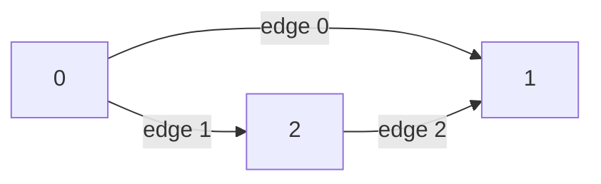

import ChapterProblems from '../../../components/ChapterProblems.astro';
import Api from '../../../components/Api.astro';

Every other chapter starts from a graph. You get one from a list of edges, from objects of your
own or from arrays you already have. You read it through three things: the
[out-nodes and in-nodes](../glossary/#out-node-and-in-node) of a node, the lists that Graphity
returns, and the data you keep on nodes and edges.

## Problems in this chapter

<ChapterProblems />

Most examples of this chapter use two graphs of a small program: the dependencies between its
packages, and the calls between its methods. Other examples use a small family tree and the steps
that build the program. See [Build trees and paths in a few calls](build-trees-and-paths/). Another
example uses the control flow of one of the program's methods. See
[Use arrays you already have as a graph](from-arrays/).

## Nodes, edges and their numbers

A graph in Graphity is a set of nodes and a set of directed edges. The nodes are numbered: a graph
with 8 nodes has the [node IDs](../glossary/#node-id) 0 to 7, and nothing else - no names, no
objects. An edge `a -> b` leads from its [source](../glossary/#source-and-target) `a` to its target
`b`. The targets of the [outgoing edges](../glossary/#outgoing-and-incoming-edge) of a node are its
out-nodes. The sources of its incoming edges are its in-nodes. The edges are numbered too, in the
order of their source and then their target. The number of an edge is its
[edge index](../glossary/#edge-index). A graph has at most one edge from `a` to `b`: a builder
merges duplicates. A graph may also have an edge from a node to itself. Such an edge is a
[self-loop](../glossary/#self-loop).

Here, node 0 has the out-nodes 1 and 2, and node 1 has the in-nodes 0 and 2. The edges `0 -> 1`,
`0 -> 2` and `2 -> 1` have the edge indices 0, 1 and 2.

## Graphs that never change

A graph never changes once it is built: every analysis can share it and rely on it. A
<Api ref="GraphBuilder" /> collects nodes and edges in any order and builds the graph from them.
To change a graph, you build a new one. Names and every other piece of data stay in your own
arrays, indexed by node ID or by edge index. Each kind of data has its own array, like a column of
a table whose rows are the nodes or the edges.

## Out-nodes, in-nodes and lists

A <Api ref="Graph" /> keeps its edges in two arrays. One array holds the out-nodes of all nodes,
node after node. The other holds the position where the out-nodes of each node start. This is the
[CSR layout](../glossary/#csr-layout) (compressed sparse row). The in-nodes need a second pair of
arrays, which a <Api ref="BiAdjacentGraph" /> adds. The algorithms that follow edges against their
direction take such a graph.

Most answers of Graphity are lists. Most sets of nodes, such as the out-nodes of a node, come as a
<Api ref="SortedIntView" />: in ascending order and without duplicates. A sequence of nodes, such
as a [topological order](../glossary/#topological-order) or a [path](../glossary/#path), comes as
a plain list in its own order. A list of edges comes as an <Api ref="Edges" />, which gives the
source, the target and the edge index of each edge.
