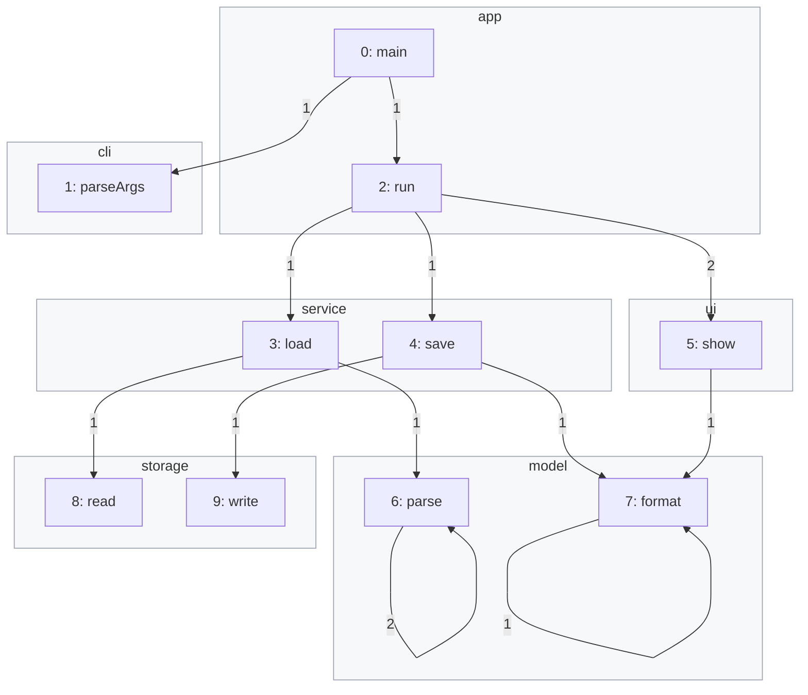
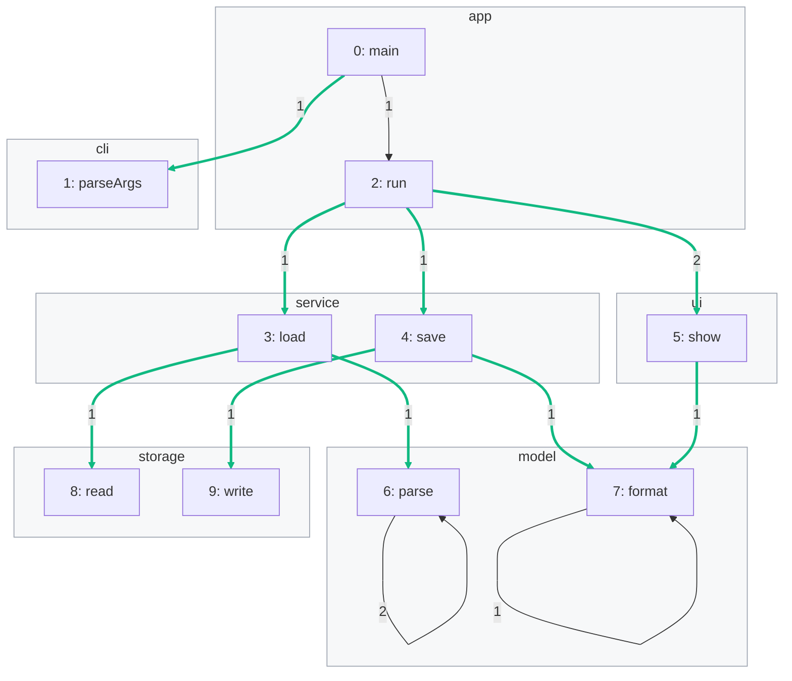

import Example from '../../../components/Example.astro';
import Api from '../../../components/Api.astro';
import Compare from '../../../components/Compare.astro';
import InCode from '../../../components/InCode.astro';

:::note[In short]
- Keep one array per kind of data: indexed by [node ID](../../glossary/#node-id) for nodes, by
  [edge index](../../glossary/#edge-index) for edges.
- <Api ref="Graph.edgeIndexOf(int, int)" /> finds the edge index of an edge from its
  [source and target](../../glossary/#source-and-target).
- <Api ref="Graph.forEachEdge(EdgeConsumer)" /> visits every edge with its source, target and
  edge index.
:::

## Problem

You want to keep data on your nodes and edges, but Graphity stores only the nodes and edges. You
need a place for the data in which each value belongs to one node or edge, and that an analysis can
read quickly. Almost every graph has such data:

- names, sizes and owners of the nodes, such as the name and the package of a method;
- counts and weights of the edges, such as the number of places where one method calls another;
- results of an analysis, such as the [group](../../glossary/#partition-and-group) of each node,
  kept for the next step.

## Example

The example graph `calls` models the calls between the methods of a small program. It has an edge
from each method to each method it calls. The array `names` holds the names of the methods. Each
method belongs to a package. That is data on the nodes, and the gray frames show the packages. A
call can occur at several places in the code, which are called its call sites. Their number is data
on the edges, and the pictures write it on each edge. The list
<InCode java="callSites" rust="call_sites" ts="callSites" csharp="callSites" /> holds the caller and
the callee of each call site. Which calls cross a package boundary, and how many call sites does
each of them have? The picture after shows these calls in green:

<Compare
  before="The calls, with their packages and call sites"
  after="The calls between packages"
  legend={{ contextGroup: 'Package', outputEdge: 'Call between packages' }}
>

</Compare>

## Solution

Data on nodes is an array indexed by node ID. Data on edges is an array indexed by edge index, and
<Api ref="Graph.edgeIndexOf(int, int)" /> finds the edge index of each call:

<Example java="guide/KeepingData.java#data" />

<Api ref="Graph.forEachEdge(EdgeConsumer)" /> visits every edge with its source, its target and
its edge index. The edge index leads to the data of the edge:

<Example java="guide/KeepingData.java#forEachEdge" />

The result lists the nine of the twelve calls that cross a package boundary, each with its number
of call sites. They are the green edges of the picture after. `run -> show` has two call sites,
since `run` shows the notes before and after saving them.

## Good to know

- **Why arrays.** An array per kind of data is compact: an array of 32-bit integers
  (<InCode java="int[]" rust="Vec<u32>" ts="Int32Array" csharp="int[]" />) takes 4 bytes per node.
  Reading one entry is a single memory access. Objects of your own work as well, in an array of
  objects indexed the same way.
- **The [outgoing edges](../../glossary/#outgoing-and-incoming-edge) of one node** have consecutive
  edge indices, from <Api ref="Graph.outEdgeStart(int)" /> to just before
  <Api ref="Graph.outEdgeEnd(int)" />. <Api ref="Graph.edgeSource(int)" /> and
  <Api ref="Graph.edgeTarget(int)" /> go from an edge index back to its nodes.
- **All node IDs, one after the other.** <Api ref="Graph.nodes()" /> returns them, with the type
  <InCode java="IntStream" rust="Range<u32>" ts="Generator<number>" csharp="IEnumerable<int>" />.
- **After a transformation**, such as a [subgraph](../../glossary/#subgraph), the node IDs and edge
  indices change. The data comes along through [mappings](../../glossary/#mapping).
  See [Carry node data over to a transformed graph](../../transforming/node-data/) and
  [Carry edge data over to a transformed graph](../../transforming/edge-data/). In a
  [condensed graph](../../glossary/#condensed-graph), the data of each group is reduced to one value
  instead. See [Reduce the data of the nodes or edges of a group](../../transforming/reduce-data/).
