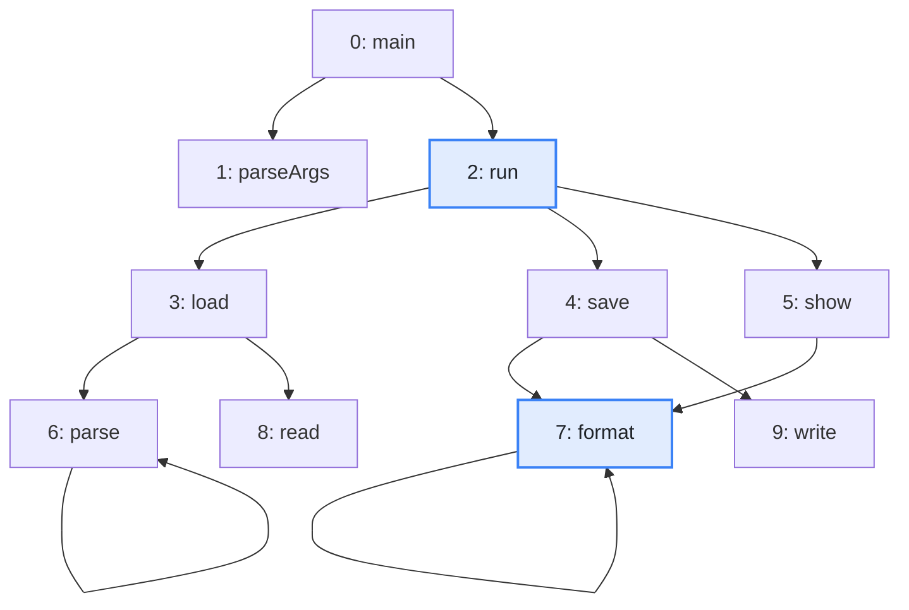
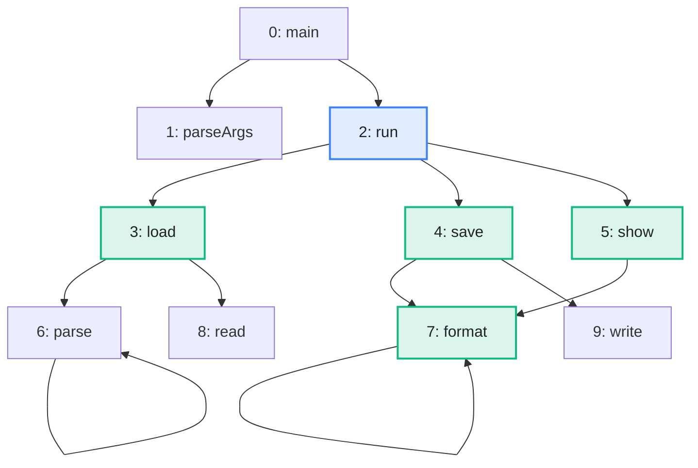

import Example from '../../../components/Example.astro';
import Api from '../../../components/Api.astro';
import Compare from '../../../components/Compare.astro';

:::note[In short]
- <Api ref="Graph.outNodes(int)" /> returns the [out-nodes](../../glossary/#out-node-and-in-node)
  of a node: the [targets](../../glossary/#source-and-target) of its
  [outgoing edges](../../glossary/#outgoing-and-incoming-edge).
- <Api ref="BiAdjacentGraph.of(Graph)" /> adds the in-nodes of every node to a graph;
  <Api ref="BiAdjacentGraph.inNodes(int)" /> then returns the sources of the incoming edges of a
  node.
- <Api ref="BiAdjacentGraph.neighbors(int)" /> returns both together.
:::

## Problem

You have a node and want the nodes directly connected to it. Its out-nodes are the targets of its
outgoing edges. Its in-nodes are the sources of its incoming edges. A graph stores the out-nodes of
every node; the in-nodes have to be built once. Such questions come up for:

- the methods a method calls, and the methods that call it;
- the packages a package uses, and the packages that use it;
- the tasks that wait for a task, and the tasks it waits for.

## Example

The example graph `calls` models the calls between the methods of a small program. It has an edge
from each method to each method it calls. Which methods does `run` call, and which methods call
`format`? The picture after shows both answers in green: the methods that `run` calls, and the
methods that call `format` - among them `format` itself, which calls itself.

<Compare
  before="The calls and the methods run and format"
  after="The out-nodes of run and the in-nodes of format"
  legend={{ inputNode: 'Method asked about', outputNode: 'Out-node or in-node' }}
>

</Compare>

## Solution

The out-nodes come straight from the graph:

<Example java="guide/FindingNeighbors.java#outNodes" />

For the in-nodes, <Api ref="BiAdjacentGraph.of(Graph)" /> builds a graph that stores the in-nodes
of every node as well:

<Example java="guide/FindingNeighbors.java#inNodes" />

`run` calls `load`, `save` and `show`; `format` is called by `save`, `show` and itself. The
[neighbors](../../glossary/#neighbor) of a node are its in-nodes and its out-nodes together: `save`
has the in-node `run` and the out-nodes `format` and `write`. Its
[degree](../../glossary/#out-degree-and-in-degree) is 3. The degree counts edges, not neighbors, and
here the two numbers agree only by chance: `format` has 3 neighbors but the degree 4, since its
[self-loop](../../glossary/#self-loop) counts once as an incoming edge and once as an outgoing edge.

## Good to know

- **Build the bi-adjacent graph once.** <Api ref="BiAdjacentGraph.of(Graph)" /> costs time and
  memory in proportion to the graph; keep it and pass it to everything that needs in-nodes.
  Several algorithms in this guide take a <Api ref="BiAdjacentGraph" /> for that reason. It also
  works wherever a <Api ref="Graph" /> is expected.
- **A [root node](../../glossary/#root-node)** has no in-nodes:
  <Api ref="BiAdjacentGraph.isRootNode(int)" /> answers it for one node in constant time.
- **Sorted results.** The out-nodes, the in-nodes and the neighbors come in ascending order and
  without duplicates, so <Api ref="Graph.hasOutNode(int, int)" />,
  <Api ref="BiAdjacentGraph.hasInNode(int, int)" /> and
  <Api ref="BiAdjacentGraph.hasNeighbor(int, int)" /> search them in logarithmic time.
  See [Work with the lists Graphity returns](../result-lists/) for what else they offer.
- **Back to one direction.** On a <Api ref="BiAdjacentGraph" />,
  <Api ref="BiAdjacentGraph.uniAdjacentGraph()" label="uniAdjacentGraph" /> returns the same graph
  without its in-nodes; once only that graph is kept, the memory of the in-nodes can be freed. On a
  plain <Api ref="Graph" />, <Api ref="Graph.uniAdjacentGraph()" label="uniAdjacentGraph" /> returns
  the same graph, so code that takes either kind of graph can call it.
