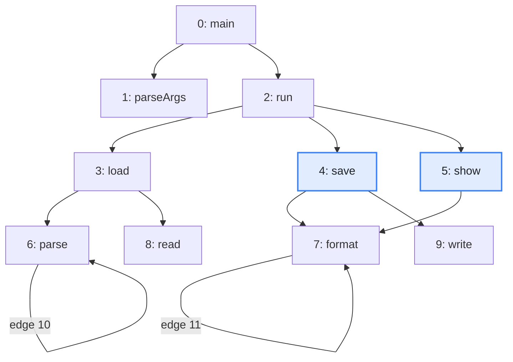
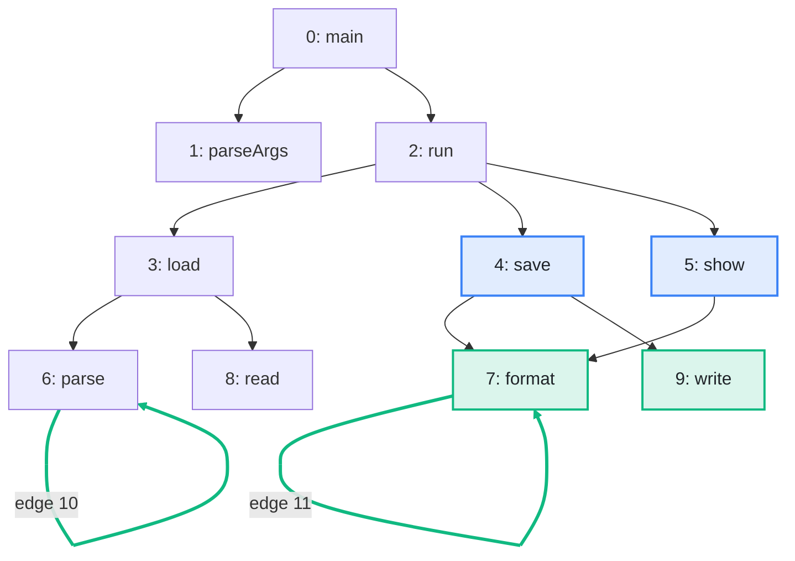

import Example from '../../../components/Example.astro';
import Api from '../../../components/Api.astro';
import Compare from '../../../components/Compare.astro';
import InCode from '../../../components/InCode.astro';

:::note[In short]
- Most sets of nodes, such as the [out-nodes](../../glossary/#out-node-and-in-node) of a node or
  the nodes a search [reaches](../../glossary/#reach), are a <Api ref="SortedIntView" />. It is
  ascending and without duplicates. You read it in a loop, or by position with
  <InCode java="getInt(i)" rust="view[i]" ts="get(i)" csharp="view[i]" />.
- A sequence of nodes in an order of its own is a plain list in that order. Examples are a
  [topological order](../../glossary/#topological-order), a [path](../../glossary/#path) and a
  [cycle](../../glossary/#cycle).
- A list of edges is an <Api ref="Edges" />. Position by position, it gives the
  [source](../../glossary/#source-and-target), the target and the
  [edge index](../../glossary/#edge-index) of each edge.
:::

## Problem

You have a list from Graphity and want to read it, combine it with another list and look things up
in it, without copying it into an array first. Most answers of Graphity are lists. They come from:

- the graph itself, such as the out-nodes of a node;
- searches, such as the nodes that a node reaches;
- analyses that return edges, such as the
  [back edges](../../glossary/#tree-back-forward-and-cross-edge) of a search or the
  [bridges](../../glossary/#bridge-and-articulation-point) of a graph.

## Example

The example graph `calls` models the calls between the methods of a small program. It has an edge
from each method to each method it calls. The array `names` holds the names of the methods. The two
edges from a method to itself are labeled with their edge indices. How many methods does `run` call,
and is `save` among them? Which methods do `save` or `show` call? And which calls are recursive, as
a list of edges with their edge indices? The picture after shows in green the methods that `save` or
`show` call, and the recursive calls:

<Compare
  before="The calls and the methods save and show"
  after="The out-nodes of save or show, and the recursive calls"
  legend={{ inputNode: 'Method asked about', outputNode: 'Out-node of save or show', outputEdge: 'Recursive call' }}
>

</Compare>

## Solution

The out-nodes of a node, like most sets of nodes that Graphity returns, are a
<Api ref="SortedIntView" />. They come in ascending order and without duplicates, so looking up
a node is a binary search, and two lists combine in one pass:

<Example java="guide/ReadingResultLists.java#sortedLists" />

`run` calls three methods. `save` is among them, at position 1.
<Api ref="SortedIntView.union(SortedIntView)" /> returns the methods that `save` or `show` call:
`format` and `write`. They are the green nodes of the picture after.

An algorithm that returns edges returns an <Api ref="Edges" />, which holds three lists of the same
length. <Api ref="Edges.count()" /> is their length, and <Api ref="Edges.isEmpty()" /> tells
whether there is no edge. Here, <Api ref="BackEdges.of(Graph)" /> returns the back edges of a
search. These are the edges that close a cycle.
See [Remove edges to break every cycle](../../order-and-cycles/break-cycles/). In the calls, the
only cycles are the two methods that call themselves, so the back edges are the recursive calls:

<Example java="guide/ReadingResultLists.java#edges" />

The result names the two recursive calls with their edge indices 10 and 11. They are the green
edges of the picture after. The edge index leads to the data of each edge in your arrays.
See [Keep data on nodes and edges](../keep-data/).

## Good to know

- **Views, not copies.** A <Api ref="SortedIntView" /> of out-nodes shares the graph's own array,
  and it cannot be changed. <Api ref="SortedIntView.toIntArray()" /> makes a copy that you can
  change.
- **Your own sorted arrays.** <Api ref="SortedIntView.viewOf(int[], int, int)" /> makes a view of a
  range of an array, so that you can combine it with the lists of Graphity. The range must be
  strictly ascending, which means sorted and without duplicates. Any other range is rejected. The
  view shares your array, so this range must not change while the view is in use.
- **Searching.** <Api ref="SortedIntView.indexOf(int)" /> and
  <Api ref="SortedIntView.lastIndexOf(int)" /> search in logarithmic time. Since values occur only
  once, both return the same position.
- **Lists in an order of their own.** A topological order, a path, a cycle, the
  [body of a loop](../../glossary/#loop), a [subtree](../../glossary/#subtree-and-preorder), and
  the sources and targets of an edge list come as plain lists of
  [node IDs](../../glossary/#node-id) in their own order. They are not sorted and not always
  without duplicates. They read like any list, but a binary search or a union does not apply to
  them. Treat all of these lists, and the edge indices of an edge list, as read-only: copy one
  before you sort or change it.
- **The order of an edge list.** Edge lists come in edge index order, except the back edges of
  <Api ref="BackEdges.of(Graph)" />. Those come in the order in which the search finds them.
  <Api ref="Edges.of(EdgeTypes, EdgeType)" /> with the back type returns the same edges in edge
  index order.
- **Into a builder.** Both kinds of lists go into a <Api ref="GraphBuilder" /> without being
  copied into an array first. A node list goes in as the out-nodes of a node with
  <Api ref="GraphBuilder.addOutEdges(int, IntList)" /> or as a path with
  <Api ref="GraphBuilder.addPath(IntList)" />. An edge list goes in with
  <Api ref="GraphBuilder.addEdges(Edges)" />.
