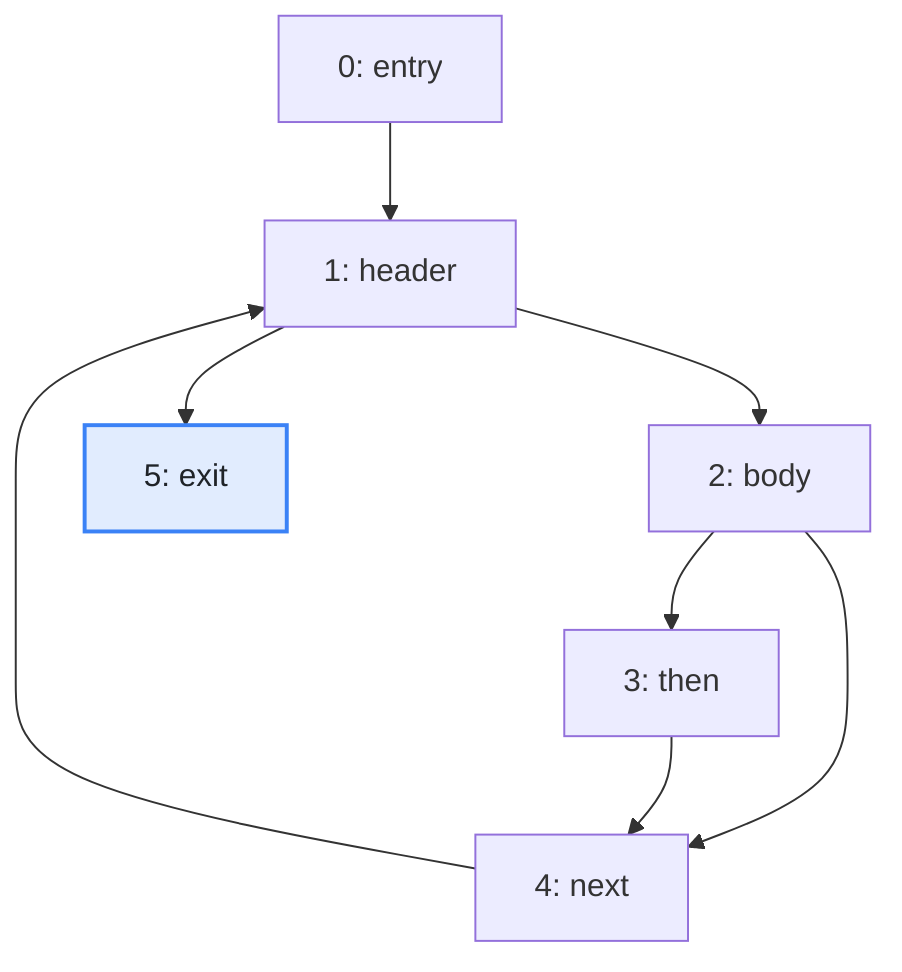
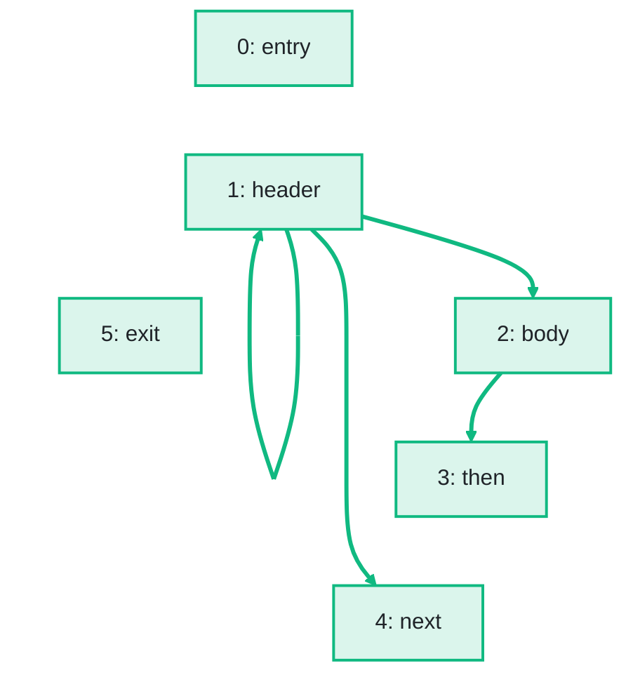

import Example from '../../../components/Example.astro';
import Api from '../../../components/Api.astro';
import Compare from '../../../components/Compare.astro';
import Gap from '../../../components/Gap.astro';
import InCode from '../../../components/InCode.astro';
import Program from '../../../components/Program.astro';

:::note[In short]
- A block is [control dependent](../../glossary/#control-dependence) on a branch if the outcome of
  the branch decides whether the block runs.
- <Api ref="Dominators.of(BiAdjacentGraph, int)" /> on the
  [transposed graph](../../glossary/#transposed-graph) computes the
  [post-dominators](../../glossary/#dominator) from the [exit](../../glossary/#entry-and-exit).
- <Api ref="ControlFlow.dominanceFrontiers(Dominators)" /> of the post-dominators, turned around
  with <Api ref="BiAdjacentGraph.of(Graph)" /> and <Api ref="BiAdjacentGraph.transposed()" />, is
  the control dependence: an edge from each branch to the blocks it decides.
:::

## Problem

Which condition decides whether a statement runs? Often it is the condition of the `if` or loop that
the statement is written in. After a `break`, a `continue`, an early `return` or a `goto`, it can be
a branch elsewhere. A statement can also depend on several branches. A block of a [control-flow
graph](../../glossary/#control-flow-graph) is control dependent on a branch if the outcome of the
branch decides whether the block runs. You need this for:

- a tool that extracts the statements that matter for a value, and with them the conditions that
  decide whether they run;
- a security analysis that asks which checks guard a call;
- a tool that explains code: "this statement runs only if the input is not blank".

## Example

The method <InCode java="load" rust="load" ts="load" csharp="Load" /> of a small program reads the notes
of a notebook from a file:

<Program name="load" />

The graph `cfg` holds its control flow. This control-flow graph has a node for each
[basic block](../../glossary/#basic-block) and an edge from each block to each block that can run
right after it. `exit` is its only exit. Which branch decides whether each block runs?

<Compare
  before="The control flow and its exit block"
  after="Its control dependence"
  legend={{ inputNode: 'Exit block', outputNode: 'Block of the dependence graph', outputEdge: 'From a branch to a block it decides' }}
>

</Compare>

The picture after shows the dependence graph that the code returns: all blocks, and an edge from
each deciding block to the blocks it decides. The blocks stay in their places, and the edges of the
control flow are not drawn.

## Solution

Control dependence follows from the post-dominators of the control-flow graph, in three steps:

1. Compute the post-dominators. See
   [Find the nodes that every path to the exit passes through](../../dominance/post-dominators/).
2. Compute their [dominance frontiers](../../glossary/#dominance-frontier). See
   [Find the blocks where the dominance of a block ends](../dominance-frontiers/).
3. Turn the result around, which gives its transposed graph.

<Example java="guide/AnalyzingControlFlowFurther.java#controlDependence" />

The [loop](../../glossary/#loop) condition in `header` decides whether `body` and `next` run, and
whether `header` runs again. The `if` in `body` decides whether `then` runs. `entry` and `exit`
depend on no branch: they always run.

## Good to know

- **Why the transposed graph.** In the post-dominators, the dominance frontier of a block holds the
  branches that the block depends on. Turned around, the graph has an edge from each branch to the
  blocks it decides.
- **Which outcome.** The result names the branch, not the outcome. A block `y` that depends on a
  branch `x` runs when `x` continues with an [out-node](../../glossary/#out-node-and-in-node) of `x`
  that `y` post-dominates. <Api ref="Ancestry.of(Dominators)" /> on the post-dominators answers
  this with <Api ref="Ancestry.isAncestorOf(int, int)" />. `next` post-dominates `body` but not
  `exit`, so it runs when `header` continues with `body`.
- **Several exits.** A method that returns in several places has several exits: compute the
  post-dominators from all of them, with <Api ref="Dominators.of(BiAdjacentGraph, IntList)" /> on
  the transposed graph.
- **Endless loops.** A block from which no exit can be [reached](../../glossary/#reach) has no
  immediate post-dominator, and the result reads as if such blocks were not there. In the result,
  they depend on no branch. A branch that either enters such a loop or goes on to the rest of the
  method is not shown as deciding the blocks after it, although it decides whether they run. Pass
  the exit and one block of each such loop as the entries of the transposed graph to
  <Api ref="Dominators.of(BiAdjacentGraph, IntList)" />. See
  [Find the nodes that every path to the exit passes through](../../dominance/post-dominators/).
