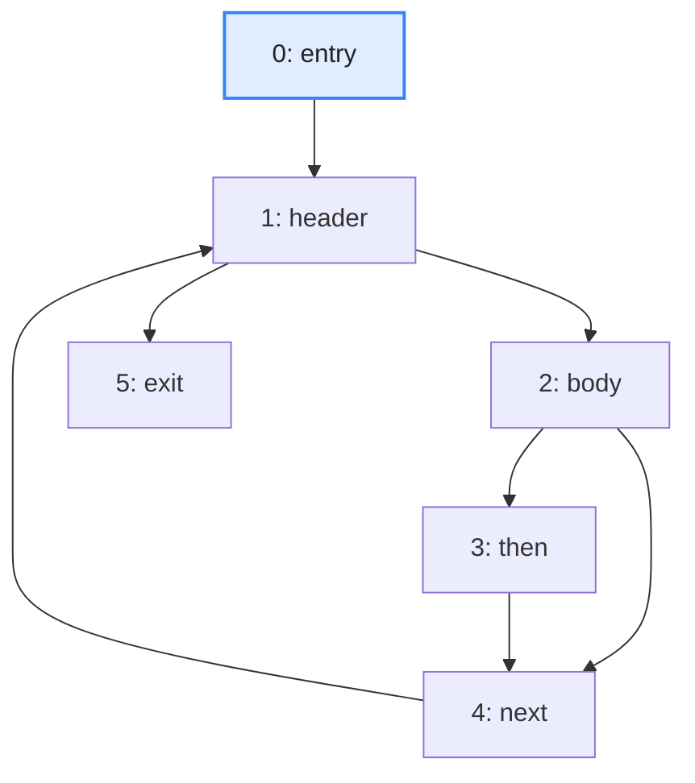
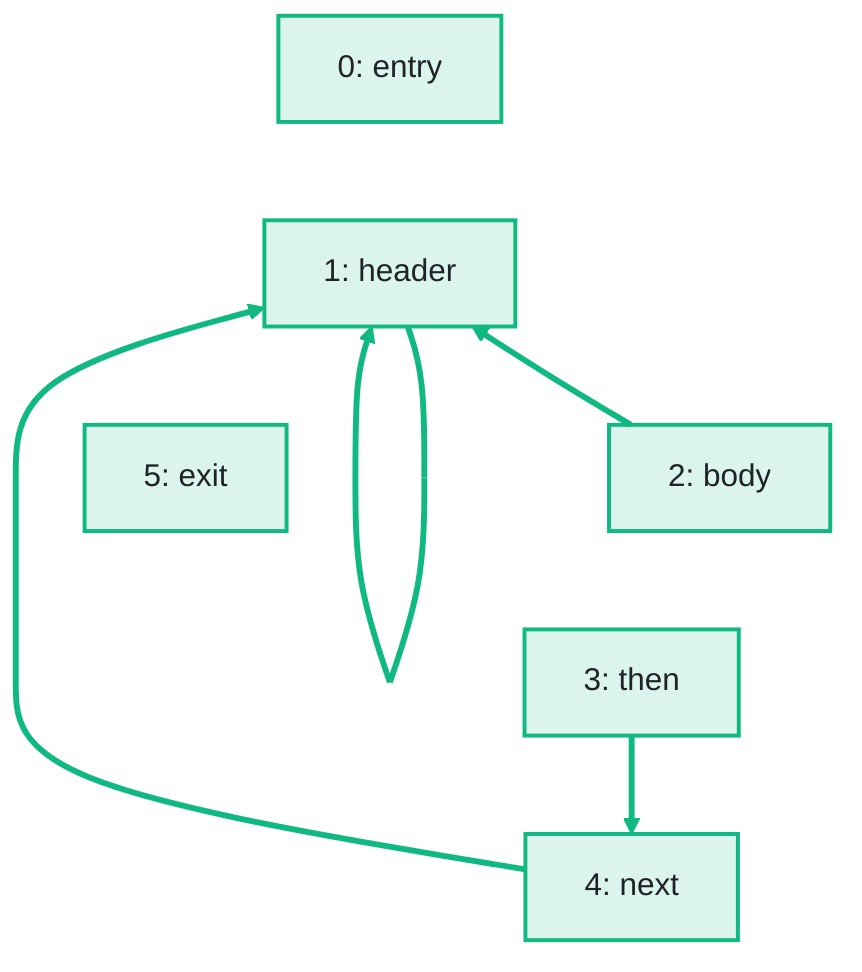

import Example from '../../../components/Example.astro';
import Api from '../../../components/Api.astro';
import Compare from '../../../components/Compare.astro';
import Gap from '../../../components/Gap.astro';
import InCode from '../../../components/InCode.astro';
import Program from '../../../components/Program.astro';

:::note[In short]
- <Api ref="ControlFlow.dominanceFrontiers(Dominators)" /> returns the
  [dominance frontiers](../../glossary/#dominance-frontier) as a graph: an edge `n -> m` for every
  block `m` where the dominance of `n` ends.
:::

## Problem

You want to know where the effect of a block ends. A variable assigned in one branch of an `if`
keeps its new value only until the two branches join. There, a [path](../../glossary/#path) that
skips the branch comes in, so the value is no longer certain. A block `d`
[dominates](../../glossary/#dominator) a block `n` if every path from the
[entry](../../glossary/#entry-and-exit) to `n` passes through `d`. The blocks where a path through
`d` first joins a path that skips `d` are called the dominance frontier of `d`. Typical such blocks
are the block where the two branches of an `if` join, seen from each branch, and the
[header](../../glossary/#loop-header) of a [loop](../../glossary/#loop), seen from the blocks of the
loop. You need this for:

- finding where a variable assigned in `d` may have another value from another path. Compilers place
  the phi-nodes of [SSA form](../../glossary/#ssa-form-and-phi-node) (static single assignment)
  there. See [Find the blocks that need a phi-node for a variable](../phi-nodes/).
- finding which branches decide whether a block runs. See [Find which conditions decide whether a
  block runs](../control-dependence/).
- a data-flow analysis that merges its results only at these blocks, where they can differ, not at
  every block where paths join.

## Example

The method <InCode java="load" rust="load" ts="load" csharp="Load" /> of a small program reads the notes
of a notebook from a file:

<Program name="load" />

The graph `cfg` holds its control flow. This
[control-flow graph](../../glossary/#control-flow-graph) has a node for each
[basic block](../../glossary/#basic-block) and an edge from each block to each block that can run
right after it. Where does the dominance of each block end?

<Compare
  before="The control flow and its entry block"
  after="Its dominance frontiers"
  legend={{ inputNode: 'Entry block', outputNode: 'Block of the frontier graph', outputEdge: 'From a block to a block of its frontier' }}
>

</Compare>

The picture after shows the frontier graph that the code returns: all blocks, and an edge from each
block to each block in its dominance frontier. The blocks stay in their places, and the edges of the
control flow are not drawn.

## Solution

The frontiers follow from the dominators. See
[Find the nodes that every path from the entry passes through](../../dominance/dominators/).

<Example java="guide/AnalyzingControlFlowFurther.java#dominanceFrontiers" />

A block is in the dominance frontier of `d` if `d` dominates one of its
[in-nodes](../../glossary/#out-node-and-in-node) but does not strictly dominate the block itself. A
block `d` strictly dominates a block if it dominates that block and is not that block.

`then` dominates only itself, and its only [out-node](../../glossary/#out-node-and-in-node) is
`next`. So `next` is the one block in the dominance frontier of `then`. It is where the path through
`then` and the path that skips it join. The frontiers of `body` and of `next` hold `header`. Both
dominate `next`, which is an in-node of `header`. They do not dominate `header`, which is
[reached](../../glossary/#reach) from `entry` as well. `header` is in its own frontier, since it
dominates `next` but does not strictly dominate itself. `entry` and `exit` lie on no
[cycle](../../glossary/#cycle) and dominate every block they reach, so their frontiers are empty.

## Good to know

- **A block in its own frontier**, as `header` here, is typical of the header of a loop: the result
  can have [self-loops](../../glossary/#self-loop).
- **Quadratic size.** The frontiers can grow with the square of the number of blocks, for example
  for deeply nested `do-while` loops. For placing phi-nodes,
  <Api ref="IteratedDominanceFrontier" /> answers without building them. See
  [Find the blocks that need a phi-node for a variable](../phi-nodes/).
- **Built anew on every call.** <Api ref="ControlFlow.dominanceFrontiers(Dominators)" /> does not
  keep its result; keep it in a variable to use it more than once.
