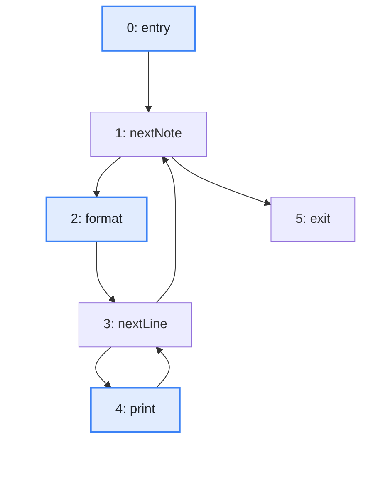
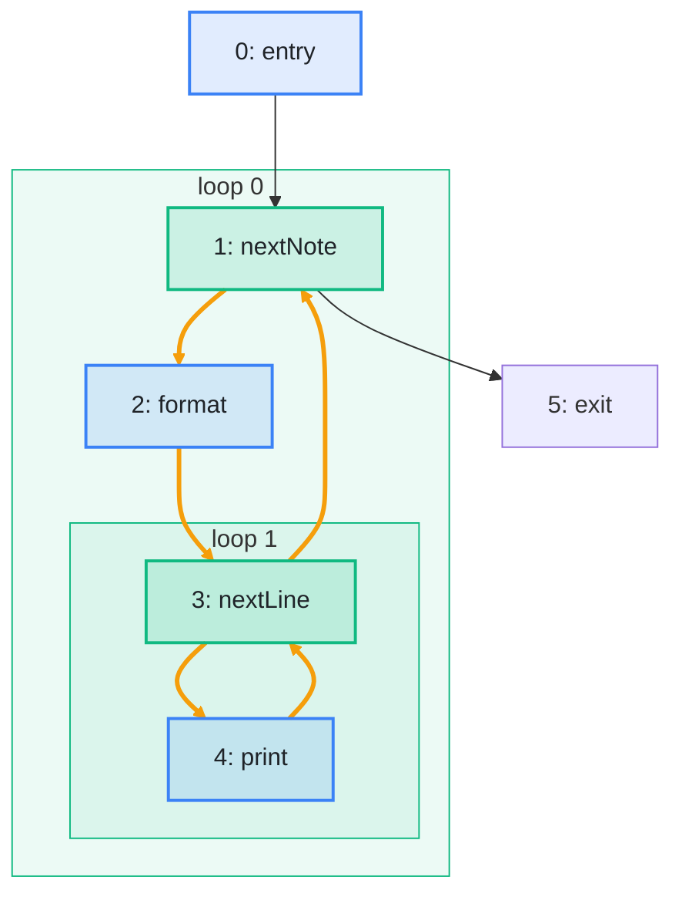

import Example from '../../../components/Example.astro';
import Api from '../../../components/Api.astro';
import Compare from '../../../components/Compare.astro';
import Gap from '../../../components/Gap.astro';
import InCode from '../../../components/InCode.astro';
import Program from '../../../components/Program.astro';

:::note[In short]
- <Api ref="Loops.of(BiAdjacentGraph, int)" /> finds the [loops](../../glossary/#loop) of a
  [control-flow graph](../../glossary/#control-flow-graph) from its
  [entry](../../glossary/#entry-and-exit) block.
- <Api ref="Loops.headerOf(int)" /> returns the [header](../../glossary/#loop-header) of a loop.
- <Api ref="Loops.bodyOf(int)" /> returns the body of a loop: its blocks with those of the loops
  nested in it.
- <Api ref="Loops.parentOf(int)" /> returns the loop that immediately encloses a loop.
- <Api ref="Loops.innermostLoopOf(int)" /> returns the innermost loop that contains a block.
- <Api ref="Loops.loopDepthOf(int)" /> returns the number of loops that contain a block.
:::

## Problem

You want to know where the loops of a function are, because compilers and analyzers do much of their
work per loop. The blocks that form a loop are its *body*. The block through which a loop is entered
is its header. That is where the test of a `for` or `while` loop sits. You also want to know which
loop lies in which, and how deep each block is nested. The source code shows the loops, but the
control-flow graph is what the analysis has, for example after inlining, after other optimizations,
or for bytecode without the source. You need this for:

- moving a computation whose result does not change out of a loop, so that it runs once instead of
  on every pass;
- unrolling small loops;
- estimating how often a block runs, since a block in two nested loops usually runs far more often
  than one in none;
- putting the effort where the program spends its time, for example by keeping the variables of
  inner loops in registers.

## Example

The method <InCode java="show" rust="show" ts="show" csharp="Show" /> prints the notes of a small notebook
program, each note with its lines, in two nested loops:

<Program name="show" />

The graph `cfg` holds its control flow. This control-flow graph has a node for each
[basic block](../../glossary/#basic-block) and an edge from each block to each block that can run
right after it. The picture before shows it. Which blocks form loops, how do they nest, and which is
the innermost loop of `format` and of `print`?

The picture after shows the two loops. Loop `0` runs over the notes. Its header is `nextNote`, and
its body holds every block that can run again before the method returns. Loop `1` runs over the
lines and is nested in loop `0`. Its header is `nextLine`. The orange edges lie on
[cycles](../../glossary/#cycle): execution can run through them again and again.

<Compare
  before="The control flow, its entry and the blocks asked about"
  after="Its loops and their headers"
  legend={{ inputNode: 'Entry or block asked about', outputGroup: 'Loop', outputNode: 'Loop header' }}
>

</Compare>

## Solution

<Api ref="Loops.of(BiAdjacentGraph, int)" /> finds the loops from the entry block. It follows edges
against their direction too, so it takes a <Api ref="BiAdjacentGraph" />, which
<Api ref="BiAdjacentGraph.of(Graph)" /> builds from the control-flow graph. The result is a
<Api ref="Loops" />, which answers the questions about each loop and each block:

<Example java="guide/FindingLoops.java#loops" />

Loops have IDs from 0 to <InCode java="loopCount() - 1" rust="loop_count() - 1" ts="loopCount - 1" csharp="LoopCount - 1" />.
<Api ref="Loops.innermostLoopOf(int)" /> returns the innermost loop that contains a block.
<Api ref="Loops.bodyOf(int)" /> returns the blocks of a loop: its header first, then its other
blocks, then those of the loops nested in it. The body of the loop over the notes therefore contains
the body of the loop over the lines. <Api ref="Loops.parentOf(int)" /> returns the loop that
immediately encloses a loop, and <InCode java="-1" rust="None" ts="-1" csharp="-1" /> for an
outermost one. <Api ref="Loops.loopDepthOf(int)" /> counts the loops that contain a block: `2` for
`print`, `0` for `entry` and `exit`.

## Good to know

- **Outer loops have smaller IDs.** A loop has a smaller ID than the loops nested in it. So going
  through the IDs from <InCode java="loopCount() - 1" rust="loop_count() - 1" ts="loopCount - 1" csharp="LoopCount - 1" /> down to 0 visits
  every loop after the loops inside it. An optimizer usually works in that order.
- **Is a block in a loop?** <Api ref="Loops.isInLoop(int, int)" /> answers it for a block and a
  loop, also when the block lies in a loop nested in it.
- **Loops with several entries.** A loop written with `for` or `while` is entered only through its
  header. A loop built with `goto`, in bytecode or in a generated state machine can have several
  [entries](../../glossary/#loop-header). An entry is a block at which execution can enter the loop
  from outside it. A loop with several entries is [irreducible](../../glossary/#loop-header).
  Graphity finds it as one loop, and <Api ref="Loops.entriesOf(int)" /> returns all its entries.
  <Api ref="Loops.isReducible()" /> tells whether the graph has no irreducible loop among the blocks
  that the entry [reaches](../../glossary/#reach). See
  [Find loops that can be entered in more than one place](../irreducible-loops/).
- **Several entries of the function.** <Api ref="Loops.of(BiAdjacentGraph, IntList)" /> takes a list
  of entry blocks, for example when exception handlers are blocks that no edge leads to. Blocks that
  no entry reaches are in no loop.

<Gap>
Find the exits of a loop: the edges that leave its body, and the blocks they lead to, for example to
place code that runs once after the loop. Graphity returns the body and the entries of each loop,
but not its exits. They have to be collected from the
[out-nodes](../../glossary/#out-node-and-in-node) of the body.
</Gap>
