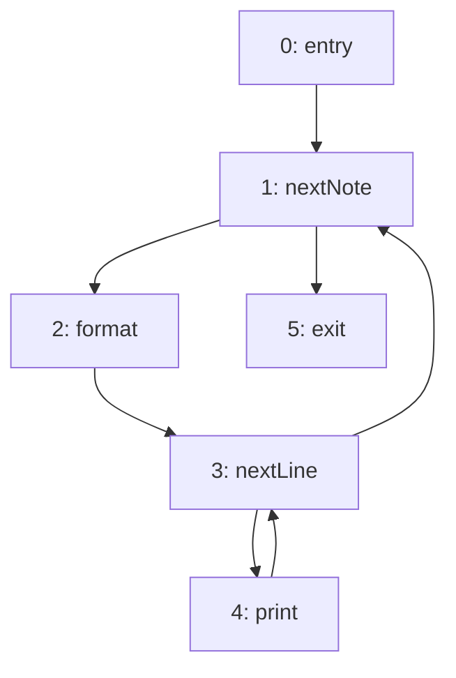

import Api from '../../../components/Api.astro';
import ChapterProblems from '../../../components/ChapterProblems.astro';
import InCode from '../../../components/InCode.astro';
import Program from '../../../components/Program.astro';

Compilers, static analyzers, decompilers and bytecode tools all look at a function the same way: as
a graph of the [paths](../glossary/#path) that its execution can take. With the library
<InCode java="graphity-controlflow" rust="graphity-controlflow" ts="@kobayami/graphity-controlflow" csharp="Graphity.ControlFlow" />,
you read from that graph where the [loops](../glossary/#loop) are and how they nest, where the
[dominance](../glossary/#dominator) of a block ends, where
[SSA form](../glossary/#ssa-form-and-phi-node) (static single assignment) needs phi-nodes, and which
branch decides whether a block runs.
The chapter builds on the chapter [Dominance](../dominance/). The library is part of
<InCode java="graphity" rust="graphity-all" ts="@kobayami/graphity" csharp="Graphity.All" />, which
brings all of Graphity. It can also be added on its own.

## Problems in this chapter

<ChapterProblems />

The examples of this chapter use the control flow of three methods of a small notebook program:

- <InCode java="show" rust="show" ts="show" csharp="Show" /> has two nested loops;
- <InCode java="parseArgs" rust="parseArgs" ts="parseArgs" csharp="ParseArgs" /> is a state machine;
- <InCode java="load" rust="load" ts="load" csharp="Load" /> has a loop and an `if` in it.

Each problem shows the source of the method it analyzes.

## The control-flow graph

A [basic block](../glossary/#basic-block) is a stretch of code that runs from top to bottom without
a jump into it or out of it, except at its start and at its end. The
[control-flow graph](../glossary/#control-flow-graph) has a node for each basic block and an edge
`a -> b` if execution can continue with block `b` after block `a`. The
[entry](../glossary/#entry-and-exit) is the block where the function starts. An exit is a block
where it returns.

<Program name="show" />

This method <InCode java="show" rust="show" ts="show" csharp="Show" /> of a small notebook program
prints its notes. Its control-flow graph has six blocks: the code before the loops, the test of
each loop, the code that each loop repeats, and the code after the loops.

## Loops

A loop is a set of blocks that execution can run through again and again. The block through which a
loop is entered is its [header](../glossary/#loop-header). That is where the test of a `for` or
`while` loop sits. Every block of a loop lies on a [cycle](../glossary/#cycle) through its header.
The body of a loop is its header with all the other blocks of the loop. Loops nest: in
<InCode java="show" rust="show" ts="show" csharp="Show" />, the loop over the lines lies in the body
of the loop over the notes. The first has the header `nextLine`, and the second has the header
`nextNote`. A loop that can be entered at more than one block is
[irreducible](../glossary/#loop-header). Code with `goto` can produce such a loop.

## Dominance frontiers and phi-nodes

A block `d` dominates a block `n` if every path from the entry to `n` passes through `d`. Following
the paths from `d`, you come to blocks where this ends. These blocks are the
[dominance frontier](../glossary/#dominance-frontier) of `d`. They are the first blocks after `d` on
the paths from `d` that `d` does not strictly dominate. Typical such blocks are the block where the
two branches of an `if` join, and the header of a loop.

In SSA form, every variable is assigned exactly once. Where paths with different assignments of a
variable join, a phi-node picks the value of the path that was taken. The phi-nodes of a variable go
into the iterated dominance frontier of the blocks that assign it. That is their dominance frontier,
then the dominance frontier of the blocks found, and so on until no block is added.

## Control dependence

A block is [control dependent](../glossary/#control-dependence) on a branch if the outcome of the
branch decides whether the block runs. In
<InCode java="load" rust="load" ts="load" csharp="Load" />, the `if` decides whether the line is
parsed. Control dependence follows from the dominance frontiers of the
[post-dominators](../glossary/#dominator). The post-dominators are the dominators of the [transposed
graph](../glossary/#transposed-graph), with the exits as its entries.

## The graphs that the analyses take

Graphity takes the control-flow graph as a plain <Api ref="Graph" />, built from your own
representation of the code. The blocks are [node IDs](../glossary/#node-id), and their instructions
stay in your own data. Most analyses of this chapter follow edges against their direction as well,
from a block to its [in-nodes](../glossary/#out-node-and-in-node). So <Api ref="Loops" /> and
<Api ref="Dominators" /> take a <Api ref="BiAdjacentGraph" />, which adds the in-nodes of every node
to a graph. Build that graph once with <Api ref="BiAdjacentGraph.of(Graph)" /> and pass it to both.
The dominance frontiers and the placement of phi-nodes take the dominators computed on it.
