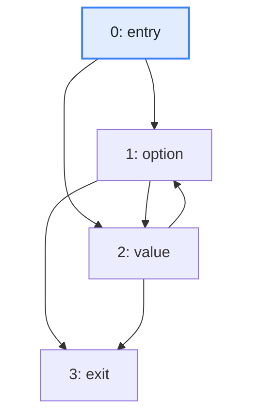
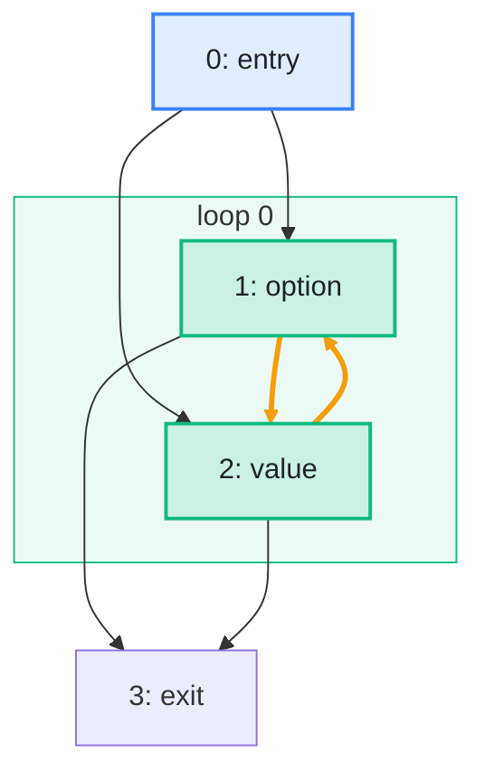

import Example from '../../../components/Example.astro';
import Api from '../../../components/Api.astro';
import Compare from '../../../components/Compare.astro';
import Gap from '../../../components/Gap.astro';
import InCode from '../../../components/InCode.astro';

:::note[In short]
- <Api ref="Loops.isReducible()" /> tells whether every [loop](../../glossary/#loop) of a
  [control-flow graph](../../glossary/#control-flow-graph) is entered only through its
  [header](../../glossary/#loop-header).
- <Api ref="Loops.entriesOf(int)" /> returns all blocks through which a loop can be entered. An
  [irreducible](../../glossary/#loop-header) loop has more than one.
:::

## Problem

You want to know which loops of a function can be entered in more than one place. A loop written
with `for` or `while` is entered through its header and through no other block. Code can also jump
into the middle of a loop. A block at which execution can enter a loop from outside it is an
[entry](../../glossary/#loop-header) of the loop. A loop with more than one entry is irreducible.
Many optimizations assume that a loop has a single entry, so an analysis has to know which loops
have several, and which blocks they are. Irreducible loops come from:

- code with `goto`, written by hand or generated;
- bytecode that a tool changed after compiling, for example to optimize or to obfuscate it;
- state machines generated as code, with a jump for every transition.

## Example

The method <InCode java="parseArgs" rust="parseArgs" ts="parseArgs" csharp="ParseArgs" /> of a small program is
generated from a state machine. Its states `option` and `value` jump to each other. The method
starts in either of them, depending on the first argument:

```text
entry:   if (isOption(args[0])) goto option; else goto value;
option:  read an option;  if (done) goto exit; else goto value;
value:   read a value;    if (done) goto exit; else goto option;
exit:    return the settings;
```

The graph `cfg` holds its control flow. This control-flow graph has a node for each
[basic block](../../glossary/#basic-block) and an edge from each block to each block that can run
right after it. Which loops does it have, and through which blocks can they be entered?

<Compare
  before="The control flow and its entry block"
  after="Its loop, with two entries"
  legend={{ inputNode: 'Entry block', outputGroup: 'Loop', outputNode: 'Loop entry' }}
>





</Compare>

The picture after shows the one loop that Graphity finds, with the blocks `option` and `value`. Both
are entries of the loop, and `option` is also its header. The orange edges lie on the
[cycle](../../glossary/#cycle) of the loop.

## Solution

<Example java="guide/AnalyzingControlFlowFurther.java#irreducible" />

Graphity reports the irreducible loop as one loop with two entries. Its header is the loop entry
that a [depth-first search](../../glossary/#depth-first-search) from the
[entry](../../glossary/#entry-and-exit) block of the graph [reaches](../../glossary/#reach) first.
The search takes the [out-nodes](../../glossary/#out-node-and-in-node) of each block in ascending
order, so here the header is `option`.

## Good to know

- **Which entry is the header** depends on the order of the search, not on the code. With several
  entry blocks of the function, <Api ref="Loops.of(BiAdjacentGraph, IntList)" /> searches from them
  in the order of the list. For an irreducible loop, rely on <Api ref="Loops.entriesOf(int)" />, not
  on the header alone.
- **Making it reducible.** Compilers duplicate code to turn an irreducible loop into a reducible
  one, or treat it as a unit and give up some optimizations inside it. Either way they start from
  the entries.
- **Natural loops.** A loop that can be entered only through its header is a
  [natural loop](../../glossary/#natural-loop). Every loop written with `for` or `while` is one. If
  no loop is irreducible, the loops that Graphity finds are the natural loops.
  See [Find the loops of a function and how they nest](../find-loops/) for such loops.

<Gap>
Make an irreducible loop reducible by duplicating blocks, so that every loop has a single entry,
with a [mapping](../../glossary/#mapping) from each block of the new graph to the block it copies.
This starts from the entries of each loop. Graphity returns them, but does not build the new graph.
</Gap>
