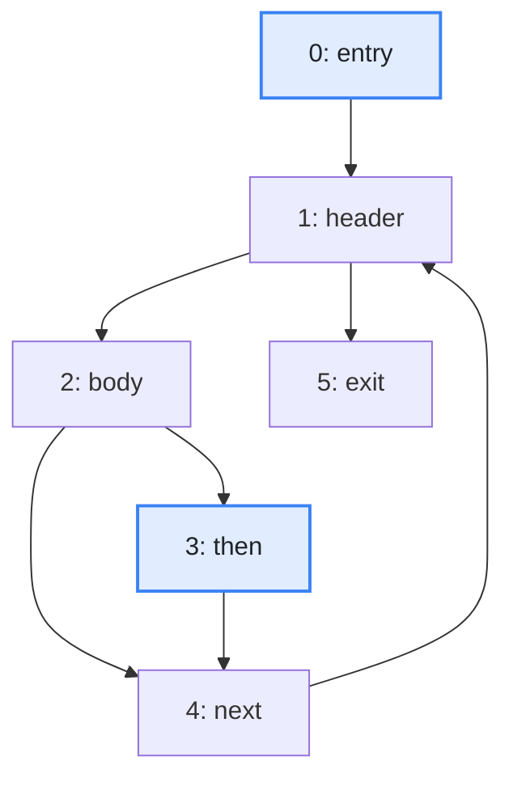
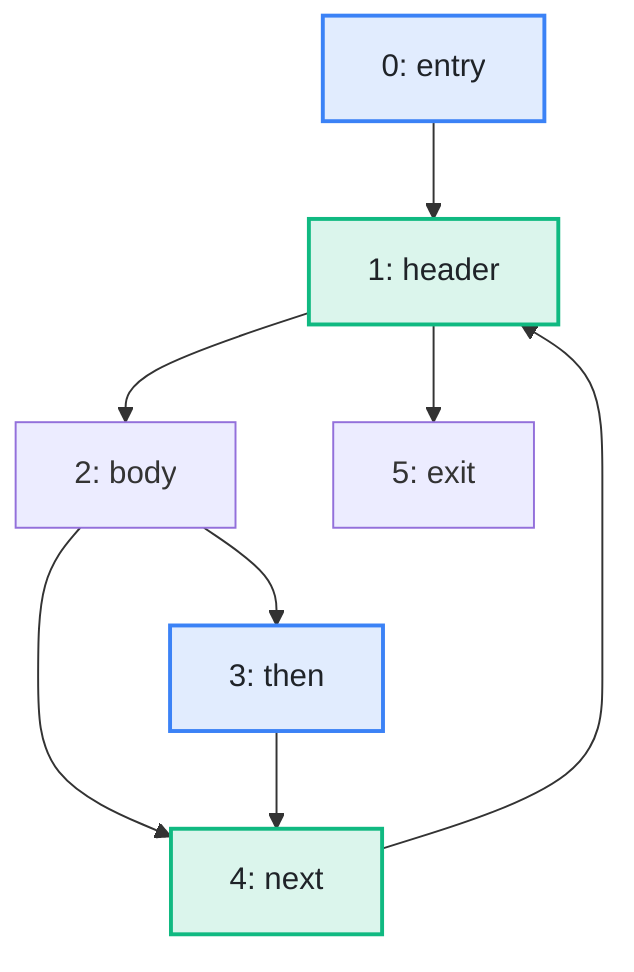

import Example from '../../../components/Example.astro';
import Api from '../../../components/Api.astro';
import Compare from '../../../components/Compare.astro';
import Gap from '../../../components/Gap.astro';
import InCode from '../../../components/InCode.astro';
import Program from '../../../components/Program.astro';

:::note[In short]
- <Api ref="IteratedDominanceFrontier.of(Dominators)" /> prepares the placement of
  [phi-nodes](../../glossary/#ssa-form-and-phi-node) for a
  [control-flow graph](../../glossary/#control-flow-graph).
- <Api ref="IteratedDominanceFrontier.frontierOf(IntList)" /> returns, for the blocks that assign a
  variable, the blocks that need a phi-node for it.
:::

## Problem

You want to find the blocks where [paths](../../glossary/#path) with different values of a variable
join. Compilers need them to convert code to SSA form (static single assignment). In that form,
every variable is assigned exactly once, and each assignment creates a new version of the variable.
Where paths with different versions of a variable join, such as after an `if` or at the
[header](../../glossary/#loop-header) of a [loop](../../glossary/#loop), a phi-node picks the
version of the path that was taken. The phi-nodes of a variable go into the iterated [dominance
frontier](../../glossary/#dominance-frontier) of the blocks that assign it. You need this for:

- a compiler or a just-in-time compiler that converts each function to SSA form, for each of its
  variables;
- a decompiler or a static analyzer that builds SSA form to follow the values of variables.

## Example

The method <InCode java="load" rust="load" ts="load" csharp="Load" /> of a small program reads the notes
of a notebook from a file. Here it also keeps the note it added last:

<Program name="load-keeping-last" />

The graph `cfg` holds its control flow. This control-flow graph has a node for each
[basic block](../../glossary/#basic-block) and an edge from each block to each block that can run
right after it. The variable `last` is assigned in `entry` and in `then`, as the picture before
shows. The loop counter `i` is assigned in `entry` and in `next`. Which blocks need a phi-node for
`last`, and which for `i`?

<Compare
  before="The blocks that assign the variable last"
  after="The blocks that need a phi-node for the variable last"
  legend={{ inputNode: 'Block that assigns the variable last', outputNode: 'Block that needs a phi-node' }}
>

</Compare>

The picture after shows the two blocks that need a phi-node for `last`. At `header`, the value from
`entry` and the value from the pass before join. At `next`, the path through `then` and the path
that skips it join.

## Solution

The phi-nodes follow from the [dominators](../../glossary/#dominator). See
[Find the nodes that every path from the entry passes through](../../dominance/dominators/).

<Example java="guide/AnalyzingControlFlowFurther.java#phi" />

`i` needs a phi-node at `header` only, where its value from `entry` and its value from `next` join.
`last` needs one at `next` as well, where the path through `then` and the path that skips it join.

The iterated dominance frontier of the blocks that assign a variable starts with their dominance
frontier. Then comes the dominance frontier of the blocks found, and so on until no block is added.
These steps repeat because a phi-node assigns the variable as well. Here, the dominance frontier of
`then` holds `next`, and the dominance frontier of `next` holds `header`. See [Find the blocks where
the dominance of a block ends](../dominance-frontiers/).

## Good to know

- **One analysis, many variables.** <Api ref="IteratedDominanceFrontier.of(Dominators)" /> prepares
  the queries once per control-flow graph, and
  <Api ref="IteratedDominanceFrontier.frontierOf(IntList)" /> answers them for one variable after
  the other. The cost of a query follows the part of the graph it explores, not the whole graph. A
  query never builds the dominance frontiers themselves, which can grow with the square of the
  number of blocks.
- **Only where the variable is used.** A phi-node is needed only where the variable is still used
  afterwards. <Api ref="IteratedDominanceFrontier.frontierOf(IntList)" /> returns every block where
  versions of it join. To leave out the others, you need to know where each variable is used, and
  that is up to the compiler.
