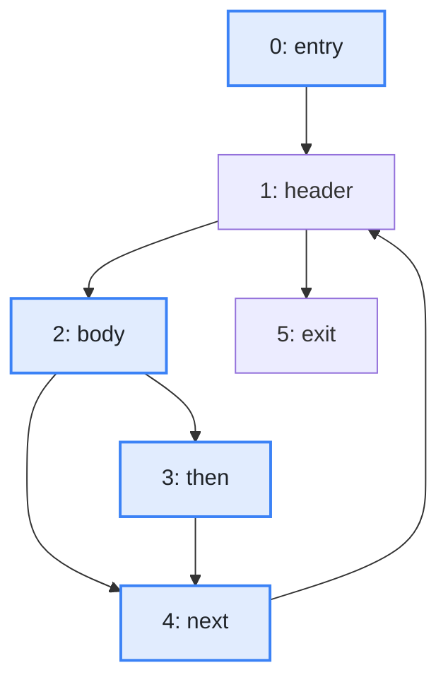
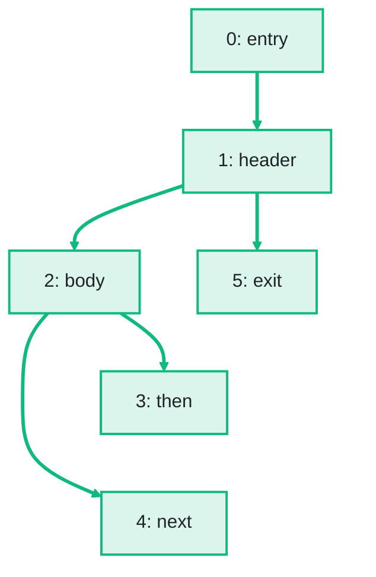

import Example from '../../../components/Example.astro';
import Api from '../../../components/Api.astro';
import Compare from '../../../components/Compare.astro';
import Gap from '../../../components/Gap.astro';
import InCode from '../../../components/InCode.astro';
import Program from '../../../components/Program.astro';

:::note[In short]
- <Api ref="Graphs.dominatorTree(Dominators)" /> returns the
  [dominator tree](../../glossary/#dominator) as a graph, with an edge from each immediate dominator
  to the nodes it immediately dominates.
- <Api ref="Ancestry.of(Dominators)" /> builds an ancestor index of that tree, and
  <Api ref="Ancestry.isAncestorOf(int, int)" /> answers whether one node dominates another, as a
  question about [ancestors](../../glossary/#ancestor-and-descendant).
- <Api ref="Ancestry.lowestCommonAncestorOf(int, int)" /> returns the lowest node that dominates
  both of two nodes.
:::

## Problem

You have a [control-flow graph](../../glossary/#control-flow-graph) and many questions of the same
kind: if this block runs, has that block always run before it? A block that every
[path](../../glossary/#path) from the [entry](../../glossary/#entry-and-exit) to a block `n` passes
through is called a dominator of `n`. The dominators of all blocks form a tree, called the dominator
tree. In this tree, the dominators of `n` are its ancestors. Many analyses walk this tree or ask it
questions. Does this block dominate that one? Which is the lowest block that dominates both? Which
blocks does a block dominate? You need this for:

- a compiler that walks the dominator tree to convert code to
  [SSA form](../../glossary/#ssa-form-and-phi-node) (static single assignment) and to move code;
- an analyzer that asks whether a check dominates every use of a value;
- a tool that lists the code that runs only after a given block has run: the blocks that this block
  dominates.

## Example

The method <InCode java="load" rust="load" ts="load" csharp="Load" /> of a small program reads the notes
of a notebook from a file:

<Program name="load" />

The graph `cfg` holds its control flow. This
[control-flow graph](../../glossary/#control-flow-graph) has a node for each
[basic block](../../glossary/#basic-block) and an edge from each block to each block that can run
right after it. What is its dominator tree? Does `body` dominate `next`? Does `then`? Which is the
lowest block that dominates both `then` and `next`?

<Compare
  before="The control flow, its entry and the blocks asked about"
  after="Its dominator tree"
  legend={{ inputNode: 'Entry or block asked about', outputNode: 'Block with its dominators as ancestors', outputEdge: 'From immediate dominator to block' }}
>

</Compare>

The picture after shows the dominator tree that the code returns: an edge from each block to the
blocks it immediately dominates.

## Solution

The dominators come from <Api ref="Dominators.of(BiAdjacentGraph, int)" />. See
[Find the nodes that every path from the entry passes through](../dominators/).

<Example java="guide/FindingDominators.java#dominatorTree" />

The tree has the [node IDs](../../glossary/#node-id) of the control-flow graph, and its
[root](../../glossary/#root-node) is the entry. Every question about dominance is a question about
ancestors in this tree. `body` is an ancestor of `next`, and `then` is not. `body` is also the
[lowest common ancestor](../../glossary/#lowest-common-ancestor) of `then` and `next`, so it is the
lowest block that dominates both.

## Good to know

- **No graph needed for questions.** <Api ref="Ancestry.of(Dominators)" /> shares the immediate
  dominators instead of building the tree as a graph; build the graph only to walk it or to draw it.
- **Constant time.** The ancestor index answers each question in logarithmic time at most. For many
  questions, build <Api ref="PreorderAncestry.of(Ancestry)" /> from it:
  <Api ref="PreorderAncestry.isAncestorOf(int, int)" /> answers whether one block dominates another
  in constant time, and <Api ref="PreorderAncestry.subtreeOf(int)" /> lists the blocks that a block
  dominates. See
  [Test many times whether one node is an ancestor of another](../../trees/ancestor-test/) and
  [List a node and all its descendants](../../trees/subtrees/).
- **Unreachable nodes.** A node that the entry does not [reach](../../glossary/#reach) dominates
  only itself and is the root of a tree of its own, which makes the dominator tree a
  [forest](../../glossary/#tree-and-forest). <Api ref="Dominators.isReachable(int)" /> tells such a
  node apart.
