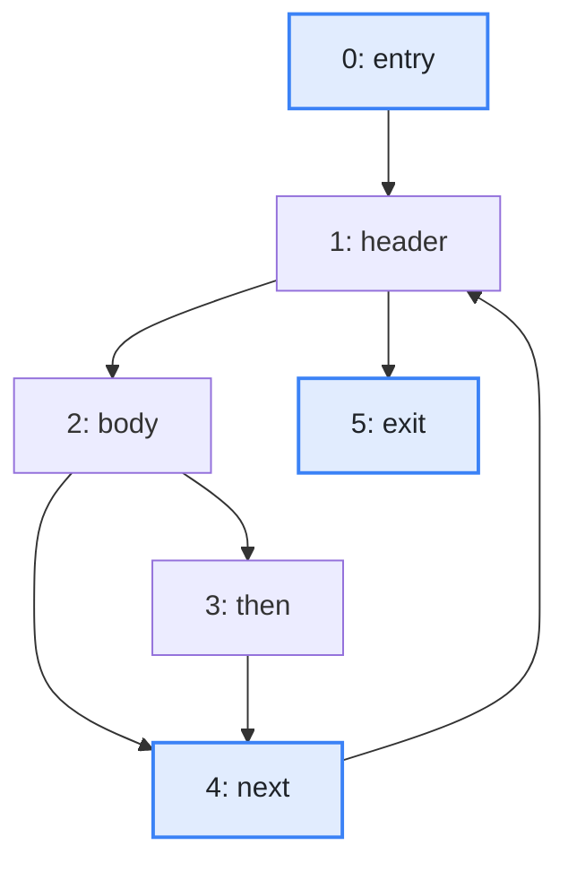
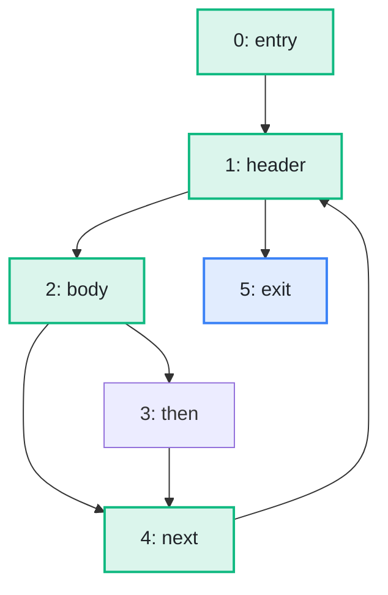

import Example from '../../../components/Example.astro';
import Api from '../../../components/Api.astro';
import Compare from '../../../components/Compare.astro';
import Gap from '../../../components/Gap.astro';
import InCode from '../../../components/InCode.astro';
import Program from '../../../components/Program.astro';

:::note[In short]
- <Api ref="Dominators.of(BiAdjacentGraph, int)" /> computes the
  [dominators](../../glossary/#dominator) of a graph from its
  [entry](../../glossary/#entry-and-exit).
- <Api ref="Dominators.immediateDominatorOf(int)" /> returns the immediate dominator of a node: the
  nearest node other than the node itself that every [path](../../glossary/#path) from the entry to
  it passes through.
:::

## Problem

You want to know what is certain to have happened before a node. A node `d` dominates a node `n`
if every path from the entry to `n` passes through `d`. The dominators of a node are:

- in the [control-flow graph](../../glossary/#control-flow-graph) of a method, the blocks that have
  always run before a block runs, so that a value computed there is always available and a check
  there has always been made;
- in the calls of a program, the methods that every path of calls from `main` to a method passes
  through;
- in a network, the checkpoints that all traffic from the outside to a host passes.

## Example

The method <InCode java="load" rust="load" ts="load" csharp="Load" /> of a small program reads the notes
of a notebook from a file:

<Program name="load" />

The graph `cfg` holds its control flow. This control-flow graph has a node for each
[basic block](../../glossary/#basic-block) and an edge from each block to each block that can run
right after it. Which blocks have always run when `next` runs, and which of them is the nearest? And
which is the nearest for `exit`?

<Compare
  before="The control flow, its entry and the blocks asked about"
  after="The blocks that dominate the block named next"
  legend={{ inputNode: 'Entry or block asked about', outputNode: 'Dominator' }}
>

</Compare>

In the picture after, the blocks that dominate `next` are green, `next` itself included. `body` is
the nearest of the others, so it is the immediate dominator of `next`.

## Solution

The analysis follows the edges against their direction as well, so it takes a
<Api ref="BiAdjacentGraph" />, which <Api ref="BiAdjacentGraph.of(Graph)" /> builds from the graph:

<Example java="guide/FindingDominators.java#dominators" />

`body` is the immediate dominator of `next`. `header` is the immediate dominator of `exit`, since it
is the only [in-node](../../glossary/#out-node-and-in-node) of `exit`. Following the immediate
dominators up from `next` gives all blocks that dominate `next`: the green ones in the picture
after. The walk ends at the entry, which has no immediate dominator. The same works on any graph
with an entry.

## Good to know

- **All dominators of a node** are the nodes on the path from the
  [root](../../glossary/#root-node) of the dominator tree to the node. The loop in the code collects
  them. See [Build the dominator tree and ask it questions](../dominator-tree/) for how to ask only
  whether one node dominates another.
- **Unreachable nodes** are the nodes that the entry does not [reach](../../glossary/#reach). They
  have no immediate dominator, and neither has the entry: for both,
  <Api ref="Dominators.immediateDominatorOf(int)" /> returns <InCode java="-1" rust="None" ts="-1" csharp="-1" />.
  <Api ref="Dominators.isReachable(int)" /> tells the two cases apart.
- **The graph** the dominators were computed on comes back from <Api ref="Dominators.graph()" />.
  The dominators keep it, so that the analyses built on them, such as the
  [dominance frontiers](../../glossary/#dominance-frontier), need nothing else. See
  [Find the blocks where the dominance of a block ends](../../control-flow/dominance-frontiers/).
