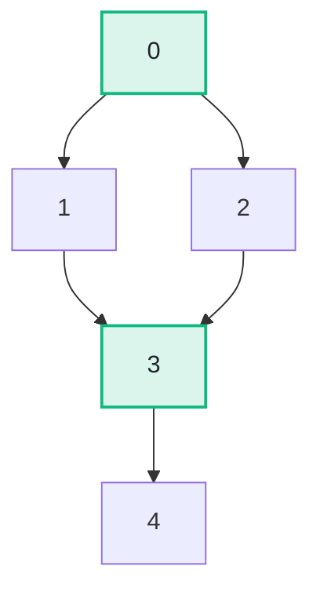

import Api from '../../../components/Api.astro';
import ChapterProblems from '../../../components/ChapterProblems.astro';
import Figure from '../../../components/Figure.astro';
import InCode from '../../../components/InCode.astro';

Some nodes cannot be avoided: every [path](../glossary/#path) from the
[entry](../glossary/#entry-and-exit) to a node passes through them. Compilers build on this to find
[loops](../glossary/#loop) and to convert code to [SSA form](../glossary/#ssa-form-and-phi-node)
(static single assignment). Analyzers use it to find the checks that guard a piece of code. In a
network, it finds the checkpoints that all traffic to a host passes.

## Problems in this chapter

<ChapterProblems />

The examples of this chapter use the control flow of the method
<InCode java="load" rust="load" ts="load" csharp="Load" /> of a small program, and the calls between its
methods. The picture on this page is a small graph of numbers.

## Dominators

The block where a function starts is the entry of its
[control-flow graph](../glossary/#control-flow-graph). In other graphs, the entry is the node where
the paths of interest start, such as `main` in the calls of a program. A node `d`
[dominates](../glossary/#dominator) a node `n` if every path from the entry to `n` passes through
`d`. Every node dominates itself. A node `d` strictly dominates `n` if it dominates `n` and is not
`n`. The nearest strict dominator of `n` is called its immediate dominator.

<Figure legend={{ outputNode: 'Dominator of 3' }}>

</Figure>

Here, with the entry 0, the nodes that dominate 3 are green. Every path from 0 to 3 passes through 0
and 3. Not every path passes through 1 or through 2, since `0 -> 2 -> 3` avoids 1 and `0 -> 1 -> 3`
avoids 2. So 0 is the immediate dominator of 3, and 3 is the immediate dominator of 4.

## The dominator tree

The immediate dominators form a [tree](../glossary/#tree-and-forest) called the dominator tree. It
has an edge from each node to the nodes it immediately dominates. Its
[root](../glossary/#root-node) is the entry. A node that the entry does not
[reach](../glossary/#reach) dominates only itself and is the root of a tree of its own, so the
dominator tree is then a forest. The dominators of a node are its
[ancestors](../glossary/#ancestor-and-descendant) in this tree, so every question about dominance
is a question about ancestors. See the chapter [Trees and hierarchies](../trees/) for such
questions. Here, 0 is the [parent](../glossary/#parent-and-child) of 1, 2 and 3 in the dominator
tree, and 3 is the parent of 4.

## Post-dominators

You can ask the same question in the other direction. A node `p` post-dominates a node `n` if every
path from `n` to an exit passes through `p`. Turning every edge around gives the
[transposed graph](../glossary/#transposed-graph). The post-dominators are the dominators of that
graph, with the exits as its entries. Here, with the exit 4, the node 3 post-dominates 0, 1 and 2:
whichever of 1 and 2 follows 0, 3 follows as well.

## Several entries

A graph can have several entries, such as a program with several entry points, or the transposed
graph of a function that returns in several places. A node `d` then dominates a node `n` only if
every path from any entry to `n` passes through `d`. The entries act as if one extra node had an
edge to each of them. That node is called a virtual root. So an entry has no immediate dominator,
and the dominator tree becomes a forest.

All these analyses follow the edges against their direction as well, so they take a
<Api ref="BiAdjacentGraph" />, which adds the [in-nodes](../glossary/#out-node-and-in-node) of every
node to a graph.
