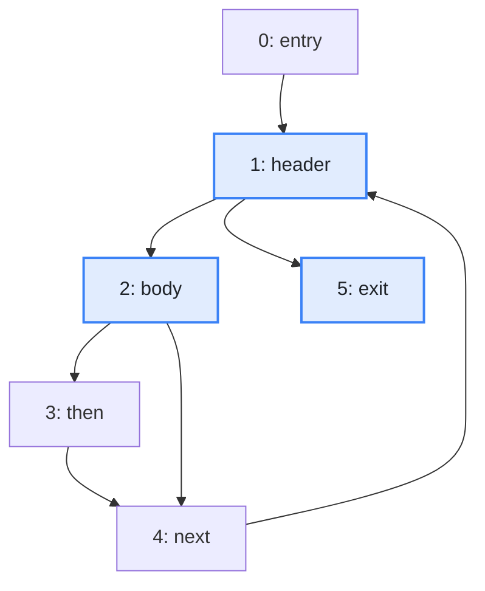
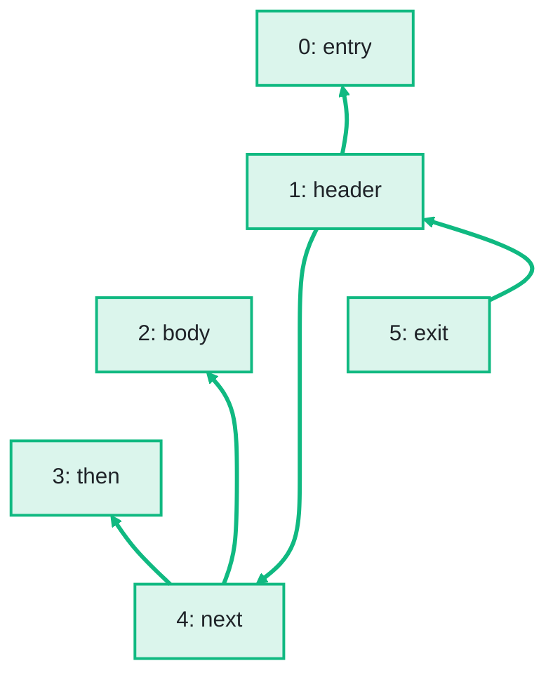

import Example from '../../../components/Example.astro';
import Api from '../../../components/Api.astro';
import Compare from '../../../components/Compare.astro';
import Gap from '../../../components/Gap.astro';
import InCode from '../../../components/InCode.astro';
import Program from '../../../components/Program.astro';

:::note[In short]
- <Api ref="BiAdjacentGraph.transposed()" /> returns the
  [transposed graph](../../glossary/#transposed-graph), with every edge turned around.
- <Api ref="Dominators.of(BiAdjacentGraph, int)" /> on that graph computes the
  [post-dominators](../../glossary/#dominator) from the [exit](../../glossary/#entry-and-exit).
- <Api ref="Dominators.immediateDominatorOf(int)" /> then returns the immediate post-dominator of a
  node: the nearest node other than the node itself that every [path](../../glossary/#path) from it
  to the exit passes through.
- <Api ref="Graphs.dominatorTree(Dominators)" /> then returns the post-dominator tree.
:::

## Problem

You want to know what is certain to happen after a node. A node `p` post-dominates a node `n` if
every path from `n` to an exit passes through `p`. Whatever happens after `n`, `p` follows. The
post-dominators of a node answer questions such as these:

- where the branches of an `if` join again: the first block that runs after the `if`, whichever
  branch is taken;
- where code is sure to run before a method returns, such as cleanup;
- which branch decides whether a block runs. This is called the [control
  dependence](../../glossary/#control-dependence) of the block, and it follows from the
  post-dominators. See [Find which conditions decide whether a block
  runs](../../control-flow/control-dependence/).

## Example

The method <InCode java="load" rust="load" ts="load" csharp="Load" /> of a small program reads the notes
of a notebook from a file:

<Program name="load" />

The graph `cfg` holds its control flow. This
[control-flow graph](../../glossary/#control-flow-graph) has a node for each
[basic block](../../glossary/#basic-block) and an edge from each block to each block that can run
right after it. `exit` is its only exit. Which block is the first to run after `body` in every case,
whether `then` runs or not? Which block is it after `header`? And what is the post-dominator tree?

<Compare
  before="The control flow, its exit and the blocks asked about"
  after="Its post-dominator tree"
  legend={{ inputNode: 'Exit or block asked about', outputNode: 'Block with its post-dominators as ancestors', outputEdge: 'From immediate post-dominator to block' }}
>

</Compare>

The picture after shows the post-dominator tree that the code returns: an edge from each block to
the blocks it immediately post-dominates. Its [root](../../glossary/#root-node) is `exit`, and its
edges point against the control flow.

## Solution

The post-dominators are the dominators of the transposed graph, with the exits as its entries. So
turn every edge around with <Api ref="BiAdjacentGraph.transposed()" /> and compute the dominators
from the exit. See [Find the nodes that every path from the entry passes through](../dominators/).

<Example java="guide/FindingDominators.java#postDominators" />

Whether `body` continues with `then` or not, `next` follows. `next` is where the two branches join,
and it is the immediate post-dominator of `body`. The immediate post-dominator of `header` is
`exit`. No other block lies on every path from `header` to `exit`, since the edge `header -> exit`
is itself such a path. The tree has the [node IDs](../../glossary/#node-id) of the control-flow
graph.

## Good to know

- **No exit, no immediate post-dominator.** A node from which no exit can be
  [reached](../../glossary/#reach), such as a block in an endless [loop](../../glossary/#loop), has
  no immediate post-dominator: <Api ref="Dominators.immediateDominatorOf(int)" /> returns
  <InCode java="-1" rust="None" ts="-1" csharp="-1" /> for it, and <Api ref="Dominators.isReachable(int)" /> returns
  false. If you need one, pass the exit and one block of each such loop as the entries of the
  transposed graph to <Api ref="Dominators.of(BiAdjacentGraph, IntList)" />. The effect is the same
  as adding an extra exit with an edge from that block.
- **Several exits.** A method that returns in several places has several exits. Pass them all as
  entries of the transposed graph to <Api ref="Dominators.of(BiAdjacentGraph, IntList)" />. See
  [Find dominators from several entries](../several-entries/).
