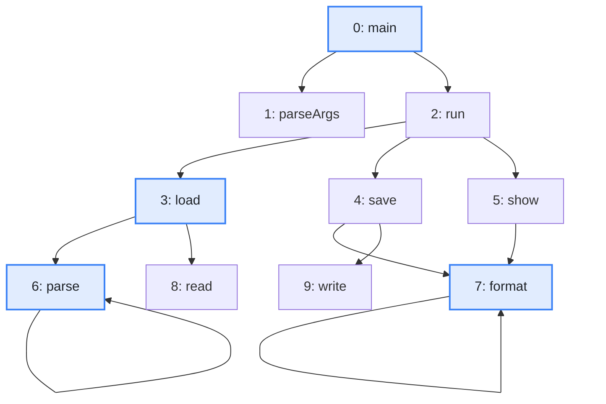
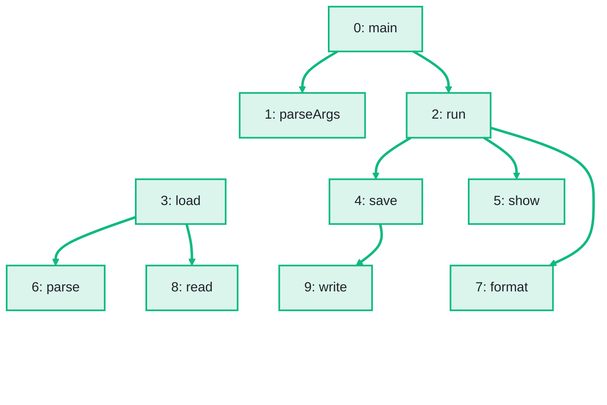

import Example from '../../../components/Example.astro';
import Api from '../../../components/Api.astro';
import Compare from '../../../components/Compare.astro';
import Gap from '../../../components/Gap.astro';
import InCode from '../../../components/InCode.astro';

:::note[In short]
- <Api ref="Dominators.of(BiAdjacentGraph, IntList)" /> computes the
  [dominators](../../glossary/#dominator) from several [entries](../../glossary/#entry-and-exit) at
  once: a node `d` dominates a node `n` only if every [path](../../glossary/#path) from any entry to
  `n` passes through `d`.
- The entries act as if one extra node, called a virtual [root](../../glossary/#root-node), had an
  edge to each of them: an entry has no immediate dominator, and
  <Api ref="Graphs.dominatorTree(Dominators)" /> returns a
  [forest](../../glossary/#tree-and-forest).
:::

## Problem

You want to know what is certain to have happened before a node, but the paths start at several
nodes. The nodes where the paths of interest start are the entries of the graph. With several
entries, a node `d` dominates a node `n` only if every path from any of the entries to `n` passes
through `d`. You need this for:

- a program with several entry points, such as a main method and background jobs;
- a method with exception handlers, if the graph has no edges that lead to them;
- a network with several gateways;
- the post-dominators of a method that returns in several places, where the
  [transposed graph](../../glossary/#transposed-graph) has an entry for each exit. See
  [Find the nodes that every path to the exit passes through](../post-dominators/).

## Example

The example graph `calls` models the calls between the methods of a small program. It has an edge
from each method to each method it calls. Besides `main`, a background job calls `load` directly, so
the calls have two entries: `main` and `load`. Which methods still dominate `load`, `parse` and
`format`, and what is the dominator forest?

<Compare
  before="The calls, the entries and the methods asked about"
  after="The dominator forest from main and load"
  legend={{ inputNode: 'Entry or method asked about', outputNode: 'Method with its dominators as ancestors', outputEdge: 'From immediate dominator to method' }}
>

</Compare>

The picture after shows the dominator forest that the code returns: a tree from `main` and a tree
from `load`, with an edge from each method to the methods it immediately dominates.

## Solution

<Example java="guide/FindingDominators.java#entries" />

`load` is an entry now and the root of a tree of its own. It has no immediate dominator, and it is
the immediate dominator of `parse` and `read`. `run` still dominates `format`: every path from
either entry to `format` passes through `run`.

## Good to know

- **The order of the entries** does not matter. An entry given twice counts once, and with no
  entries, no node is reachable.
- **The roots of the forest** are of three kinds: the entries, the other nodes whose only strict
  dominator is the virtual root, and the nodes that no entry [reaches](../../glossary/#reach). If
  `main` also called `read` directly, `read` would be of the second kind: the path `main -> read`
  avoids `load`, and the path `load -> read` avoids `main`. For all three kinds,
  <Api ref="Dominators.immediateDominatorOf(int)" /> returns <InCode java="-1" rust="None" ts="-1" csharp="-1" />.
  <Api ref="Dominators.isReachable(int)" /> tells the unreachable ones apart.
