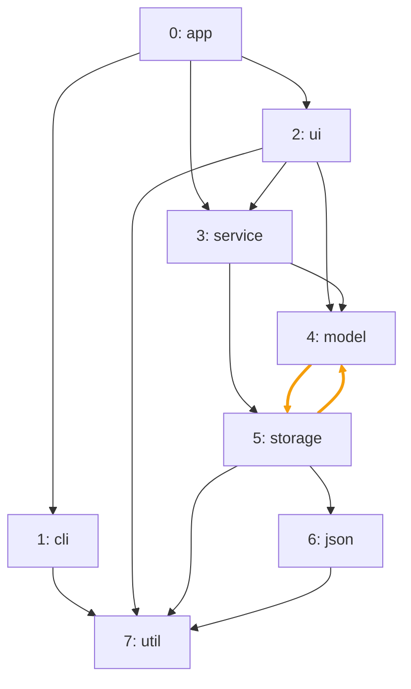
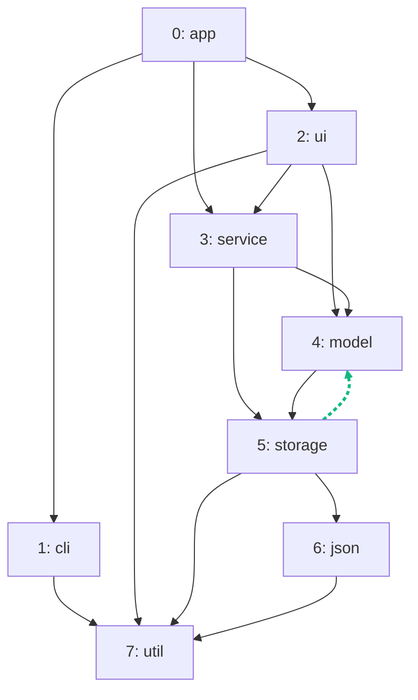

import Example from '../../../components/Example.astro';
import Api from '../../../components/Api.astro';
import Compare from '../../../components/Compare.astro';
import Gap from '../../../components/Gap.astro';

:::note[In short]
- <Api ref="BackEdges.of(Graph)" /> returns the
  [back edges](../../glossary/#tree-back-forward-and-cross-edge) of a
  [depth-first search](../../glossary/#depth-first-search): every [cycle](../../glossary/#cycle)
  contains one of them.
- Without them, the graph is a [DAG](../../glossary/#dag) (directed acyclic graph).
:::

## Problem

Your graph has cycles, and you need it without them. A depth-first search goes from a node along
[outgoing edges](../../glossary/#outgoing-and-incoming-edge) as deep as it can. An edge by which the
search comes back to a node that is still on its current [path](../../glossary/#path) closes a
cycle. Such an edge is a back edge. Removing the back edges leaves a DAG, and the rest of the graph
stays as it was. You need this for:

- an algorithm that requires a DAG, for example to compute a
  [topological order](../../glossary/#topological-order) or to draw the graph in layers;
- a call graph to be analyzed from the bottom up, where recursive calls are in the way;
- a dependency graph in which the few dependencies that close a cycle should be found and cut.

## Example

The example graph `dependencies` models the dependencies between the packages of a small program. It
has an edge from each package to each package it uses. `model` and `storage` use each other. This is
the only cycle, and its two edges are orange in the picture before. Which edges can be left out so
that no cycle remains? The picture after shows the packages and the back edge `storage -> model`,
which is the one edge to leave out.

<Compare
  before="The packages with their cycle"
  after="The packages and the back edge to leave out"
  legend={{ removedEdge: 'Back edge, left out' }}
>

</Compare>

## Solution

<Example java="guide/BreakingCycles.java#backEdges" />

<Api ref="BackEdges.of(Graph)" /> returns the one back edge `storage -> model`. Its
[edge index](../../glossary/#edge-index) is 10. The code builds the graph again without this edge.
The new graph has 13 edges and no cycle, so it is a DAG and has a topological order.

## Good to know

- **Why it works.** Every cycle contains a back edge of every depth-first search: the edge by
  which the search comes back to a node of the cycle that is still on its path. So without the
  back edges, no cycle is left. A [self-loop](../../glossary/#self-loop), such as a method that
  calls itself, is a cycle of one edge and a back edge too.
- **Which edge depends on the search.** Starting at `app`, the search
  [reaches](../../glossary/#reach) `model` before `storage`, so `storage -> model` is the back edge.
  A search that reached `storage` first would find `model -> storage` instead. Graphity's search is
  always the same. See [Classify the edges of a depth-first search](../edge-types/) for how it goes
  and what the other edges are.
- **In the order of the search.** <Api ref="BackEdges.of(Graph)" /> lists the back edges in the
  order in which the search finds them, not in the order of their edge indices. For edge index
  order, pass the result of <Api ref="EdgeTypes.of(Graph)" /> and the back type to
  <Api ref="Edges.of(EdgeTypes, EdgeType)" />. You get the same edges, at the cost of classifying
  every edge. See [Classify the edges of a depth-first search](../edge-types/) for these calls.
- **A builder cannot remove edges**, so the example builds the graph again without the back edges.
  Their edge indices say which edges to leave out.
- **Condense instead of break.** To keep the cycles but treat each of them as a unit, see
  [Condense each group into one node to get a DAG](../../sccs/condense-to-dag/).

<Gap>
Remove as few edges as possible (a minimum feedback arc set), for example to suggest the fewest
dependencies to cut. The back edges break every cycle, but they are not in general the fewest
edges that do.
</Gap>

<Gap>
Take a graph without some of its edges in one call, such as the graph without its back edges. The
new graph should keep the [node IDs](../../glossary/#node-id). Graphity takes
[subgraphs](../../glossary/#subgraph) of nodes, not of edges, so the example builds the graph again.
</Gap>
