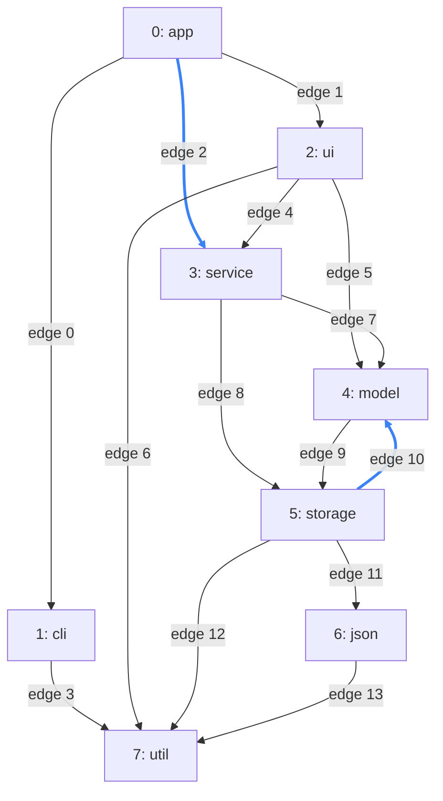
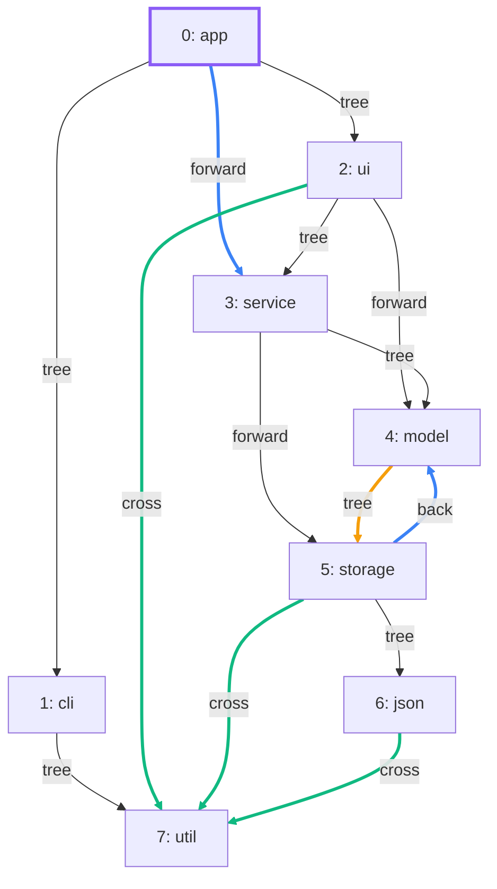

import Example from '../../../components/Example.astro';
import Api from '../../../components/Api.astro';
import Compare from '../../../components/Compare.astro';

:::note[In short]
- <Api ref="EdgeTypes.of(Graph)" /> runs a [depth-first search](../../glossary/#depth-first-search)
  and gives every edge a type:
  [tree, back, forward or cross](../../glossary/#tree-back-forward-and-cross-edge).
- <Api ref="EdgeTypes.typeOf(int)" /> returns the type of one edge.
- <Api ref="Edges.of(EdgeTypes, EdgeType)" /> returns all edges of one type.
:::

## Problem

You want to know, for each edge of a graph, what role it plays in a depth-first search. Such a
search goes from a node along [outgoing edges](../../glossary/#outgoing-and-incoming-edge) as deep
as it can before it turns back. It meets every edge once and gives it one of four types, by where
the edge leads:

- A tree edge leads to a node the search had not seen yet. Together, the tree edges form a
  [tree](../../glossary/#tree-and-forest) from the start node. If the search needs several start
  nodes to [reach](../../glossary/#reach) every node, the tree edges form a forest.
- A back edge leads back to a node on the current [path](../../glossary/#path) and closes a
  [cycle](../../glossary/#cycle).
- A forward edge leads to a node that the search has already reached from the edge's
  [source](../../glossary/#source-and-target) along one or more tree edges.
- A cross edge leads to a node that the search has already finished and that is neither an [ancestor
  nor a descendant](../../glossary/#ancestor-and-descendant) of the edge's source in the tree of the search.

You need this for:

- dependencies between packages or modules, to find the edges that close a cycle: a graph has a
  cycle exactly when it has a back edge;
- the [control-flow graph](../../glossary/#control-flow-graph) of a function, to find the edges that
  lead back to a [loop header](../../glossary/#loop-header). The search starts at node 0, so that
  node must be the [entry](../../glossary/#entry-and-exit). If every [loop](../../glossary/#loop) is
  also entered only through its header, these edges are the back edges;
- a search of your own that treats each edge by its type.

## Example

The example graph `dependencies` models the dependencies between the packages of a small program. It
has an edge from each package to each package it uses. The picture before shows the [edge
index](../../glossary/#edge-index) of each edge. Which type is each edge, for a search that starts
at `app` and takes the [out-nodes](../../glossary/#out-node-and-in-node) of each node in ascending
order? The code asks about `storage -> model` and `app -> service`, and collects the cross edges.
The picture after shows the type of each edge. The start node `app` is purple. The orange edge
`model -> storage` is the other edge of the cycle of `model` and `storage`.

<Compare
  before="The packages and their dependencies"
  after="The type of each edge"
  legend={{ inputEdge: 'Edge asked about', contextNode: 'Start node', cycleEdge: 'Other edge of the cycle', outputEdge: 'Cross edge' }}
>

</Compare>

## Solution

<Example java="guide/ClassifyingEdges.java#edgeTypes" />

`storage -> model` is the only back edge. The search reaches `model` before `storage`, so this edge
leads back to `model` while `model` is still on the path. The edge closes the cycle.
`app -> service` is a forward edge, because the search reaches `service` through `ui` first. Three
cross edges lead to `util`, which the search had already finished from `cli`.
<Api ref="Edges.of(EdgeTypes, EdgeType)" /> returns these three as an edge list.

## Good to know

- **The types depend on the search.** Another start node or another order of the out-nodes gives
  other types. One thing is the same for every search: there is no back edge exactly when the graph
  is a [DAG](../../glossary/#dag) (directed acyclic graph). Graphity's search always starts at the
  nodes in ascending order and takes the out-nodes of each node in ascending order, so a graph
  always gets the same types.
- **Edges that other paths make redundant.** For every forward edge, a path of tree edges also
  leads from its source to its target. A tree edge or a cross edge can have another path as well,
  such as `service -> model` (through `storage`) and `ui -> util` (through `service` and `storage`).
  <Api ref="Graphs.transitiveReduction(Graph)" /> removes all such edges of a DAG. See
  [Remove edges that other paths make redundant](../../reachability/transitive-reduction/).
- **Only the back edges?** <Api ref="BackEdges.of(Graph)" /> finds them without classifying the
  others. See [Remove edges to break every cycle](../break-cycles/).
- **Edge lists.** <Api ref="Edges.of(EdgeTypes, EdgeType)" /> returns an edge list.
  See [Work with the lists Graphity returns](../../basics/result-lists/) for what it offers.
- **During a search of your own.** See
  [React to every edge of a depth-first search](../../searches/dfs-edges/) for a search that
  sees each edge as it runs.
