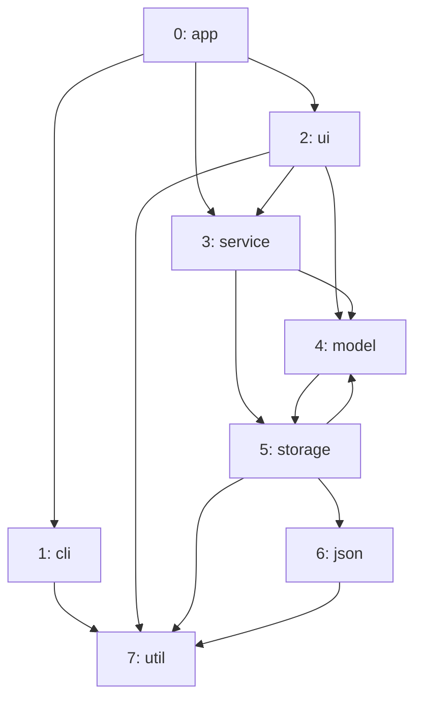
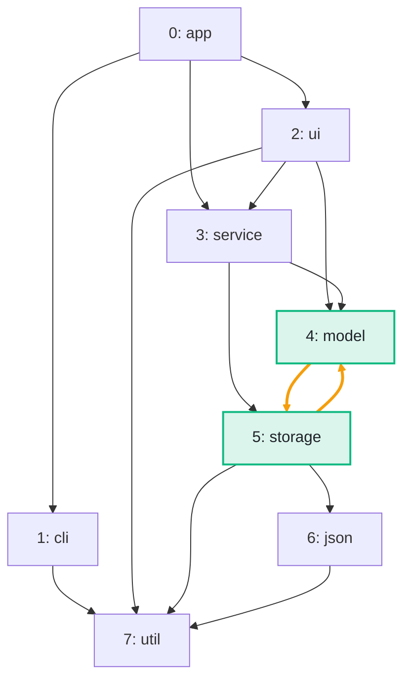

import Example from '../../../components/Example.astro';
import Api from '../../../components/Api.astro';
import Compare from '../../../components/Compare.astro';
import Gap from '../../../components/Gap.astro';

:::note[In short]
- <Api ref="Graphs.isDag(Graph)" /> tells whether a graph has no [cycle](../../glossary/#cycle).
- <Api ref="Graphs.findCycle(Graph)" /> returns the nodes of one cycle, or an empty list.
:::

## Problem

You want to be sure that following the edges of a graph never leads back to the same node. A
[path](../../glossary/#path) that does is called a cycle. If the graph has a cycle, you want to show
it, so that someone can find and fix it. You need this wherever edges stand for an order that must
exist:

- dependencies between modules that must be built one after the other;
- steps of a process that must run in order;
- a hierarchy of categories, in which no category may contain itself.

## Example

The example graph `dependencies` models the dependencies between the packages of a small program.
It has an edge from each package to each package it uses. Is the graph free of cycles, and if not,
where is a cycle? The picture after shows the cycle found: `model` and `storage` use each other.

<Compare
  before="The packages and their dependencies"
  after="The cycle of model and storage"
  legend={{ cycleEdge: 'Edge of the cycle', outputNode: 'Node of the cycle' }}
>

</Compare>

## Solution

<Example java="guide/FindingCycles.java#findCycle" />

The packages are not a [DAG](../../glossary/#dag) (directed acyclic graph).
<Api ref="Graphs.findCycle(Graph)" /> returns the nodes of a cycle in the order of its edges. An
edge leads from each node to the next, and from the last node back to the first. Here the cycle is
`model -> storage -> model`, with the green nodes and the orange edges of the picture after.

## Good to know

- **The same cycle every time, but not necessarily the shortest.** The search goes
  [depth-first](../../glossary/#depth-first-search) from the nodes in ascending order and returns
  the first cycle it closes. Here, that is also the shortest one.
- **A shortest cycle through a node `v`:** search from `v`, take the
  [in-node](../../glossary/#out-node-and-in-node) of `v` with the smallest
  [distance](../../glossary/#distance), and close the path to it with its edge back to `v`.
  See [Find a shortest path between two nodes](../../reachability/shortest-path/) for that search.
- **All nodes on cycles** are the nodes of the
  [SCCs](../../glossary/#strongly-connected-component) (strongly connected components) for which
  <Api ref="Sccs.containsCycle(int)" /> is true. Every other SCC is a single node on no cycle. The
  SCCs give the nodes, not the cycles themselves.
  See [Find the groups of nodes that reach each other](../../sccs/find-mutual-dependencies/) for
  these calls.
- **A [self-loop](../../glossary/#self-loop) is a cycle** of one node: an edge from a node to
  itself.
- **Before sorting.** <Api ref="TopOrder.of(Graph)" /> and <Api ref="TopOrderAndLevels.of(Graph)" />
  reject a graph with a cycle, so check first where a cycle is possible. See
  [Put the nodes in dependency order](../topological-order/) and
  [Find which nodes can be processed in parallel](../levels/). To get rid of the cycles, see
  [Remove edges to break every cycle](../break-cycles/).

<Gap>
Find a shortest cycle of the whole graph in one call. Graphity returns the first cycle its search
closes.
</Gap>
