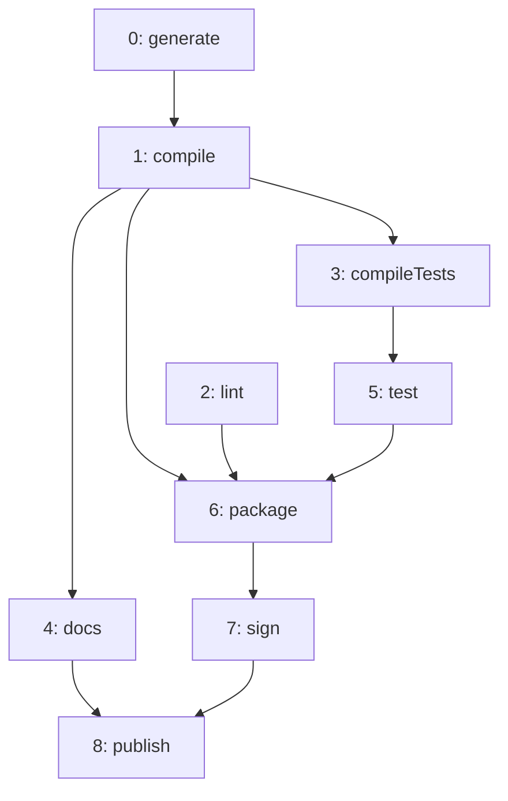
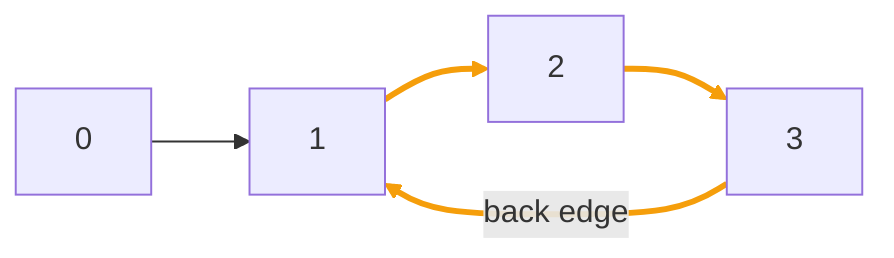

import ChapterProblems from '../../../components/ChapterProblems.astro';
import Figure from '../../../components/Figure.astro';

Many graphs say what must happen before what, for example: a step of a build before the steps that
need its output, a package before the packages that use it. An order has to respect every edge, and
a [cycle](../glossary/#cycle) rules that out.

## Problems in this chapter

<ChapterProblems />

The examples of this chapter use a small program: the steps that build and publish it, and the
dependencies between its packages.

## Orders that respect every edge

A [topological order](../glossary/#topological-order) lists the nodes so that the
[source](../glossary/#source-and-target) of every edge comes before its target. It exists exactly
when the graph has no cycle: in a cycle, every node would have to come
before itself. A graph without cycles is a [DAG](../glossary/#dag) (directed acyclic graph).

These are the steps of a build: an edge `a -> b` means that step `b` may start only after step
`a` has finished. `generate` and `lint` need nothing. `package` needs `compile`, `lint` and `test`.
One topological order is lint, generate, compile, docs, compileTests, test, package, sign, publish.
There are others, since `lint` can go anywhere before `package`.

Which way the edges point matters. Here they point from the step that runs first to the step that
runs after it, so a topological order is an order in which the steps can run. Where edges mean
"depends on", as they do between packages, they point the other way. A topological order then lists
every node before the nodes it depends on. See
[Put the nodes in dependency order](topological-order/) for what to do then.

## Root nodes and levels

A node that no edge leads to is a [root node](../glossary/#root-node): it has no
[in-nodes](../glossary/#out-node-and-in-node). In the build, the root nodes are `generate` and
`lint`: these steps can start right away. The [level](../glossary/#level) of a node in a DAG is the
number of edges on a longest [path](../glossary/#path) to it from a root node. `compile` has level
1, `compileTests` and `docs` have level 2, and `publish` has level 6. No path connects two nodes of
the same level, so they can be processed at the same time.

## Cycles and back edges

A graph with a cycle has no topological order, and the methods that compute one reject it. A
[depth-first search](../glossary/#depth-first-search) helps to find the cycles or to get rid of
them. It goes from a node along [outgoing edges](../glossary/#outgoing-and-incoming-edge) as deep as
it can before it turns back. An edge by which it comes back to a node that is still on its current
path is a [back edge](../glossary/#tree-back-forward-and-cross-edge). Every cycle contains one.

<Figure>

</Figure>

Here, the orange edges lie on the cycle `1 -> 2 -> 3 -> 1`. A search from node 0 goes through 1
and 2 to 3. There it meets `3 -> 1`, which leads back to node 1 on its path. This edge is the back
edge. Without it, the graph is a DAG.
