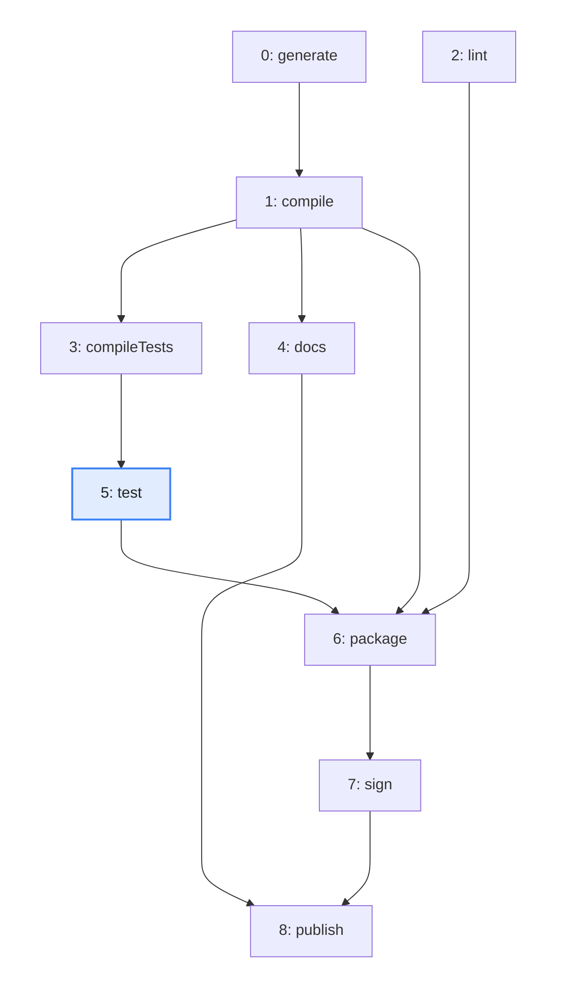
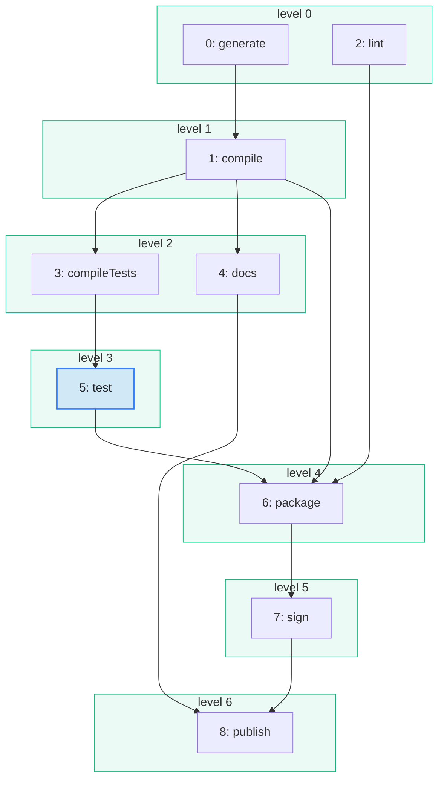

import Example from '../../../components/Example.astro';
import Api from '../../../components/Api.astro';
import Compare from '../../../components/Compare.astro';
import Gap from '../../../components/Gap.astro';

:::note[In short]
- <Api ref="TopOrderAndLevels.of(Graph)" /> gives each node of a [DAG](../../glossary/#dag)
  (directed acyclic graph) a [level](../../glossary/#level): 0 for a
  [root node](../../glossary/#root-node), otherwise one more than the highest level of its
  [in-nodes](../../glossary/#out-node-and-in-node).
- The nodes of one level have no [path](../../glossary/#path) between them, so they can be
  processed at the same time.
- <Api ref="TopOrderAndLevels.order()" /> lists the nodes level by level.
:::

## Problem

You have several workers, such as threads, machines or people. You want to run tasks at the same
time wherever they do not depend on each other. A
[topological order](../../glossary/#topological-order) puts the tasks in a single line. You want
stages instead: all tasks of a stage can run together, and a stage starts when the stage before it
is done. You need this for:

- a build or a test run spread over several threads or machines;
- a computation over a DAG in which each node needs the results of its in-nodes;
- a plan for a team, in which tasks that do not depend on each other go to different people.

## Example

The example graph `steps` models the steps that build and publish a small program. It has an edge
`a -> b` if step `b` may start only after step `a`. The array `names` holds the names of the steps.
`generate` and `lint` need nothing and can start together. `compileTests` and `docs` both wait only
for `compile`. Which steps can run at the same time, and on which level is `test`? The picture after
shows the steps in their levels, with one frame per level:

<Compare
  before="The steps of the build"
  after="The steps by level"
  legend={{ inputNode: 'Step asked about', outputGroup: 'Level' }}
>

</Compare>

## Solution

<Example java="guide/FindingLevels.java#levels" />

A root node is a node without in-nodes. The level of a node is the number of edges on a longest path
to it from a root node. So no edge and no path connects two nodes of the same level. See
[Find the starting points of a graph](../root-nodes/) for how to find the root nodes.

<Api ref="TopOrderAndLevels.levelOf(int)" /> returns the level of a node, and
<Api ref="TopOrderAndLevels.levelCount()" /> returns the number of levels. The code collects the
steps of each level into a stage. The build runs in seven stages, and two of them have two steps
each.

## Good to know

- **The longest path counts.** `package` needs `compile`, which is on level 1, but `package` is on
  level 4. It also waits for `test`, which is on level 3. The number of levels is the length of the
  longest path plus one. That is the least number of stages the work needs, however many workers
  there are.
- **An order as well.** <Api ref="TopOrderAndLevels.order()" /> is a topological order that
  lists the nodes level by level. <Api ref="TopOrderAndLevels.levels()" /> returns the level of
  every node as a list. For the order alone, <Api ref="TopOrder.of(Graph)" /> needs less memory.
- **Cycles.** Like any topological order, the levels exist only for a DAG.
  <Api ref="TopOrderAndLevels.of(Graph)" /> rejects a graph with a [cycle](../../glossary/#cycle).
- **Steps of different levels can overlap.** `docs` is on level 2 and `test` is on level 3, but no
  path connects them, so they can run at the same time as well. The levels put each node into the
  earliest stage its in-nodes allow. To keep every worker busy, start each step as soon as its last
  in-node has finished.

<Gap>
Take the duration of each step into account: find the earliest start of each step and the path with
the longest total duration. That path is called the critical path, and it decides how long the whole
build takes. Graphity's methods count edges, and none of them reads durations from an array yet. By
hand, go through the nodes in the order of <Api ref="TopOrder.of(Graph)" /> and pass the end of each
step on to its out-nodes. That computes the earliest starts.
</Gap>
