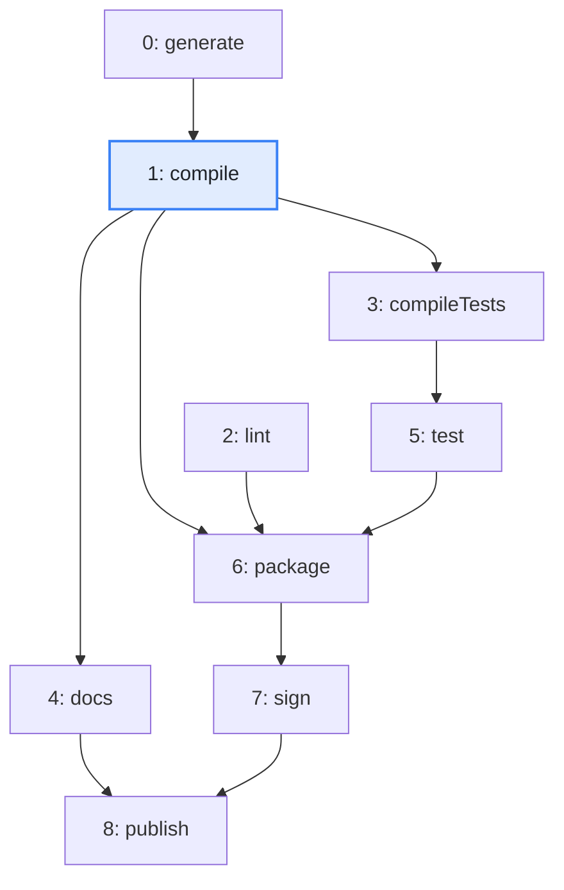
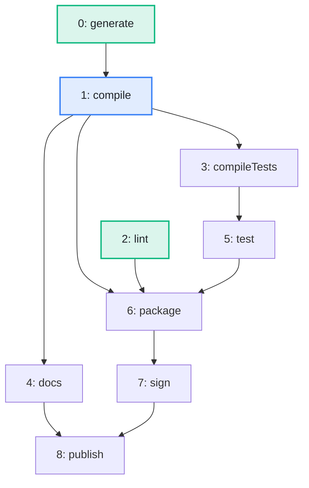

import Example from '../../../components/Example.astro';
import Api from '../../../components/Api.astro';
import Compare from '../../../components/Compare.astro';

:::note[In short]
- <Api ref="Graphs.rootNodes(BiAdjacentGraph)" /> returns the
  [root nodes](../../glossary/#root-node) in ascending order. A root node has no
  [in-nodes](../../glossary/#out-node-and-in-node).
- <Api ref="BiAdjacentGraph.isRootNode(int)" /> checks a single node.
:::

## Problem

Where does a graph start? The nodes that no edge leads to are called root nodes. A schedule starts
there, and so does a search of the whole graph. You need this to find:

- the tasks that need no other task and can start right away;
- the packages that no other package uses, which are often the entry points of a program;
- the people at the top of a hierarchy.

## Example

The example graph `steps` models the steps that build and publish a small program. It has an edge
`a -> b` if step `b` may start only after step `a`. Which steps can start right away, and is
`compile` one of them? The picture after shows the root nodes in green.

<Compare
  before="The steps of the build"
  after="The root nodes of the build"
  legend={{ inputNode: 'Step asked about', outputNode: 'Root node' }}
>

</Compare>

## Solution

A root node has no in-nodes, so the graph has to know the in-nodes of every node.
<Api ref="BiAdjacentGraph.of(Graph)" /> builds a <Api ref="BiAdjacentGraph" />, which stores them:

<Example java="guide/FindingRoots.java#rootNodes" />

The root nodes are `generate` and `lint`, which are green in the picture after. `compile` is not
one, since it waits for `generate`.

## Good to know

- **A [DAG](../../glossary/#dag) (directed acyclic graph) with at least one node has a root node**,
  and a search from all its root nodes [reaches](../../glossary/#reach) every node. A graph with
  [cycles](../../glossary/#cycle) may have no root node, since every node on a cycle has an in-node.
  Use the root nodes of its [condensed graph](../../glossary/#condensed-graph) instead. These are
  the [SCCs](../../glossary/#strongly-connected-component) (strongly connected components) that no
  edge from another SCC leads to. A search from one node of each such SCC reaches every node.
  See [Condense each group into one node to get a DAG](../../sccs/condense-to-dag/) for how to build
  this graph.
- **[Leaves](../../glossary/#leaf)** are the nodes without
  [out-nodes](../../glossary/#out-node-and-in-node). You can find them without a
  <Api ref="BiAdjacentGraph" />: they are the nodes whose <Api ref="Graph.outDegree(int)" /> is 0.
- **Levels.** The root nodes are the nodes of [level](../../glossary/#level) 0. See
  [Find which nodes can be processed in parallel](../levels/).
