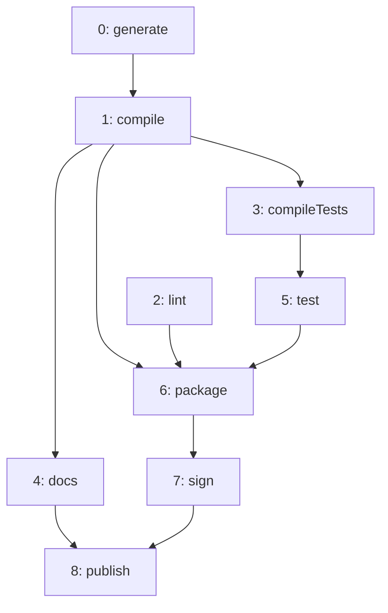
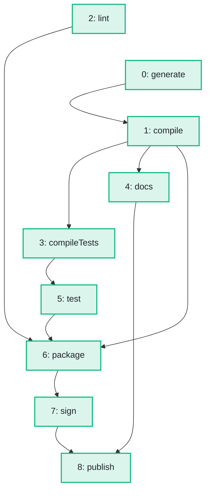

import Example from '../../../components/Example.astro';
import Api from '../../../components/Api.astro';
import Compare from '../../../components/Compare.astro';
import Gap from '../../../components/Gap.astro';

:::note[In short]
- <Api ref="TopOrder.of(Graph)" /> returns the nodes of a [DAG](../../glossary/#dag) (directed
  acyclic graph) in [topological order](../../glossary/#topological-order): for every edge, the
  [source](../../glossary/#source-and-target) comes before the target.
:::

## Problem

You have tasks that run one after the other, and some tasks need others to be finished first. You
want an order that respects all of these needs. As a graph, each task is a node, and an edge
`a -> b` says that `a` must come before `b`. The order you want lists every node before its
[out-nodes](../../glossary/#out-node-and-in-node). Such an order is called a topological order. You
need this for:

- a build, in which every step runs after the steps it needs;
- an installation, in which every package is installed after the packages it requires;
- a spreadsheet, in which every cell is computed after the cells it refers to.

## Example

The example graph `steps` models the steps that build and publish a small program. It has an edge
`a -> b` if step `b` may start only after step `a`. The array `names` holds the names of the steps.
In which order can the steps run? The picture after shows the steps in the order found, one below
the other: every edge points downward.

<Compare
  before="The steps of the build"
  after="The steps in topological order"
  legend={{ outputNode: 'Step in topological order' }}
>

</Compare>

## Solution

<Example java="guide/SortingTopologically.java#topOrder" />

<Api ref="TopOrder.of(Graph)" /> returns the [node IDs](../../glossary/#node-id) in topological
order, and the code turns them into names. Every step comes after the steps it needs: `compile`
comes after `generate`, and `package` comes after `compile`, `lint` and `test`. `publish` comes
last.

## Good to know

- **One of several orders.** A graph has many topological orders when some nodes have no
  [path](../../glossary/#path) between them, like `lint` and `generate`.
  <Api ref="TopOrder.of(Graph)" /> always returns the same one for the same graph.
  <Api ref="TopOrderAndLevels.of(Graph)" /> returns another, which lists the nodes by
  [level](../../glossary/#level). See [Find which nodes can be processed in parallel](../levels/).
- **Edges that mean "depends on"** point the other way than here: from a node to the nodes it
  needs. The order then lists every node before the nodes it depends on, so read it from the back
  to the front.
- **Node IDs in this order.** You can renumber a graph in a topological order, so that every edge
  leads to a higher node ID. See
  [Number the nodes in a different order](../../transforming/renumber/).
- **Cycles.** A graph with a [cycle](../../glossary/#cycle) has no topological order, and
  <Api ref="TopOrder.of(Graph)" /> rejects it.
  See [Find out whether a graph has a cycle, and show one](../find-cycle/) for how to check first.
  See [Put the nodes in dependency order although the graph has
  cycles](../../sccs/order-despite-cycles/) for an order despite cycles. Where edges mean "depends
  on", you read that order from the front: it lists every node after the nodes it depends on. The
  exception is the nodes on a common cycle, which come together.

<Gap>
Choose among the topological orders: for example the one that takes the lowest node ID first
wherever the edges allow, so that the nodes keep their given order as far as possible. Graphity
returns one fixed order per method.
</Gap>
