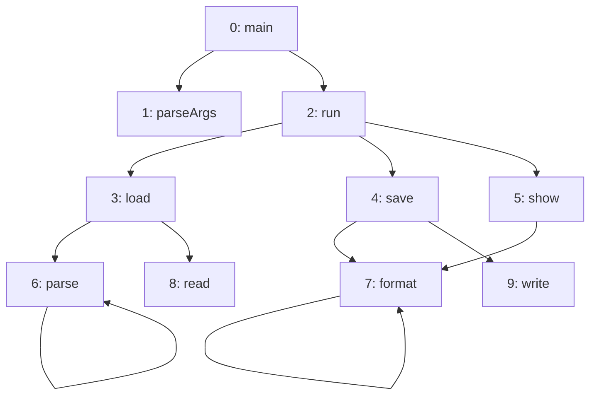

import ChapterProblems from '../../../components/ChapterProblems.astro';

A [path](../glossary/#path) of edges leads from a node to the nodes it
[reaches](../glossary/#reach). A method reaches all the methods it may end up calling, and a package
reaches everything it depends on.

## Problems in this chapter

<ChapterProblems />

The examples of this chapter use a small program: the calls between its methods, and the steps that
build and publish it.

## Reach and distance

A node reaches another node if a path of edges leads from the one to the other. Every node reaches
itself. The [distance](../glossary/#distance) from one node to another is the number of edges on a
shortest such path. Reach and distance both follow the edges in their direction: `main` reaches
`write`, but `write` does not reach `main`.

Here, `main` reaches every method, and the largest distance is 3. `run` reaches all methods but
`main` and `parseArgs`. `read` and `write` reach nothing but themselves. To ask which methods may
end up calling `format`, you follow the edges against their direction. For that, search the
[transposed graph](../glossary/#transposed-graph), in which every edge is turned around.

## Searches from start nodes

A search starts at one node or at several. These are its *start nodes*, which Graphity calls
sources. From there, the search follows the edges. A
[breadth-first search](../glossary/#breadth-first-search) visits the nodes in the order of their
distance from the nearest start node, so it finds the distances and a shortest path to every node it
reaches.

## All reachability at once

The [transitive closure](../glossary/#transitive-closure-and-reduction) of a graph has an edge
`u -> v` wherever a path of one or more edges leads from `u` to `v`. In the calls above, it also has
`main -> write`. It answers at once every question "does `u` reach `v`?" for two different nodes.

The transitive reduction goes the other way. In a [DAG](../glossary/#dag) (directed acyclic graph),
it leaves out every edge `u -> v` for which a longer path also leads from `u` to `v`. It keeps the
fewest edges with which every node still reaches the same nodes.
