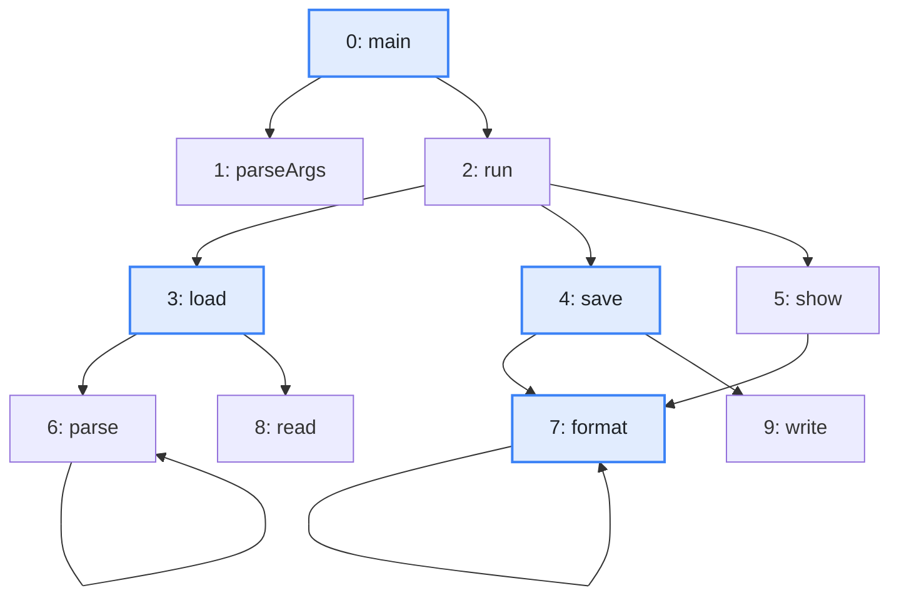
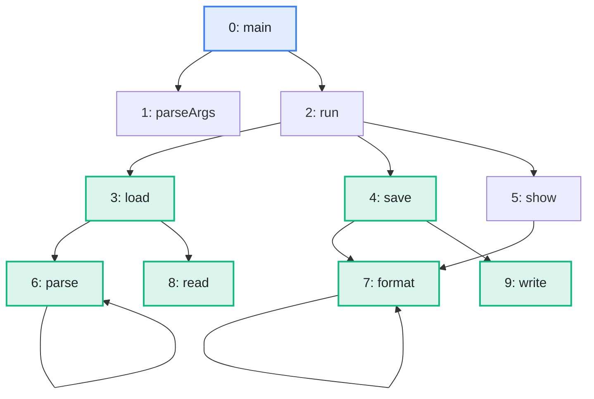

import Example from '../../../components/Example.astro';
import Api from '../../../components/Api.astro';
import Compare from '../../../components/Compare.astro';
import InCode from '../../../components/InCode.astro';

:::note[In short]
- <Api ref="BfsDistances.of(Graph, IntList)" /> searches from several start nodes at once: each
  node gets its [distance](../../glossary/#distance) from the nearest of them.
- <Api ref="BfsDistances.maxDistance()" /> returns the largest distance of a node the search
  [reaches](../../glossary/#reach).
:::

## Problem

You have several start nodes and want to know how far each node is from the nearest of them. You may
also want to know how far a search goes, that is, the largest distance of any node it reaches. Such
questions come up for:

- the nearest of several servers or exits, for every place of a network;
- the methods that may end up calling one of several changed methods, to review the nearest
  first;
- how many calls away from an entry point the farthest method lies, or after how many steps a
  message has reached every node it can reach.

## Example

The example graph `calls` models the calls between the methods of a small program. It has an edge
from each method to each method it calls. How far is each method from the nearer of the two methods
`load` and `save`? And how many calls away from `main` is the farthest method? The picture after
shows in green the methods that the search from `load` and `save` reaches.

<Compare
  before="The calls, the start nodes and the methods asked about"
  after="The methods that load and save reach"
  legend={{ inputNode: 'Start node or method asked about', outputNode: 'Reached method' }}
>

</Compare>

## Solution

<Api ref="BfsDistances.of(Graph, IntList)" /> searches from both start nodes at once:

<Example java="guide/ShortestPaths.java#nearest" />

Each method gets its distance from the nearer start node. `format` is one call from `save`, and
the [path](../../glossary/#path) to it starts at `save`. `main` is reached by neither start node, so
it has no distance, and <Api ref="BfsDistances.isReachable(int)" /> returns false for it.

The largest distance tells how far a search goes. From `main`, it is the number of calls on a
shortest chain to the farthest method:

<Example java="guide/ShortestPaths.java#maxDistance" />

Along a shortest chain of calls, every method that `main` may end up calling is at most three calls
away from it.

## Good to know

- **Start nodes have the distance 0.** A path starts at the nearest start node. If several are
  equally near, it starts at the one that comes first in the list. A start node given twice counts
  once.
- **Sources.** Graphity calls the start nodes sources. They have nothing to do with the
  [source of an edge](../../glossary/#source-and-target).
- **Without start nodes**, no node is reached, and <Api ref="BfsDistances.maxDistance()" /> returns
  <InCode java="-1" rust="None" ts="-1" csharp="-1" />.
- **Distances to the start nodes** instead of from them need the
  [transposed graph](../../glossary/#transposed-graph). An example is the distance from every method
  to the nearest changed method it may end up calling.
  See [Find everything that reaches a node](../reaching/) for how to search the transposed graph.
- **Not the longest path.** The largest distance counts the edges of shortest paths. A longer
  chain of calls can exist, such as `main -> run -> save -> format -> format`. A path through a
  [cycle](../../glossary/#cycle) can be as long as you like. In a [DAG](../../glossary/#dag)
  (directed acyclic graph), the number of edges on a longest path from a
  [root node](../../glossary/#root-node) to a node is called its [level](../../glossary/#level). See
  [Find which nodes can be processed in parallel](../../order-and-cycles/levels/).
- **Between all pairs of nodes**, run one search per node.
- **From one start node.** See [Find a shortest path between two nodes](../shortest-path/) for
  <Api ref="BfsDistances.distanceOf(int)" /> and <Api ref="BfsDistances.pathTo(int)" /> from a
  single start node.
