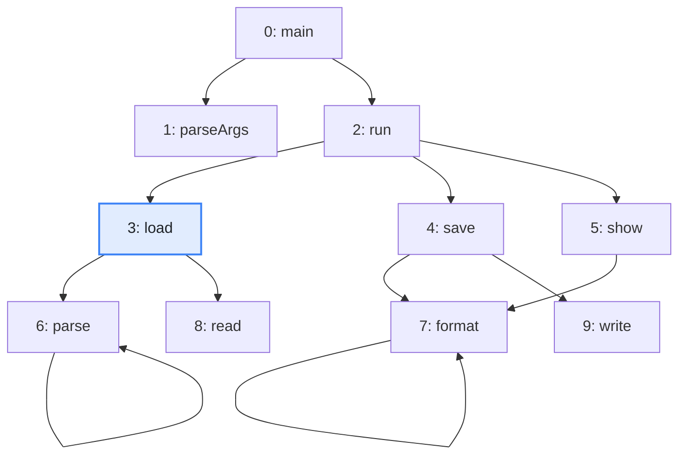
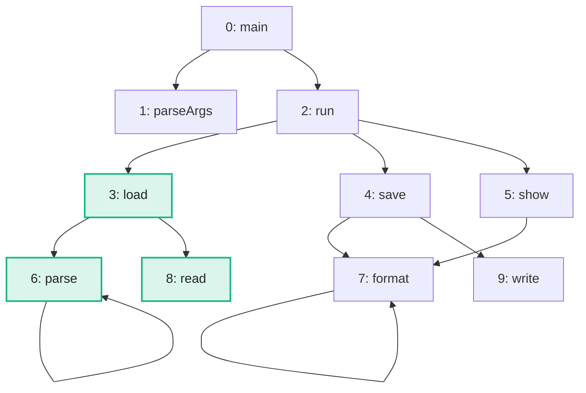

import Example from '../../../components/Example.astro';
import Api from '../../../components/Api.astro';
import Compare from '../../../components/Compare.astro';

:::note[In short]
- <Api ref="Graphs.reachableFrom(Graph, int)" /> returns, in ascending order, the nodes a node
  [reaches](../../glossary/#reach). The node itself is one of them.
- <Api ref="Graphs.reachableFrom(Graph, IntList)" /> does the same from several start nodes at
  once.
:::

## Problem

Which nodes can you get to from a node by following edges in their direction? The answer is a set
of nodes. You can ask for one start node or for several. Such questions come up for:

- the code that may run when a method runs: every method it may end up calling;
- the packages that have to be present to use a package: everything it depends on, directly or not;
- the states a protocol can still get into from the state it is in.

## Example

The example graph `calls` models the calls between the methods of a small program. It has an edge
from each method to each method it calls. Which methods may run when `load` runs? The picture after
shows in green the methods that `load` reaches. `load` itself is one of them.

<Compare
  before="The calls and the start node"
  after="The methods that load reaches"
  legend={{ inputNode: 'Start node', outputNode: 'Reached method' }}
>

</Compare>

## Solution

<Example java="guide/FindingReachable.java#reachableFrom" />

`load` reaches `parse`, `read` and itself. From `load` and `save` together, the search reaches what
either of them reaches: `save` adds itself, `format` and `write`.

## Good to know

- **Sorted and complete.** The result is a sorted list of [node IDs](../../glossary/#node-id), and
  the start nodes are in it. See [Work with the lists Graphity returns](../../basics/result-lists/)
  for how to combine it with other lists of nodes.
- **Start nodes.** Graphity calls the start nodes sources. A start node given twice counts once.
  Without start nodes, the result is empty.
- **The other direction.** A search can also follow the edges against their direction. See
  [Find everything that reaches a node](../reaching/).
- **A subgraph of what is reached.** To keep working on just these nodes, take the
  [subgraph](../../glossary/#subgraph) of them. See
  [Take the subgraph of some nodes](../../transforming/subgraph/).
- **How far, and along which [path](../../glossary/#path)?**
  <Api ref="BfsDistances.of(Graph, int)" /> also gives the [distances](../../glossary/#distance).
  See [Find a shortest path between two nodes](../shortest-path/).
- **Only within a few steps, or not through some nodes?** A search of your own can stop at a
  [level](../../glossary/#level) or follow only the nodes you choose. See [Write a breadth-first
  search](../../searches/breadth-first/).
