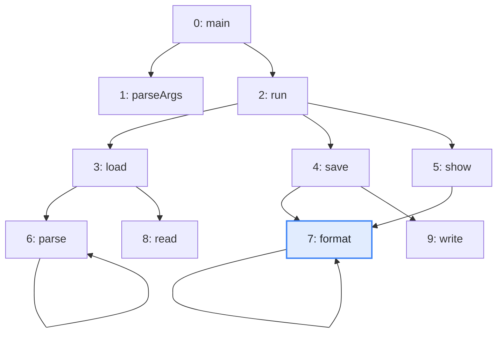
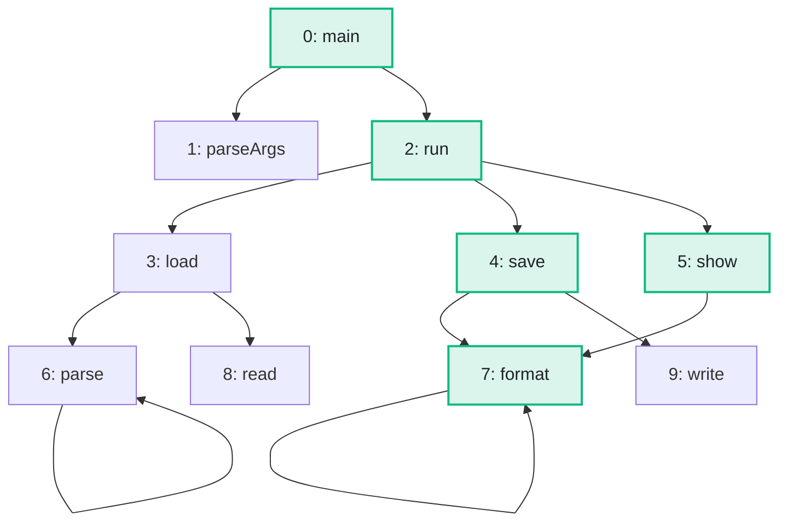

import Example from '../../../components/Example.astro';
import Api from '../../../components/Api.astro';
import Compare from '../../../components/Compare.astro';

:::note[In short]
- <Api ref="BiAdjacentGraph.of(Graph)" /> adds the
  [in-nodes](../../glossary/#out-node-and-in-node) that a plain graph lacks.
- <Api ref="BiAdjacentGraph.transposed()" /> then turns every edge around, without copying.
- <Api ref="Graphs.reachableFrom(Graph, int)" /> on the
  [transposed graph](../../glossary/#transposed-graph) returns the nodes that
  [reach](../../glossary/#reach) a node.
:::

## Problem

You have a node and want to know everything that can lead to it: every node from which a
[path](../../glossary/#path) of edges leads to it. These are not the nodes it reaches, but the nodes
that reach it. Such questions come up for:

- the impact of a change: every method that may end up calling a changed method may behave
  differently;
- the removal of a package: every package that depends on it, directly or not, breaks;
- the causes of a state: every state from which a protocol can get into it.

## Example

The example graph `calls` models the calls between the methods of a small program. It has an edge
from each method to each method it calls. `format` changes: which methods may end up calling it? The
picture after shows them in green. `format` itself is one of them.

<Compare
  before="The calls and the start node"
  after="The methods that reach format"
  legend={{ inputNode: 'Start node', outputNode: 'Method that reaches format' }}
>

</Compare>

## Solution

The transposed graph has the same nodes, with every edge turned around. What reaches a node in the
graph is what the node reaches in the transposed graph. For that, a plain graph needs its in-nodes,
which <Api ref="BiAdjacentGraph.of(Graph)" /> adds. <Api ref="BiAdjacentGraph.transposed()" /> then
turns every edge around:

<Example java="guide/FindingReachable.java#reaching" />

`main`, `run`, `save` and `show` may end up calling `format`. `format` itself is in the result too,
as a search always includes its start node.

## Good to know

- **What it costs.** <Api ref="BiAdjacentGraph.of(Graph)" /> builds the in-nodes once, in time and
  memory in proportion to the graph. <Api ref="BiAdjacentGraph.transposed()" /> then costs nothing.
  See [Turn every edge around](../../transforming/transpose/) for the reason. Keep the
  <Api ref="BiAdjacentGraph" /> if you search in both directions.
- **Only the direct callers?** <Api ref="BiAdjacentGraph.inNodes(int)" /> returns the in-nodes of
  a node, without a search.
- **The other direction.** On the graph itself, <Api ref="Graphs.reachableFrom(Graph, int)" />
  follows the edges in their direction, from one start node or from several. See
  [Find everything a node reaches](../reachable-from/). On the transposed graph, several start nodes
  work the same way.
- **Every search works backwards this way.** Shortest paths, [distances](../../glossary/#distance)
  and the other searches of this guide take the transposed graph like any other graph.
