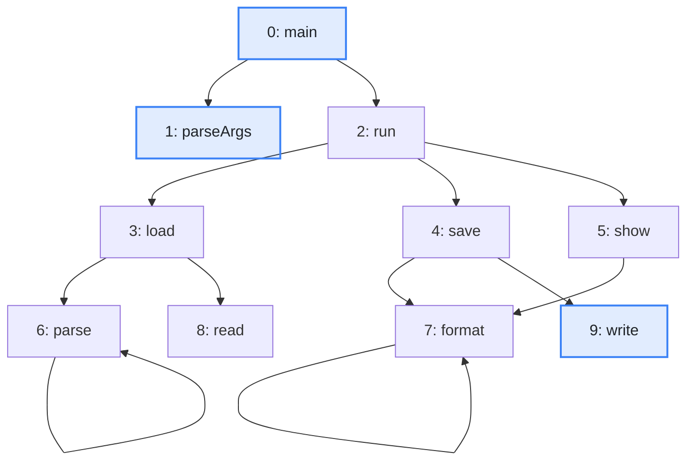
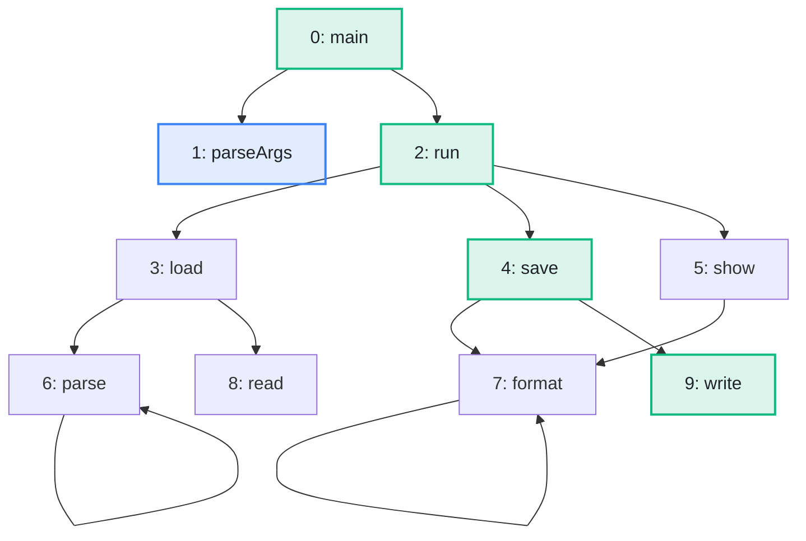

import Example from '../../../components/Example.astro';
import Api from '../../../components/Api.astro';
import Compare from '../../../components/Compare.astro';
import Gap from '../../../components/Gap.astro';
import InCode from '../../../components/InCode.astro';

:::note[In short]
- <Api ref="BfsDistances.of(Graph, int)" /> runs a
  [breadth-first search](../../glossary/#breadth-first-search) from a start node.
- <Api ref="BfsDistances.distanceOf(int)" /> returns the number of edges to a node.
- <Api ref="BfsDistances.pathTo(int)" /> returns a [path](../../glossary/#path) with that many
  edges.
:::

## Problem

How do you get from one node to another along as few edges as possible? Each edge counts as one
step. The number of edges on a shortest path is called the [distance](../../glossary/#distance).
Such questions come up for:

- the shortest chain of calls from the entry point of a program to a method, which explains how
  the method is [reached](../../glossary/#reach);
- the fewest connections between two machines of a network;
- the fewest moves between two states of a game or a puzzle.

## Example

The example graph `calls` models the calls between the methods of a small program. It has an edge
from each method to each method it calls. How many calls away from `main` is `write`, and along
which chain of calls? The picture after shows in green the methods on a shortest path from the start
node `main` to `write`.

<Compare
  before="The calls, the start node and the methods asked about"
  after="The methods on a shortest path from main to write"
  legend={{ inputNode: 'Start node or method asked about', outputNode: 'Method on the path' }}
>

</Compare>

## Solution

<Api ref="BfsDistances.of(Graph, int)" /> searches from `main` and keeps the distance of every node
it reaches:

<Example java="guide/ShortestPaths.java#pathTo" />

`write` is three calls away. <Api ref="BfsDistances.pathTo(int)" /> lists the nodes of the path
from the start node to `write`. They are the green methods of the picture after: `main` calls `run`,
`run` calls `save` and `save` calls `write`. <Api ref="BfsDistances.isReachable(int)" /> tells
whether the search reaches a node at all. It reaches `parseArgs`.

## Good to know

- **One search, all nodes.** The search computes the distances of all nodes at once, so you can ask
  it about as many nodes as you like. A node it does not reach has no distance.
  <Api ref="BfsDistances.distanceOf(int)" /> returns <InCode java="-1" rust="None" ts="-1" csharp="-1" />
  for such a node, and <Api ref="BfsDistances.pathTo(int)" /> returns an empty list.
- **Several shortest paths.** If there are several, <Api ref="BfsDistances.pathTo(int)" /> returns
  the one the search finds first. The search goes through the
  [out-nodes](../../glossary/#out-node-and-in-node) of each node in ascending order.
- **Only which nodes are reached?** <Api ref="Graphs.reachableFrom(Graph, int)" /> returns them with
  less memory than a search that keeps distances and paths. See
  [Find everything a node reaches](../reachable-from/).
- **Several start nodes, and the largest distance.** See
  [Find the distances from several start nodes, and the largest distance](../nearest-and-farthest/).
- **Against the direction of the edges**, pass the
  [transposed graph](../../glossary/#transposed-graph). See
  [Find everything that reaches a node](../reaching/).

<Gap>
Find shortest paths when edges have lengths or costs, such as the cheapest route through a network
or the path with the least total delay. Graphity counts edges. None of its searches reads lengths or
costs from an array, and algorithms such as Dijkstra's are not supported yet. Neither is listing all
paths between two nodes.
</Gap>
