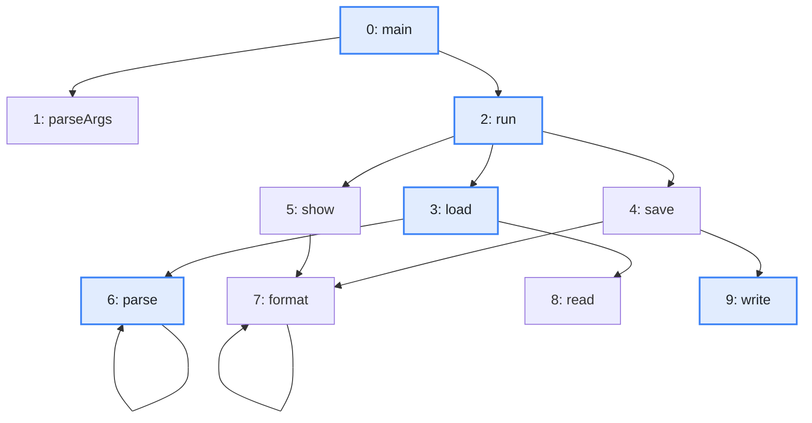
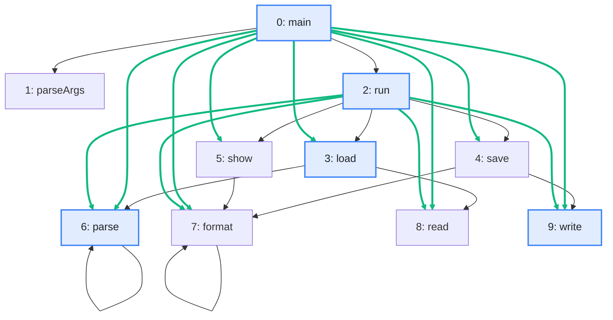

import Example from '../../../components/Example.astro';
import Api from '../../../components/Api.astro';
import Compare from '../../../components/Compare.astro';

:::note[In short]
- <Api ref="Graphs.transitiveClosure(Graph)" /> returns the
  [transitive closure](../../glossary/#transitive-closure-and-reduction): a graph with an edge
  `u -> v` wherever a [path](../../glossary/#path) of one or more edges leads from `u` to `v`.
- After that, <Api ref="Graph.hasOutNode(int, int)" /> on the closure tells whether `u`
  [reaches](../../glossary/#reach) another node `v`.
:::

## Problem

You will ask "does this node reach that one?" many times, for many pairs of nodes. A new search for
each question repeats work, so you want every answer at hand. You need this for:

- a check of every dependency in a codebase against the rules of its architecture;
- the access rights that follow from a hierarchy of roles;
- the questions asked again and again of a hierarchy of categories or types.

## Example

The example graph `calls` models the calls between the methods of a small program. It has an edge
from each method to each method it calls. Which method may end up calling which? The picture after
shows the closure. It has an edge from each method to each method it may end up calling, and the new
edges are green.

<Compare
  before="The calls and the methods asked about"
  after="The transitive closure"
  legend={{ inputNode: 'Method asked about', outputEdge: 'Edge the closure adds' }}
>

</Compare>

## Solution

<Example java="guide/TransitiveClosure.java#closure" />

The closure is the graph of the picture after, with 23 edges instead of 12. It is a graph like any
other. In this graph, the [out-nodes](../../glossary/#out-node-and-in-node) of a node are the nodes
it reaches along one or more edges, and <Api ref="Graph.hasOutNode(int, int)" /> answers whether one
node reaches another. A node lies on a [cycle](../../glossary/#cycle) exactly if it has a
[self-loop](../../glossary/#self-loop) in the closure. `parse` has one, since it calls itself, and
`load` does not.

## Good to know

- **A node and itself.** Unlike a search, the closure has the edge `u -> u` only when `u` lies on
  a cycle: a path of one or more edges leads from it back to itself. Every node reaches itself, so
  ask the closure only about two different nodes.
- **What reaches a node** is its in-nodes in the closure. To read them, call
  <Api ref="BiAdjacentGraph.of(Graph)" /> on the closure and then
  <Api ref="BiAdjacentGraph.inNodes(int)" />. See
  [Find the out-nodes and in-nodes of a node](../../basics/neighbors/).
- **Size.** The closure can have up to as many edges as the square of the node count. For the
  nodes reached from a few nodes, <Api ref="Graphs.reachableFrom(Graph, IntList)" /> costs far less.
  See [Find everything a node reaches](../reachable-from/).
- **The other way.** The closure has an edge `u -> v` wherever a path leads from `u` to `v`.
  <Api ref="Graphs.transitiveReduction(Graph)" /> keeps as few edges as possible. See
  [Remove edges that other paths make redundant](../transitive-reduction/).
