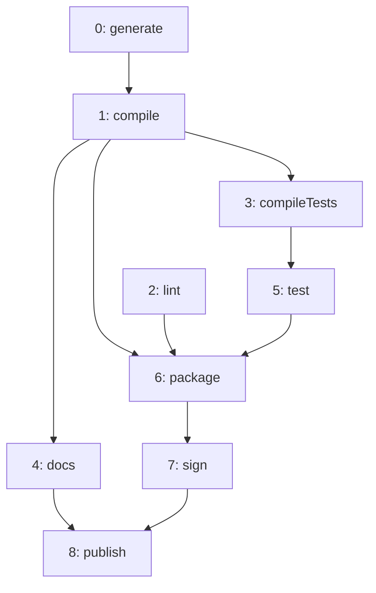
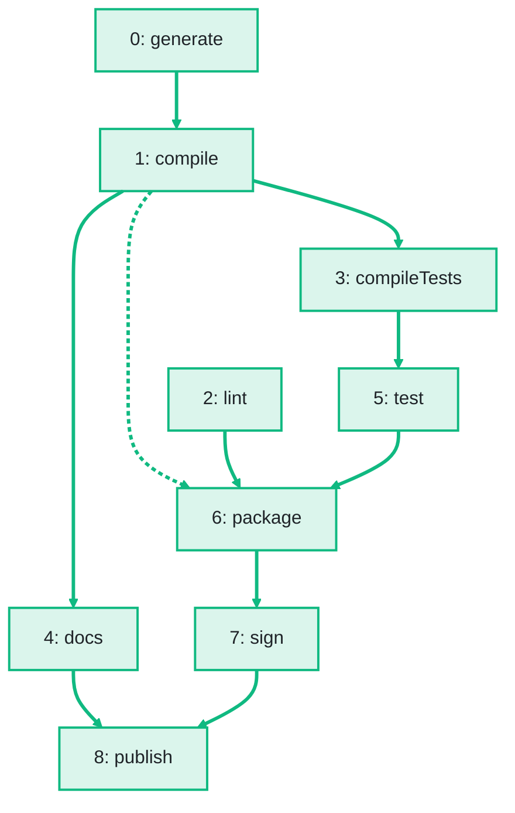

import Example from '../../../components/Example.astro';
import Api from '../../../components/Api.astro';
import Compare from '../../../components/Compare.astro';
import InCode from '../../../components/InCode.astro';
import Gap from '../../../components/Gap.astro';

:::note[In short]
- <Api ref="Graphs.transitiveReduction(Graph)" /> returns the
  [transitive reduction](../../glossary/#transitive-closure-and-reduction) of a
  [DAG](../../glossary/#dag) (directed acyclic graph): it keeps each edge unless another
  [path](../../glossary/#path) leads from its
  [source to its target](../../glossary/#source-and-target).
- In the result, every node [reaches](../../glossary/#reach) the same nodes as before, with as few
  edges as possible.
:::

## Problem

You want to remove the edges of a graph that add nothing. An edge adds nothing if a path through
other nodes already leads from its source to its target. Such an edge is called redundant. Removing
redundant edges makes a graph easier to read and to draw, and shows the edges that matter. Redundant
edges are found in:

- dependencies, where a package uses another that one of its other dependencies brings anyway;
- plans, where the order of two steps already follows from the steps between them;
- drawings of hierarchies, where a longer path also leads from the source of an edge to its target.

## Example

The example graph `steps` models the steps that build and publish a small program. It has an edge
`a -> b` if step `b` may start only after step `a`. `package` waits for `compile` - but it also
waits for `test`, which waits for `compileTests`, which waits for `compile`. Which edges are
redundant? The picture after shows the reduction in green. The dashed edge `compile -> package` is
left out.

<Compare
  before="The steps of the build"
  after="The transitive reduction and the redundant edge"
  legend={{ outputNode: 'Step of the reduction', outputEdge: 'Edge of the reduction', removedEdge: 'Redundant edge, left out' }}
>

</Compare>

## Solution

<Example java="guide/TransitiveReduction.java#reduction" />

The reduction has 9 edges instead of 10. It leaves out `compile -> package`, which is the only edge
that another path replaces. Each step reaches the same steps as before.

## Good to know

- **Only for DAGs.** On a DAG, the reduction is unique.
  <Api ref="Graphs.transitiveReduction(Graph)" /> rejects a graph with a
  [cycle](../../glossary/#cycle)
  (<InCode java="IllegalArgumentException" rust="ErrorKind::InvalidArgument" ts="Error" csharp="ArgumentException" />).
  A [self-loop](../../glossary/#self-loop) counts as a cycle. For a graph with cycles, take the
  transitive reduction of the [condensed graph](../../glossary/#condensed-graph) of its
  [SCCs](../../glossary/#strongly-connected-component) (strongly connected components). See
  [Condense each group into one node to get a DAG](../../sccs/condense-to-dag/).
- **Which edges go.** <Api ref="Graphs.diff(Graph, Graph)" /> lists them with their
  [edge indices](../../glossary/#edge-index). See
  [Find the edges added and removed between two versions](../../storing/diff/).
- **The other way.** <Api ref="Graphs.transitiveClosure(Graph)" /> computes the transitive closure,
  which adds an edge wherever a path leads. See
  [Answer many reachability questions at once](../transitive-closure/).

<Gap>
Keep the nodes of a graph with cycles and find the fewest edges with which every node still reaches
the same nodes. The result has one cycle through the nodes of each SCC, and one edge for each edge
of the transitive reduction of the condensed graph of the SCCs. The graph need not have these edges.
Graphity computes a transitive reduction only for DAGs.
</Gap>
