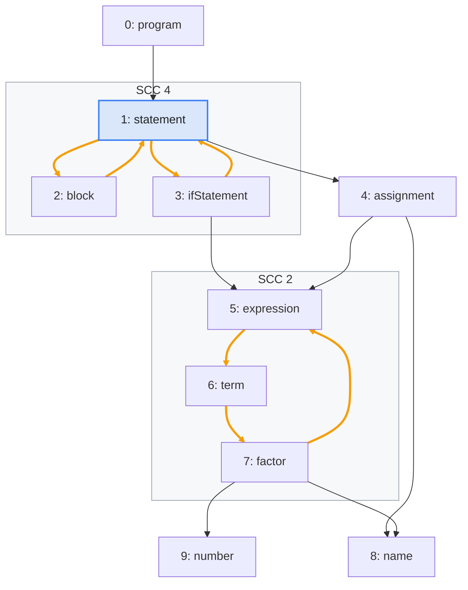
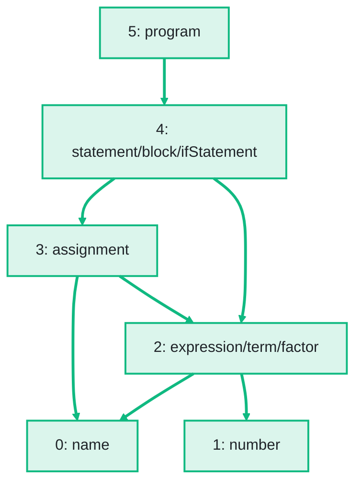

import Example from '../../../components/Example.astro';
import Api from '../../../components/Api.astro';
import Compare from '../../../components/Compare.astro';
import InCode from '../../../components/InCode.astro';

:::note[In short]
- <InCode java="Components.sccsOf(graph).condense()" rust="components::sccs_of(&graph).condense()" ts="Components.sccsOf(graph).condense()" csharp="Components.SccsOf(graph).Condense()" />
  returns the graph between the [SCCs](../../glossary/#strongly-connected-component) (strongly
  connected components). It has one node per SCC and no [cycles](../../glossary/#cycle).
- Its [node IDs](../../glossary/#node-id) are the SCC IDs, and it has an edge between two SCCs
  wherever an edge of the graph runs between them.
:::

## Problem

You want to run an algorithm that works only on a graph without cycles, but your graph has cycles.
Such algorithms compute a [topological order](../../glossary/#topological-order),
[levels](../../glossary/#level), a [transitive
reduction](../../glossary/#transitive-closure-and-reduction) or a drawing in layers. Treat each
group of nodes that [reach](../../glossary/#reach) each other as one unit. Such a group is an SCC
(strongly connected component). Condense each SCC into a single node. The result is called the
[condensed graph](../../glossary/#condensed-graph). It is a [DAG](../../glossary/#dag) (directed
acyclic graph). All edges from one group to another become one edge. You need this for:

- an overview of a large dependency graph, with each group of packages that use each other drawn
  as one box;
- an analysis of a call graph that treats each group of mutually recursive functions as one
  unit;
- an algorithm for DAGs on a graph with cycles, whose results then hold for each group.

## Example

The example is the grammar of a small programming language:

```text
program     = { statement } ;
statement   = block | ifStatement | assignment ;
block       = "{" { statement } "}" ;
ifStatement = "if" "(" expression ")" statement ;
assignment  = name "=" expression ";" ;
expression  = term { "+" term } ;
term        = factor { "*" factor } ;
factor      = number | name | "(" expression ")" ;
```

`name` and `number` are rules for single tokens. The example graph `rules` models how the rules use
each other. It has an edge from each rule to each rule it uses. The array `names` holds the names of
the rules. A tool documents the grammar with an overview: one box for each group of rules that use
each other, and an arrow from each box to each box whose rules it uses. These groups are the SCCs of
the graph.
See [Find the groups of nodes that reach each other](../find-mutual-dependencies/). The picture
before shows the two SCCs with a cycle as gray frames, and the edges of their cycles in orange.
Which group uses which? Condensing each SCC into one node gives the graph of the picture after. Its
node IDs, from 0 to 5, are the SCC IDs:

<Compare
  before="The rules and the SCCs with a cycle"
  after="The condensed graph"
  legend={{ inputNode: 'Rule asked about', contextGroup: 'SCC with a cycle', outputNode: 'SCC as one node', outputEdge: 'Edge between SCCs' }}
>





</Compare>

The three rules of the statements became one node, and so did the three rules of the expressions.
The edges inside the SCCs are gone. Each edge from one SCC to another became an edge between their
nodes, such as `4 -> 2` for `ifStatement -> expression`. Several edges between the same two SCCs
would become one.

## Solution

<Api ref="NodePartition.condense()" /> builds the condensed graph from the <Api ref="Sccs" /> of
the rules. The names of its nodes come from the rules in each SCC:

<Example java="guide/CondensingCycles.java#condense" />

The result is the graph of the picture after. It is green as a whole, since the code returns it. It
has one node per SCC, and an edge wherever a rule of one SCC uses a rule of another. It has no
cycle. Its [out-nodes](../../glossary/#out-node-and-in-node) say which groups a group uses: the
statements use the expressions and `assignment`.

## Good to know

- **For the order alone**, you do not need the condensed graph. The SCC IDs are already an order
  in which every SCC comes after the SCCs it uses.
  See [Put the nodes in dependency order although the graph has cycles](../order-despite-cycles/).
  Since the node IDs of the condensed graph are the SCC IDs, each of its edges goes from a higher
  node ID to a lower one.
- **Which edges are behind an edge.** An edge of the condensed graph stands for edges of the
  original graph. For example, `4 -> 2` stands for `ifStatement -> expression`. To find out which
  edges these are, use <Api ref="Graphs.edgePartition(Graph, NodePartition)" />. See
  [Reduce the data of the nodes or edges of a group](../../transforming/reduce-data/).
- **Groups of your own.** The same works for any grouping of nodes, such as the methods of a
  program by package. Build the groups with <Api ref="NodePartition.of(Graph, int[], int)" />.
  See [Condense groups of your own choice](../../transforming/own-groups/). Such a condensed graph
  can have cycles even where the graph has none: groups `{a, c}` and `{b}` with the edges `a -> b`
  and `b -> c` give a cycle between the two groups. The condensed graph of the SCCs never has one.
- **Break instead of condense.** To get rid of the cycles by removing edges, see
  [Remove edges to break every cycle](../../order-and-cycles/break-cycles/).
- **Built anew on every call.** <Api ref="NodePartition.condense()" /> does not keep its result.
  Keep it in a variable if you use it more than once.
