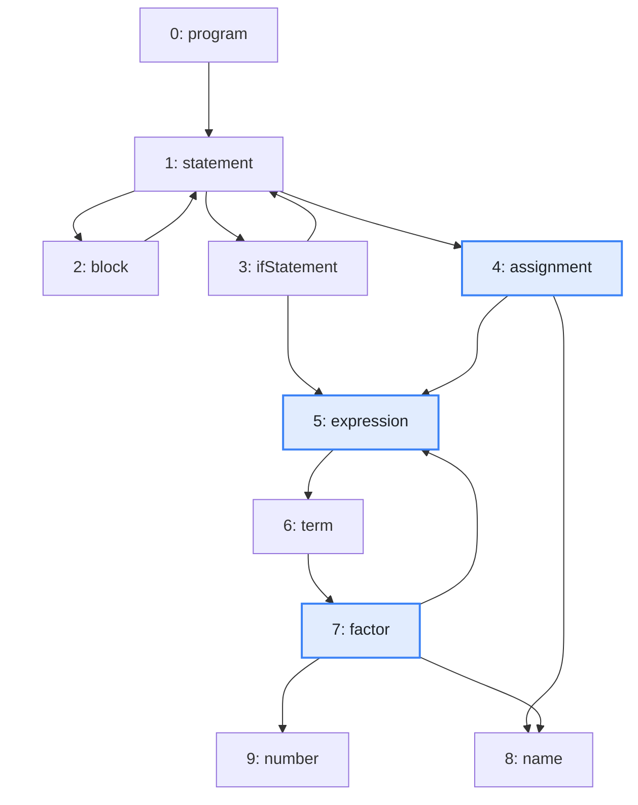
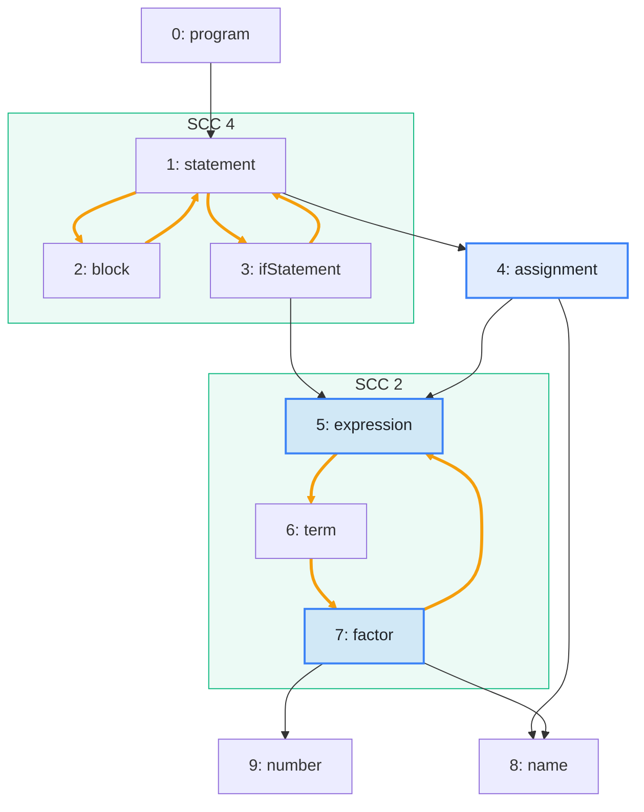

import Example from '../../../components/Example.astro';
import Api from '../../../components/Api.astro';
import Compare from '../../../components/Compare.astro';
import Gap from '../../../components/Gap.astro';

:::note[In short]
- <Api ref="Components.sccsOf(Graph)" /> divides the nodes into groups of nodes that
  [reach](../../glossary/#reach) each other. These groups are the
  [SCCs](../../glossary/#strongly-connected-component) (strongly connected components).
- <Api ref="NodePartition.nodesOf(int)" /> returns the nodes of an SCC in ascending order.
- <Api ref="Sccs.containsCycle(int)" /> tells whether an SCC contains a
  [cycle](../../glossary/#cycle). An SCC without a cycle is a single node on no cycle.
- <Api ref="Sccs.sccOf(int)" /> returns the SCC of a node.
:::

## Problem

You want to find the nodes of a graph that depend on each other, directly or through other nodes. In
the graph, these are groups of nodes in which every node reaches every other along a
[path](../../glossary/#path) of edges. If no further node can join such a group, it is an SCC. It
usually has to be handled as a whole. You need this for:

- packages or modules that use each other: they cannot be built, tested or released one by one;
- functions that call each other in a cycle: they are mutually recursive, and an analysis of one of
  them must take all of them into account;
- processes that wait for each other in a cycle: they are in a deadlock.

## Example

The example is the grammar of a small programming language:

```text
program     = { statement } ;
statement   = block | ifStatement | assignment ;
block       = "{" { statement } "}" ;
ifStatement = "if" "(" expression ")" statement ;
assignment  = name "=" expression ";" ;
expression  = term { "+" term } ;
term        = factor { "*" factor } ;
factor      = number | name | "(" expression ")" ;
```

`name` and `number` are rules for single tokens. The example graph `rules` models how the rules use
each other. It has an edge from each rule to each rule it uses. The array `names` holds the names of
the rules. A tool for grammars needs to know which rules are recursive, and with which other rules.
A parser for the grammar needs recursion exactly there. Properties such as "which tokens can a rule
start with?" have to be computed for such rules together. Which rules reach each other? The SCCs of
the graph answer it. Two of them contain a cycle: the statements, which contain statements, and the
expressions, which contain expressions. Every other rule is an SCC of its own. The picture after
shows the two SCCs with a cycle as green frames, and the edges that lie on their cycles in orange.

<Compare
  before="The rules and the rules they use"
  after="The SCCs that contain a cycle"
  legend={{ inputNode: 'Rule asked about', outputGroup: 'SCC with a cycle' }}
>





</Compare>

## Solution

<Api ref="Components.sccsOf(Graph)" /> finds the SCCs. Its result of type <Api ref="Sccs" />
answers the questions about them:

<Example java="guide/FindingMutualDependencies.java#groups" />

There are 6 SCCs. Each has an *SCC ID*, from 0 to 5. <Api ref="Sccs.containsCycle(int)" /> picks the
two with a cycle. <Api ref="NodePartition.nodesOf(int)" /> returns the nodes of each in ascending
order, which gives the two groups of the picture after. To find out whether two given rules reach
each other, compare their SCCs with <Api ref="Sccs.sccOf(int)" />. The code compares `factor` and
`assignment` with `expression`:

<Example java="guide/FindingMutualDependencies.java#sameGroup" />

## Good to know

- **A node with a [self-loop](../../glossary/#self-loop)** has an edge to itself. It lies on a
  cycle but is still an SCC of one node. <Api ref="Sccs.containsCycle(int)" /> counts it as an SCC
  with a cycle. The size of the SCC alone would not show that.
- **The SCC IDs are an order** in which every SCC comes after the SCCs it uses. In the picture
  after, SCC 2 holds the expressions and SCC 4 holds the statements. SCC 2 comes first, since the
  statements use the expressions.
  See [Put the nodes in dependency order although the graph has cycles](../order-despite-cycles/)
  for why this holds and how to use it.
- **One question, a faster answer.** If you only need to know whether the graph has a cycle at
  all, <Api ref="Graphs.isDag(Graph)" /> answers it without computing the SCCs.
  <Api ref="Graphs.isStronglyConnected(Graph)" /> also works without them: it tells whether every
  node reaches every other. See
  [Check whether every node reaches every other](../strongly-connected/). With the SCCs at hand,
  <Api ref="Sccs.isStronglyConnected()" /> answers this from them.

<Gap>
List every cycle of an SCC, not just its nodes. For example, show a developer every cycle of calls
between the functions of a mutually recursive group. Graphity finds the SCCs, and
<Api ref="Graphs.findCycle(Graph)" /> finds one cycle of a graph, but neither lists all of the
cycles. See
[Find out whether a graph has a cycle, and show one](../../order-and-cycles/find-cycle/).
</Gap>
