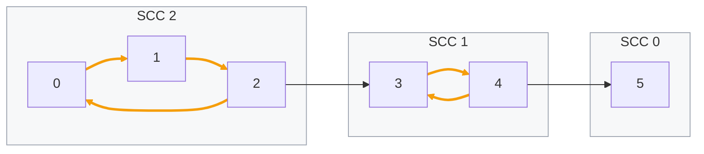

import ChapterProblems from '../../../components/ChapterProblems.astro';
import Figure from '../../../components/Figure.astro';
import InCode from '../../../components/InCode.astro';

Edges often mean "depends on", "uses", "calls" or "waits for". A [cycle](../glossary/#cycle) of
such edges needs attention. Packages on a cycle cannot be built one after the other. Functions that
call each other and grammar rules that use each other have to be analyzed together. Processes that
wait for each other in a cycle wait forever. The groups of nodes that [reach](../glossary/#reach)
each other are called [strongly connected components](../glossary/#strongly-connected-component).

## Problems in this chapter

<ChapterProblems />

The examples of this chapter use the grammar of a small programming language, whose rules use each
other: a statement can contain statements, and an expression can contain expressions. They also use
a small program: the dependencies between its packages, and the control flow of its method
<InCode java="load" rust="load" ts="load" csharp="Load" />.

## Reaching each other

A node `a` reaches a node `b` if a [path](../glossary/#path) of edges leads
from `a` to `b`. Two nodes are *strongly connected* if each reaches the other - that is, if a cycle
runs through both. A strongly connected component (SCC for short) is a group of nodes in which
every node reaches every other. The group is as large as it can be: no node outside it reaches its
nodes and is reached by them.

<Figure legend={{ contextGroup: 'SCC' }}>

</Figure>

Here, nodes `0`, `1` and `2` reach each other through the cycle `0 -> 1 -> 2 -> 0`, and so do
`3` and `4`. Node `2` reaches `3`, but `3` does not reach `2`: they are in different SCCs.
Node `5` lies on no cycle and is an SCC of its own.

Three facts follow from the definition, and the problems of this chapter build on them:

- **Every node is in exactly one SCC.** A node that lies on no cycle forms an SCC of one node.
- **Every cycle lies inside one SCC.** The orange edges lie on a cycle, and they never leave their
  frame.
- **Between the SCCs, there are no cycles.** If two SCCs reached each other, they would be one.
  So the SCCs, taken as nodes, form a [DAG](../glossary/#dag) (directed acyclic graph). This DAG is
  called the [condensed graph](../glossary/#condensed-graph). The SCCs can be put in an order that
  follows its edges: here SCC 2, then SCC 1, then SCC 0.

## A graph that is one SCC

If the whole graph is one SCC, every node reaches every other: the graph is *strongly connected*.
Inside an SCC, some edges and nodes may be indispensable: without one of them, the SCC splits into
several. These are its
[strong bridges and strong articulation points](../glossary/#strong-bridge-and-strong-articulation-point).
In the picture, every edge of SCC 2 is a strong bridge, and so is each of the two edges of SCC 1.
Nodes 0, 1 and 2 are strong articulation points. Nodes 3 and 4 are not, since without one of them
the other still forms an SCC.
