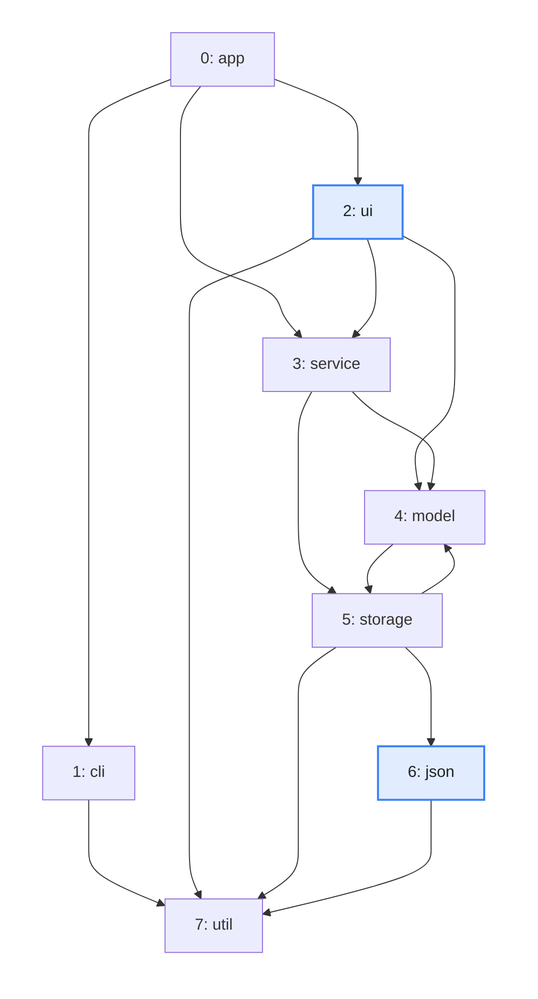
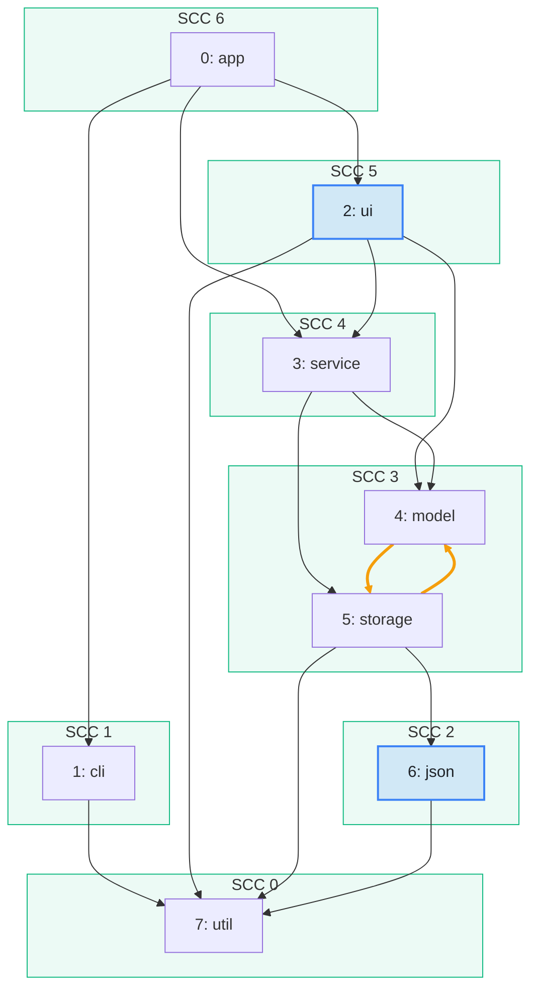

import Example from '../../../components/Example.astro';
import Api from '../../../components/Api.astro';
import Compare from '../../../components/Compare.astro';

:::note[In short]
- <Api ref="Components.sccsOf(Graph)" /> numbers the
  [SCCs](../../glossary/#strongly-connected-component) (strongly connected components) so that every
  edge between two of them goes from the higher SCC ID to the lower one.
- If you go through the SCC IDs from 0 upward, every SCC comes after the SCCs its nodes depend on.
- The nodes of one SCC depend on each other and come together.
:::

## Problem

You need an order in which every node comes after the nodes it depends on. But the graph has
[cycles](../../glossary/#cycle), so there is no [topological
order](../../glossary/#topological-order). For a graph without cycles, see [Put the nodes in
dependency order](../../order-and-cycles/topological-order/). The nodes on a cycle cannot be ordered
among themselves, so they have to be handled together. The other nodes can still be ordered before
and after such a group. You need this for:

- a build, in which packages that use each other are built together;
- the initialization of modules or services that refer to each other;
- the evaluation of formulas that refer to each other: a group of formulas that does so in a cycle
  is computed together, again and again until its values no longer change.

## Example

The example graph `dependencies` models the dependencies between the packages of a small program. It
has an edge from each package to each package it uses. The array `names` holds the names of the
packages. `model` and `storage` use each other, so no order puts each package after all packages it
uses. In which order can the packages be built? The picture after shows the SCCs in green frames,
with their IDs. `util` comes first and `app` comes last. `model` and `storage` come together: the
two orange edges of their cycle lie inside one frame.

<Compare
  before="The packages and their dependencies"
  after="The SCCs, numbered in dependency order"
  legend={{ inputNode: 'Package asked about', outputGroup: 'SCC' }}
>

</Compare>

## Solution

The SCC IDs are already the order:

<Example java="guide/OrderingDespiteCycles.java#buildOrder" />

The result lists the packages SCC by SCC, in the order of the SCC IDs of the picture after. Each
package comes after the packages it uses. The exception is the one SCC of two packages, which must
be built together. To compare the positions of two packages, compare their SCC IDs: `json` comes
before `ui`.

## Good to know

- **Why the IDs are an order.** <Api ref="Components.sccsOf(Graph)" /> numbers the SCCs so that
  every edge between two SCCs goes from the higher SCC ID to the lower one: SCC 0 has no edge to
  another SCC. On edges that mean "uses" or "depends on", the IDs from 0 upward are therefore an
  order in which every SCC comes after the SCCs it uses. That order is the reverse of a topological
  order of the SCCs.
- **Without cycles.** In a [DAG](../../glossary/#dag) (directed acyclic graph), every SCC is a
  single node, and the SCC IDs order the nodes themselves. That order is the reverse of a
  topological order.
- **The [condensed graph](../../glossary/#condensed-graph).** See
  [Condense each group into one node to get a DAG](../condense-to-dag/) for when you need its
  edges and not just the order.
