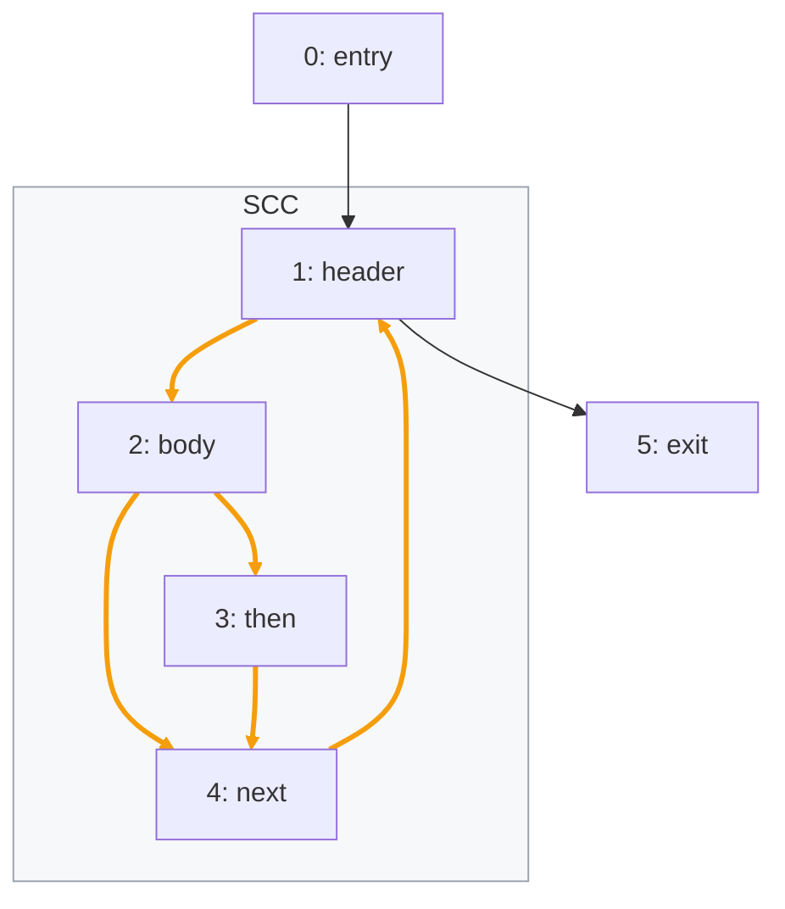
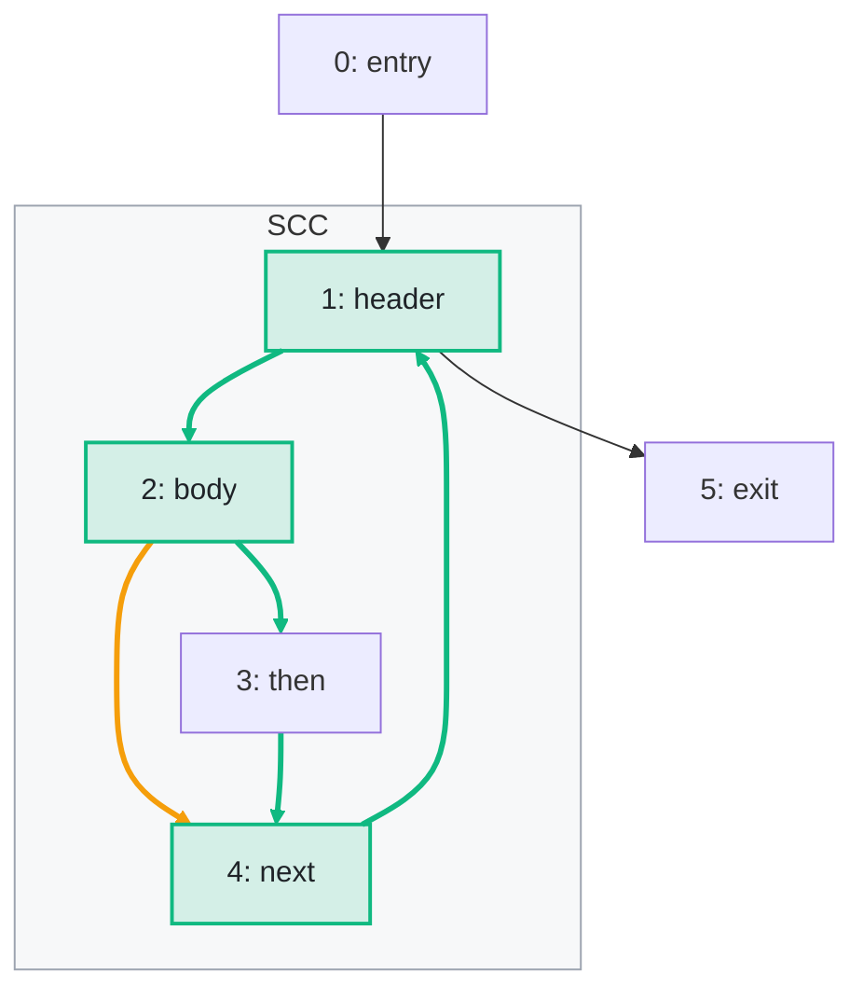

import Example from '../../../components/Example.astro';
import Api from '../../../components/Api.astro';
import Compare from '../../../components/Compare.astro';
import Program from '../../../components/Program.astro';
import InCode from '../../../components/InCode.astro';

:::note[In short]
- <Api ref="Components.strongConnectivityOf(BiAdjacentGraph)" /> finds the edges and nodes whose
  removal splits a [strongly connected component](../../glossary/#strongly-connected-component).
- <Api ref="StrongConnectivity.strongBridges()" /> returns these edges, which are called
  [strong bridges](../../glossary/#strong-bridge-and-strong-articulation-point).
- <Api ref="StrongConnectivity.strongArticulationPoints()" /> returns these nodes, which are called
  strong articulation points.
:::

## Problem

You have a group of nodes in which every node [reaches](../../glossary/#reach) every other, and you
want to know which edges and nodes keep it that way. If no further node can join the group, it is an
SCC (strongly connected component). Some edges and nodes are indispensable: without one of them,
some nodes of the SCC no longer reach the others, and the SCC splits into several. An indispensable
edge is called a strong bridge. An indispensable node is called a strong articulation point. You
need them wherever an SCC should stay one:

- a network of one-way connections: they are its single points of failure;
- a [loop](../../glossary/#loop) of a [control-flow graph](../../glossary/#control-flow-graph): they
  are the edges and blocks without which the blocks of the loop no longer reach each other;
- a group of modules that depend on each other in a [cycle](../../glossary/#cycle): they are the
  dependencies and modules whose removal splits the group.

## Example

The method <InCode java="load" rust="load" ts="load" csharp="Load" /> of a small program reads the
lines of a file and parses each line that is not blank into a note:

<Program name="load" />

The graph `cfg` holds its control flow. This control-flow graph has a node for each
[basic block](../../glossary/#basic-block). Its loop consists of `header`, `body`, `then` and
`next`. The loop is an SCC, which is the gray frame. Every edge inside it lies on a cycle and is
orange. Which edges and blocks does the loop need so that its blocks still reach each other? The
picture after shows the strong bridges as green edges and the strong articulation points as green
blocks. `body -> next` stays orange, since it lies on a cycle but is not a strong bridge.

<Compare
  before="The control flow and its loop"
  after="Strong articulation points and bridges of the loop"
  legend={{ contextGroup: 'SCC', outputNode: 'Strong articulation point', outputEdge: 'Strong bridge' }}
>

</Compare>

## Solution

The analysis follows edges against their direction as well, so it takes a
<Api ref="BiAdjacentGraph" />, which <Api ref="BiAdjacentGraph.of(Graph)" /> builds:

<Example java="guide/SplittingGroups.java#strongConnectivity" />

The result has four strong bridges and three strong articulation points. They are the green edges
and blocks of the picture after. Without any of the four edges of the cycle
`header -> body -> then -> next -> header`, the loop is no longer one SCC. Without `body -> next`,
it still is, since the [path](../../glossary/#path) `body -> then -> next` remains. Likewise,
without the block `then`, the other three blocks still reach each other through `body -> next`.
Without `header`, `body` or `next`, they do not.

## Good to know

- **Only inside SCCs.** Strong bridges lie inside SCCs of two or more nodes. Strong articulation
  points lie inside SCCs of three or more: without one node of an SCC of two, the other node still
  forms one SCC. A graph without cycles has neither, and a [self-loop](../../glossary/#self-loop)
  is never a strong bridge.
- **Two directions, two edges.** The edges `a -> b` and `b -> a` count as two edges here, and both
  are strong bridges of the SCC they form.
- **Undirected counterparts.** In the [undirected reading](../../glossary/#undirected-reading),
  where the direction does not matter,
  [bridges and articulation points](../../glossary/#bridge-and-articulation-point) play the same
  role. See [Find the edges and nodes whose removal splits a graph](../../undirected/bridges/).
- **Whether the graph is one SCC at all.** See
  [Check whether every node reaches every other](../strongly-connected/).
