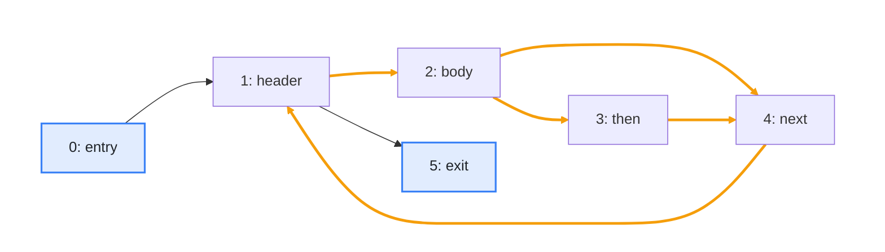
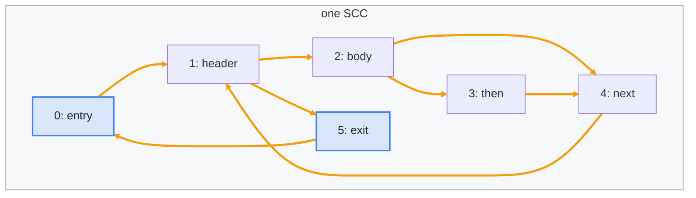

import Example from '../../../components/Example.astro';
import Api from '../../../components/Api.astro';
import Compare from '../../../components/Compare.astro';
import Program from '../../../components/Program.astro';
import InCode from '../../../components/InCode.astro';

:::note[In short]
- <Api ref="Graphs.isStronglyConnected(Graph)" /> tells whether every node of a graph
  [reaches](../../glossary/#reach) every other.
- If you have the [SCCs](../../glossary/#strongly-connected-component) (strongly connected
  components) anyway, <Api ref="Sccs.isStronglyConnected()" /> answers it from them.
:::

## Problem

You want to be sure that from every node of a graph you can get to every other node. A graph with
this property is called strongly connected. It forms a single SCC. You need this for:

- a network of one-way streets, in which every place must be reachable from every other;
- the states of a protocol or of a user interface: each state must be reachable from the start, and
  the start must be reachable again from each state;
- a [control-flow graph](../../glossary/#control-flow-graph), in which every block should be
  reachable from the [entry](../../glossary/#entry-and-exit) and reach the exit. With an extra edge
  from the exit to the entry, this is the same check.

## Example

The method <InCode java="load" rust="load" ts="load" csharp="Load" /> of a small program reads the
lines of a file and parses each line that is not blank into a note:

<Program name="load" />

The graph `cfg` holds its control flow. This control-flow graph has a node for each
[basic block](../../glossary/#basic-block), from its entry `entry` to its exit `exit`. Is every
block reachable from `entry`, and does every block reach `exit`? If so, every block can run, and
from every block the method can return. With an extra edge from `exit` back to `entry`, this is the
same as asking whether the graph is strongly connected. In the picture before, only the orange edges
of the [loop](../../glossary/#loop) lie on a [cycle](../../glossary/#cycle). The picture after adds
the edge `exit -> entry`. Now every edge lies on a cycle, and all blocks form one SCC, which is the
gray frame.

<Compare
  before="The control flow and its loop"
  after="One SCC, with an edge from exit to entry"
  legend={{ inputNode: 'End of the extra edge', contextGroup: 'SCC' }}
>

</Compare>

## Solution

<Api ref="Graphs.isStronglyConnected(Graph)" /> checks the control-flow graph as it is. Then it
checks the graph with the extra edge, which a <Api ref="GraphBuilder" /> adds to a copy of it:

<Example java="guide/CheckingStrongConnectivity.java#stronglyConnected" />

The control flow of <InCode java="load" rust="load" ts="load" csharp="Load" /> alone is not strongly
connected: no edge leads to `entry`, so no other block reaches it. With the extra edge it is
strongly connected: every block lies on a cycle through `entry` and `exit`, as the picture after
shows.

## Good to know

- **Why the trick works.** With the edge `exit -> entry`, a block that `entry` reaches and that
  reaches `exit` lies on a cycle through both, so any two such blocks reach each other. A block
  that `entry` does not reach, or that does not reach `exit`, has no such cycle, and the check
  fails.
- **Several exits.** A method that returns in several places has several exits: add an edge from
  each of them to the entry. The graph is then strongly connected exactly when every block is
  reachable from the entry and reaches one of the exits.
- **Which blocks fail the check?** <Api ref="Graphs.reachableFrom(Graph, int)" /> gives the blocks
  that `entry` reaches. A block missing from them never runs. See
  [Find everything a node reaches](../../reachability/reachable-from/). A search against the
  direction of the edges gives the blocks that reach `exit`. From a block missing from them, the
  method never returns. See [Find everything that reaches a node](../../reachability/reaching/).
  See [Find the groups of nodes that reach each other](../find-mutual-dependencies/) for the SCCs of
  any graph that fails the check.
- **Which edges and blocks keep it so.**
  <Api ref="Components.strongConnectivityOf(BiAdjacentGraph)" /> finds the edges and blocks without
  which the graph is no longer strongly connected. See [Find the edges and nodes whose removal
  splits a strongly connected component](../strong-bridges/).
- **The empty graph** counts as strongly connected, and so does a graph of a single node.
