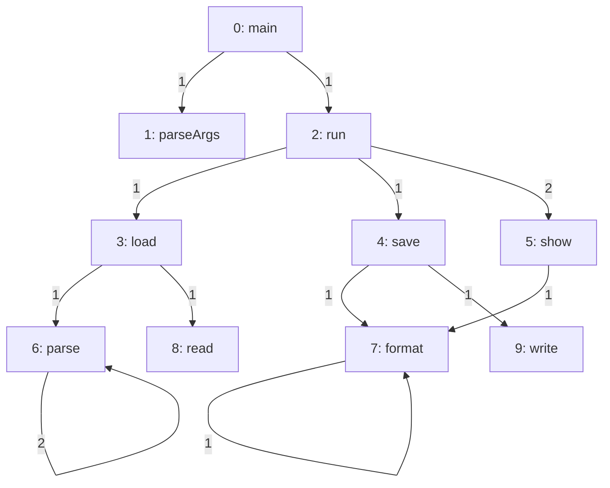
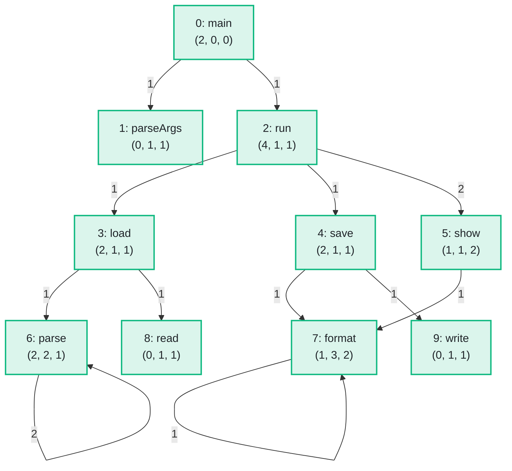

import Example from '../../../components/Example.astro';
import Api from '../../../components/Api.astro';
import Compare from '../../../components/Compare.astro';
import Gap from '../../../components/Gap.astro';
import InCode from '../../../components/InCode.astro';

:::note[In short]
- <Api ref="Csr.outAdjacency(Graph)" /> returns the graph's own array with the
  [out-nodes](../../glossary/#out-node-and-in-node) of all nodes, node after node.
- <Api ref="Csr.outAdjacencyStart(Graph)" /> returns the graph's own array of the positions where
  the out-nodes of each node start, followed by the edge count.
- <Api ref="Csr.inAdjacency(BiAdjacentGraph)" /> and
  <Api ref="Csr.inAdjacencyStart(BiAdjacentGraph)" /> do the same for the in-nodes.
:::

## Problem

You want a loop over all edges to run as fast as it can. A graph keeps its edges in two arrays, so
your loop can read these arrays directly, with no method call and no argument check per edge. On
graphs with millions of edges, this saves noticeable time. You need this for:

- a sum or a count over the edges of each node;
- an iterative algorithm, such as a ranking of the nodes, that visits every edge again and again;
- an export of a graph into the format of another program.

## Example

The example graph `calls` models the calls between the ten methods of a small program. It has an
edge from each method to each method it calls. A place in the code where one method calls another is
called a call site. The array
<InCode java="siteCount" rust="site_count" ts="siteCount" csharp="siteCount" /> holds the number of
call sites of each call. How many call sites does the code of each method have? How many methods
call each method? From how many places in other methods is each method called? The picture before
shows the number of call sites on each call. The picture after shows three numbers in brackets for
each method: the call sites in its code, its callers, and the call sites in other methods that call
it:

<Compare
  before="The calls with their call sites"
  after="The call sites in the code of each method, its callers, and the call sites in other methods"
  legend={{ outputNode: 'Method (sites in it, callers, sites in others)' }}
>

</Compare>

## Solution

The two arrays are the graph's [CSR layout](../../glossary/#csr-layout) (compressed sparse row).
See [Use arrays you already have as a graph](../../basics/from-arrays/). The out-nodes of node `v`
stand from position `start[v]` up to just before position `start[v + 1]`. The array of starts has
one entry more than the graph has nodes. This last entry is the edge count, so the rule holds for
the last node too. The position of an out-node in its array is the
[edge index](../../glossary/#edge-index) of its edge, so the edge data is at the same position:

<Example java="guide/WritingSearches.java#arrays" />

<InCode java="sitesIn" rust="sites_in" ts="sitesIn" csharp="sitesIn" /> sums the call sites of the
calls each method makes.
<InCode java="callerCount" rust="caller_count" ts="callerCount" csharp="callerCount" /> counts how
often each method is the [target](../../glossary/#source-and-target) of an edge. The in-nodes come
from a <Api ref="BiAdjacentGraph" />, which <Api ref="BiAdjacentGraph.of(Graph)" /> builds from the
graph. Their positions are edge indices of the
[transposed graph](../../glossary/#transposed-graph). So
<Api ref="EdgeMapping.gather(int[])" label="gather" /> first carries the call sites over to them,
with the [mapping](../../glossary/#mapping) from <Api ref="Graphs.transposedEdgeMapping(Graph)" />.
<InCode java="sitesFromOthers" rust="sites_from_others" ts="sitesFromOthers" csharp="sitesFromOthers" /> then sums
for each method the call sites in other methods: `show` is called from two places in `run`.

## Good to know

- **Never write to the arrays**, even where their type allows it. They are the graph's own arrays,
  not copies. Everyone who uses the graph shares them, so a write would change the graph for
  everyone.
- **Positions in the array of in-nodes** are edge indices of the transposed graph, not of the graph.
  See [Turn every edge around](../../transforming/transpose/) for how to translate them.
- **A few nodes?** For the [outgoing edges](../../glossary/#outgoing-and-incoming-edge) of one node,
  <Api ref="Graph.outEdgeStart(int)" /> and <Api ref="Graph.outEdgeEnd(int)" /> give the same range,
  with checked arguments.
- **Simpler, with a call per edge.** <Api ref="Graph.forEachEdge(EdgeConsumer)" /> visits every
  edge with its source, its target and its edge index. See
  [Keep data on nodes and edges](../../basics/keep-data/).
