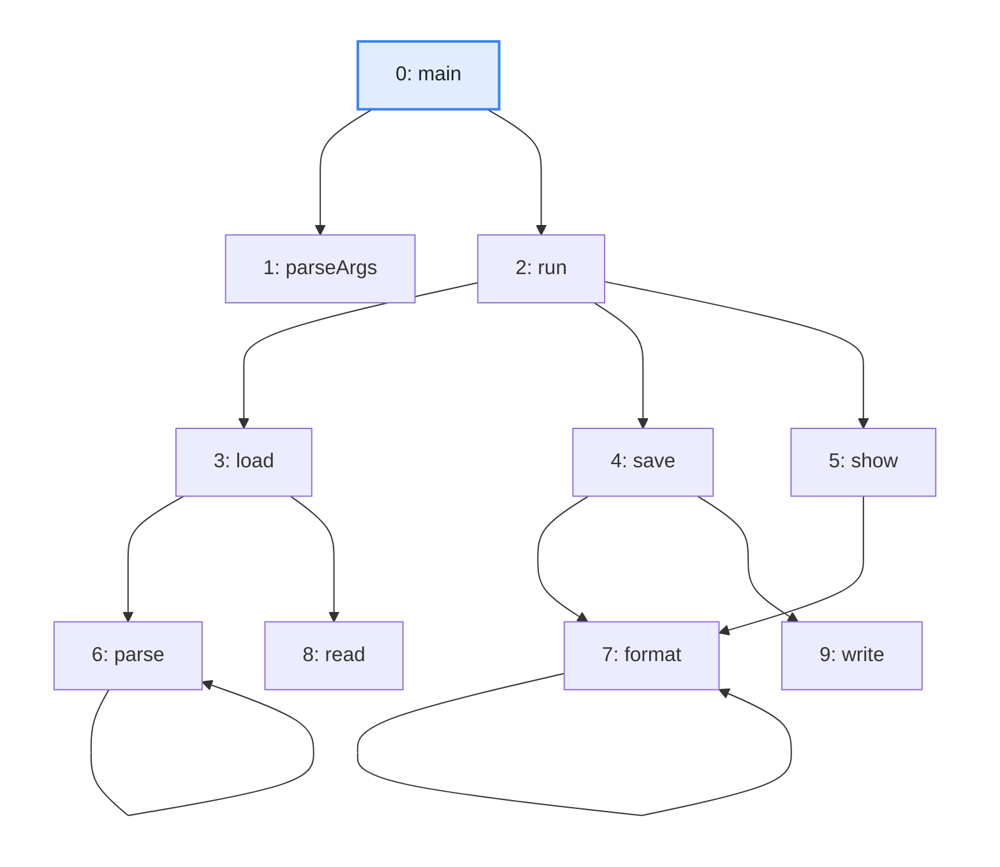
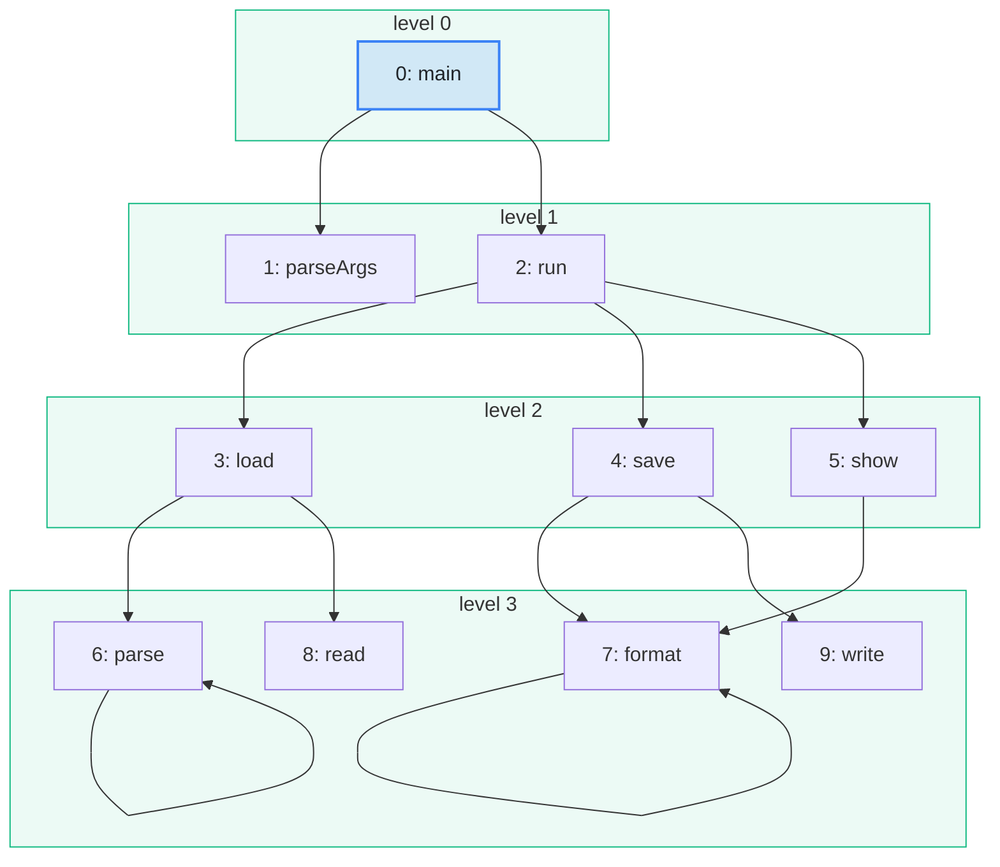

import Example from '../../../components/Example.astro';
import Api from '../../../components/Api.astro';
import Compare from '../../../components/Compare.astro';
import Gap from '../../../components/Gap.astro';
import InCode from '../../../components/InCode.astro';

:::note[In short]
- <Api ref="FrontierTraverser" /> works off a queue of nodes and calls your
  <Api ref="FrontierTraverser.visitNode(int)" /> for each node in it. The queue is called its
  frontier.
- <Api ref="FrontierTraverser.enqueueChildren(int)" /> puts the
  [out-nodes](../../glossary/#out-node-and-in-node) of a node into the queue, which makes the search
  a [breadth-first search](../../glossary/#breadth-first-search).
- <Api ref="FrontierTraverser.leaveLevel(int)" /> is called after each
  [level](../../glossary/#level).
:::

## Problem

You want a search that goes outward from a start node: first every node one edge away, then every
node two edges away, and so on. The nodes at the same [distance](../../glossary/#distance) from the
start node form a level. Often only some nodes should be followed further, or the search should stop
at a certain level. You need this for:

- the methods at each call depth from `main`;
- the people a message [reaches](../../glossary/#reach) in each round of forwarding;
- the nodes within a certain distance of a node.

## Example

The example graph `calls` models the calls between the ten methods of a small program. It has an
edge from each method to each method it calls. The array `names` holds the names of the methods.
Which methods lie at which call depth from `main` - one call away, two calls away, and so on? The
call depth of a method is its level in a breadth-first search from `main`. The picture after frames
the methods by level:

<Compare
  before="The calls between the methods"
  after="The levels from main"
  legend={{ inputNode: 'Start node', outputGroup: 'Level' }}
>

</Compare>

## Solution

<Example java="guide/WritingSearches.java#frontier" />

<InCode java="levels" rust="levels" ts="levels" csharp="Levels" /> holds a list of methods per
level, as in the picture after: `main` at level 0; `parseArgs` and `run` at level 1; `load`, `save`
and `show` at level 2; the four methods they call at level 3. Within a level, the methods come in
the order in which they entered the queue.

## Good to know

- **Visited once.** A node counts as visited when it enters the queue. So it is visited at most
  once, at the level where the search first meets it. `format` is called by `save` and by `show`,
  and it appears once. <Api ref="FrontierTraverser.isVisited(int)" /> tells whether a node is
  visited.
- **Not only breadth-first.** <Api ref="FrontierTraverser.enqueue(int)" /> puts a single node into
  the queue. So the hook chooses which nodes enter it, and they need not be out-nodes. They are
  visited in the order in which they entered, after the rest of the current level.
  <Api ref="FrontierTraverser.currentLevel()" /> tells the level of the node being visited, so you
  can stop at a certain level. <Api ref="FrontierTraverser.stop()" /> ends the run.
- **Where to start.** <Api ref="FrontierTraverser.run(int)" label="FrontierTraverser.run(int)" />
  starts at one node.
  <Api ref="FrontierTraverser.run(IntList)" label="FrontierTraverser.run(IntList)" /> starts at
  several nodes, which together form level 0.
  <Api ref="FrontierTraverser.run()" label="FrontierTraverser.run()" /> starts at every node not
  visited yet. The visited nodes add up over the runs of one traverser.
- **Distances and [paths](../../glossary/#path)** come ready-made. See
  [Find a shortest path between two nodes](../../reachability/shortest-path/).

<Gap>
Visit the nodes in an order of your own, given by a priority. An example is a best-first search that
always goes on with the most promising node. The queue of <Api ref="FrontierTraverser" /> is first
in, first out: a hook chooses which nodes enter it, not in which order they leave it.
</Gap>
