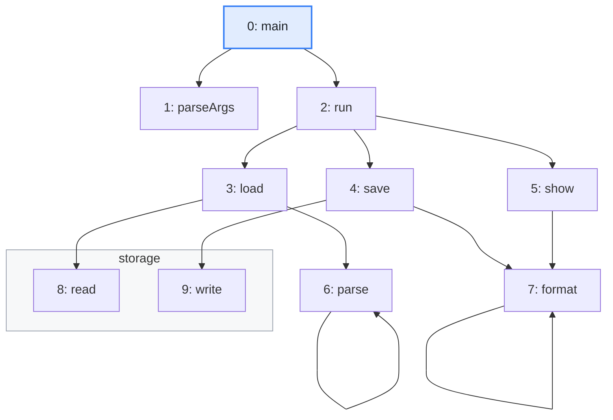
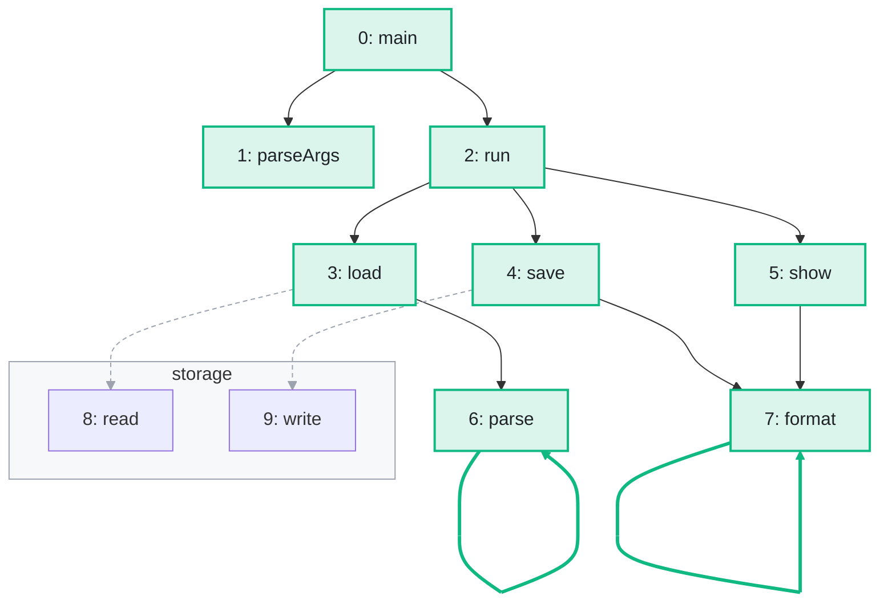

import Example from '../../../components/Example.astro';
import Api from '../../../components/Api.astro';
import Compare from '../../../components/Compare.astro';
import Gap from '../../../components/Gap.astro';
import InCode from '../../../components/InCode.astro';

:::note[In short]
- <Api ref="DfsEdgeTraverser" /> runs a [depth-first search](../../glossary/#depth-first-search) and
  reports every edge to your
  <Api ref="DfsEdgeTraverser.visitEdge(int, int, int, DfsEdgeTraverser.TargetState)" />, with the
  state of its [target](../../glossary/#source-and-target): not visited yet, on the current
  [path](../../glossary/#path), or finished.
- The hook returns <InCode java="DESCEND" rust="Descend" ts="EdgeAction.DESCEND" csharp="Descend" /> to follow the edge,
  <InCode java="SKIP" rust="Skip" ts="EdgeAction.SKIP" csharp="Skip" /> to ignore it, or <InCode java="STOP" rust="Stop" ts="EdgeAction.STOP" csharp="Stop" /> to end the
  run.
:::

## Problem

You want a depth-first search that decides for each edge whether to follow it. You may also want to
notice on the way the edges that close a [cycle](../../glossary/#cycle). A search that reports only
nodes cannot do that. You need this for:

- calls followed only within a module, or dependencies only of a certain kind;
- links followed only where a filter accepts them;
- the edges that close a cycle, reported while the search runs.

## Example

The example graph `calls` models the calls between the ten methods of a small program. It has an
edge from each method to each method it calls. The array `names` holds the names of the methods. The
methods belong to packages. The array
<InCode java="packageOf" rust="package_of" ts="packageOf" csharp="packageOf" /> holds the package of
each method. `read` and `write` belong to the package `storage`, which the gray frame shows. Which
methods does `main` [reach](../../glossary/#reach) without calling into `storage`, and which calls
on the way close a cycle? The picture after shows the methods the search reaches, the calls into
`storage` that the hook skips, and the calls that close a cycle:

<Compare
  before="The calls between the methods"
  after="The methods reached without storage, and the calls that close a cycle"
  legend={{
    inputNode: 'Start node',
    contextGroup: 'Package',
    omittedEdge: 'Skipped call into storage',
    outputNode: 'Reached method',
    outputEdge: 'Call that closes a cycle',
  }}
>

</Compare>

## Solution

<Example java="guide/WritingSearches.java#dfsEdges" />

<InCode java="reached" rust="reached" ts="reached" csharp="Reached" /> lists eight methods, in the
order in which the search enters them. `read` and `write` are missing because the hook skips the
calls to them. The calls `parse -> parse` and `format -> format` lead to a method on the current
path. They close a cycle, and
<InCode java="recursive" rust="recursive" ts="recursive" csharp="Recursive" /> lists them.

## Good to know

- **The default** follows an edge to a target not visited yet and skips any other edge.
  <InCode java="super.visitEdge(...)" rust="EdgeAction::default_for(state)" ts="super.visitEdge(...)" csharp="base.VisitEdge(...)" /> returns this
  default, as at the end of the hook in the example.
- **States.** <InCode java="ON_STACK" rust="OnStack" ts="TargetState.ON_STACK" csharp="OnStack" />
  means that the target is on the current path, so the edge closes a cycle. Such an edge is a
  [back edge](../../glossary/#tree-back-forward-and-cross-edge).
  <InCode java="FINISHED" rust="Finished" ts="TargetState.FINISHED" csharp="Finished" /> means that
  the search has left the target already. It does not tell a forward edge from a cross edge. To tell
  them apart, see [Classify the edges of a depth-first search](../../order-and-cycles/edge-types/).
- **Edge data.** The [edge index](../../glossary/#edge-index) comes with every edge, so you can read
  the data in your arrays.
- **As in a depth-first search of nodes.** See
  [Write a depth-first search without recursion](../dfs/) for that search.
  <Api ref="DfsEdgeTraverser.leaveNode(int)" label="leaveNode" />,
  <Api ref="DfsEdgeTraverser.isVisited(int)" label="isVisited" />,
  <Api ref="DfsEdgeTraverser.isOnStack(int)" label="isOnStack" /> and
  <Api ref="DfsEdgeTraverser.stop()" label="stop" /> work the same way here. So do the runs:
  <Api ref="DfsEdgeTraverser.run(int)" label="run(int)" /> from one start node,
  <Api ref="DfsEdgeTraverser.run(IntList)" label="run(IntList)" /> from several and
  <Api ref="DfsEdgeTraverser.run()" label="run()" /> from every node not visited yet. Where hooks
  for the nodes suffice, <Api ref="DfsTraverser" /> is faster.
