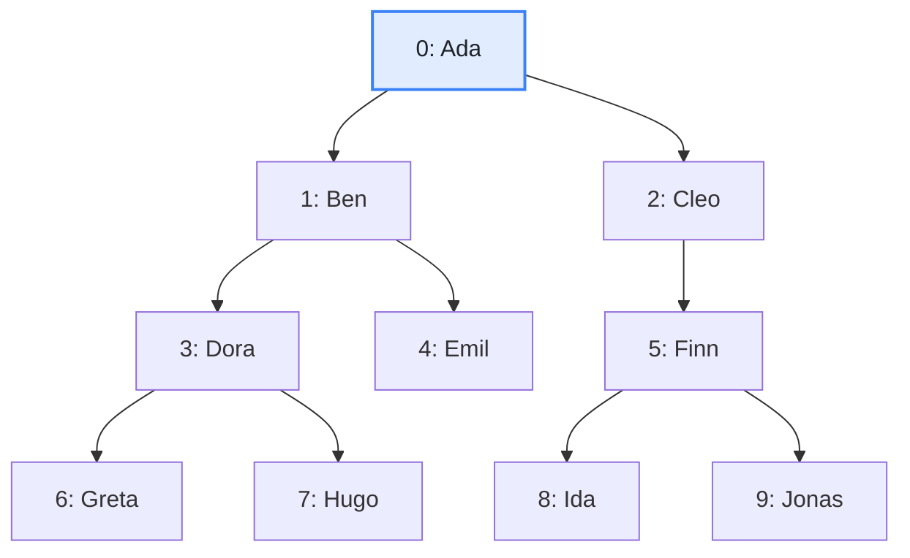
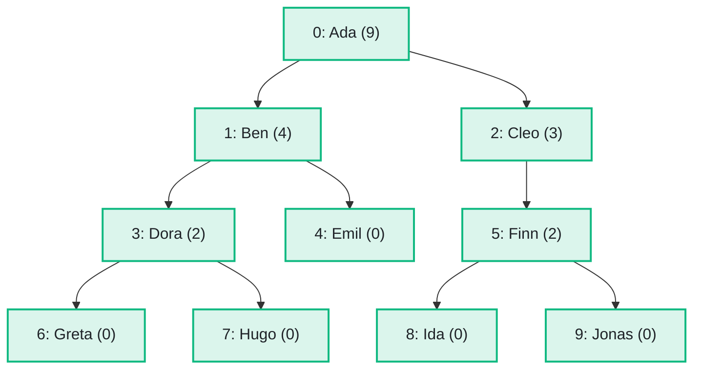

import Example from '../../../components/Example.astro';
import Api from '../../../components/Api.astro';
import Compare from '../../../components/Compare.astro';
import Gap from '../../../components/Gap.astro';
import InCode from '../../../components/InCode.astro';

:::note[In short]
- <Api ref="DfsTraverser" /> runs a [depth-first search](../../glossary/#depth-first-search) without
  recursion and calls your <Api ref="DfsTraverser.enterNode(int)" /> when it
  [reaches](../../glossary/#reach) a node.
- <Api ref="DfsTraverser.leaveNode(int)" /> is called when the search leaves the node, after
  everything it reached from there.
- <Api ref="DfsTraverser.run(int)" label="DfsTraverser.run(int)" /> searches from a start node.
:::

## Problem

You want to go through a graph and compute something on the way. Many such computations can be
written as a depth-first search with some code of your own. Written recursively, they overflow the
call stack on deep graphs, such as a long chain of calls or a deeply nested syntax
[tree](../../glossary/#tree-and-forest). You need this for:

- a value of each node computed from the values of its
  [out-nodes](../../glossary/#out-node-and-in-node), such as the sizes of
  [subtrees](../../glossary/#subtree-and-preorder) or costs;
- the nodes in the order in which the search finishes them, such as each method after the methods it
  calls, if the calls have no [cycle](../../glossary/#cycle);
- a search that stops at the first node that matches.

## Example

The example graph `family` models a family tree with one [parent](../../glossary/#parent-and-child)
per person, over four generations. It has an edge from each parent to each child. `Ada` is the
[root](../../glossary/#root-node), and her children are `Ben` and `Cleo`. How many
[descendants](../../glossary/#ancestor-and-descendant) does each person have? These are the person's
children, grandchildren and so on, without the person. The picture after shows the counts in
brackets:

<Compare
  before="The family tree"
  after="The number of descendants of each person"
  legend={{ inputNode: 'Start node', outputNode: 'Person with the number of descendants' }}
>

</Compare>

## Solution

<Api ref="DfsTraverser.leaveNode(int)" label="leaveNode" /> is called after the search has finished
the subtree of a node, so the counts of its children are ready:

<Example java="guide/WritingSearches.java#dfs" />

<InCode java="count" rust="count" ts="count" csharp="Count" /> holds the number of descendants of
each person: 9 for `Ada`, 4 for `Ben`, 3 for `Cleo`, and 0 for each person without children, as in
the picture after.

## Good to know

- **Where to start.** <Api ref="DfsTraverser.run(int)" label="DfsTraverser.run(int)" /> starts at
  one node. <Api ref="DfsTraverser.run(IntList)" label="DfsTraverser.run(IntList)" /> starts at
  several nodes in turn. <Api ref="DfsTraverser.run()" label="DfsTraverser.run()" /> starts at every
  node not visited yet, in ascending order. The visited nodes add up over the runs of one traverser:
  a later run skips the nodes that an earlier one visited.
- **Pruning.** <Api ref="DfsTraverser.enterNode(int)" label="enterNode" /> returns whether to search
  from the out-nodes of a node, and `false` skips them. In a tree, that skips the subtrees of its
  children. In other graphs, the search may still reach those nodes from another node.
- **State.** <Api ref="DfsTraverser.isVisited(int)" /> tells whether the search has reached a node.
  <Api ref="DfsTraverser.isOnStack(int)" /> tells whether the node is on the current
  [path](../../glossary/#path). <Api ref="DfsTraverser.stop()" /> ends the run from a hook.
- **The order.** Out-nodes are searched in ascending order, so a graph always gives the same search.
- **Ready-made.** The number of descendants of a node in a tree is
  <Api ref="PreorderAncestry.subtreeSizeOf(int)" /> minus 1. See [List a node and all its
  descendants](../../trees/subtrees/). You may also want an order in which each method comes after
  the methods it calls, and in which the methods on a common cycle come together. See [Put the nodes
  in dependency order although the graph has cycles](../../sccs/order-despite-cycles/). A search of
  your own is for values that Graphity does not compute, such as a sum of your own data over each
  subtree.
- **Every edge.** To see the edges as well and decide which to follow, see
  [React to every edge of a depth-first search](../dfs-edges/).
