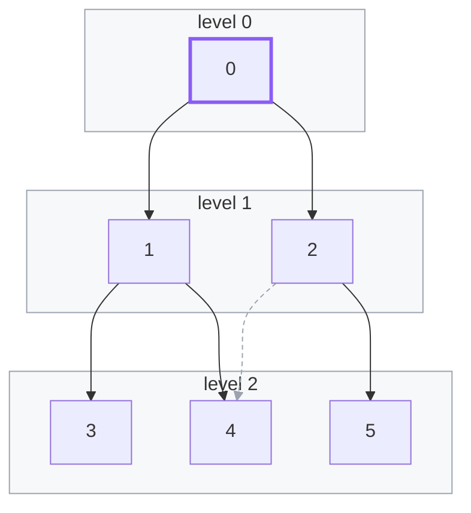

import Api from '../../../components/Api.astro';
import ChapterProblems from '../../../components/ChapterProblems.astro';
import Figure from '../../../components/Figure.astro';
import PerLanguage from '../../../components/PerLanguage.astro';

The algorithms of this guide cover the common questions. For the others, you write a search of your
own. It can, for example, collect what you need on the way, follow only some edges, or stop when you
have the answer. Graphity's traversers keep the stack or the queue and the visited nodes, and they
call your code at the right moments. They run without recursion, so that a deep graph does not
overflow the call stack.

## Problems in this chapter

<ChapterProblems />

The examples of this chapter use a family tree and the calls between the methods of a small program.

## Depth-first and breadth-first

A [depth-first search](../glossary/#depth-first-search) follows the
[outgoing edges](../glossary/#outgoing-and-incoming-edge) from a node as deep as it can before it
turns back. A [breadth-first search](../glossary/#breadth-first-search) visits the nodes in the
order of their [distance](../glossary/#distance) from the start node: first the start node, then
those one edge away, then those two edges away, and so on. Both visit each node at most once. Here,
both start at node 0:

<Figure legend={{ contextNode: 'Start node', contextGroup: 'Level', omittedEdge: 'Edge not followed' }}>

</Figure>

| node | 0 | 1 | 2 | 3 | 4 | 5 |
|---|---|---|---|---|---|---|
| depth-first: entered | 1st | 2nd | 5th | 3rd | 4th | 6th |
| depth-first: left | 6th | 3rd | 5th | 1st | 2nd | 4th |
| breadth-first: visited | 1st | 2nd | 3rd | 4th | 5th | 6th |

The depth-first search enters 3 and 4 from 1 and leaves both before it enters 2. It leaves 0 last.
Between entering and leaving, a node is on the current [path](../glossary/#path). That path is the
stack of the search.

The breadth-first search visits the nodes [level](../glossary/#level) by level. A level holds the
nodes at the same distance from the start node, and the frames show the levels. Neither search
follows the dashed edge `2 -> 4`: when they meet it, node 4 is visited already.

## Hooks

A traverser calls your code at certain moments of its search. These pieces of code are called hooks.
You start a traverser at the nodes you choose. Graphity has these traversers:

- <Api ref="DfsTraverser" /> goes depth-first. It calls one hook when it enters a node and another
  when it leaves the node, after everything the search [reached](../glossary/#reach) from there.
- <Api ref="DfsEdgeTraverser" /> goes depth-first as well. It also reports every edge with the state
  of its [target](../glossary/#source-and-target): not visited yet, on the current path, or
  finished. Your hook decides whether to follow the edge.
- <Api ref="FrontierTraverser" /> works off a first-in-first-out queue, level by level. It is the
  base of a breadth-first search, or of any search that chooses which nodes enter the queue.

<PerLanguage>

You write the hooks in a subclass of the traverser, as methods that override its own. The
traverser's protected methods tell the state of the search, such as whether a node is visited. They
also let you stop the search.

You write the hooks in a type of your own and pass it to the run. The type implements the trait of
the traverser: `DfsHooks`, `DfsEdgeHooks` or `FrontierHooks`. Each hook also receives a `DfsControl`
or a `FrontierControl`. Its methods tell the state of the search, such as whether a node is visited.
They also let you stop the search.

You write the hooks in a subclass of the traverser, as methods that override its own. The
traverser's protected methods tell the state of the search, such as whether a node is visited. They
also let you stop the search.

You write the hooks in a subclass of the traverser, as methods that override its own. The
traverser's protected methods tell the state of the search, such as whether a node is visited. They
also let you stop the search.

</PerLanguage>

The visited nodes add up over the runs of one traverser: a node is visited at most once in its
lifetime. A loop over all edges that needs no search at all reads the arrays of the graph directly.
