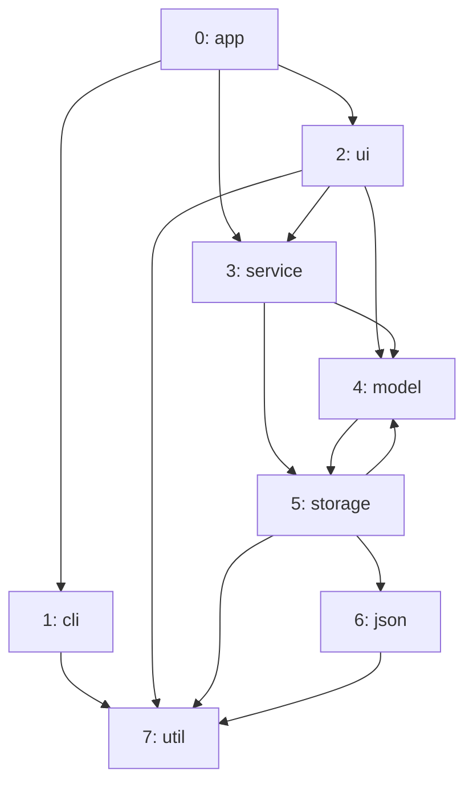
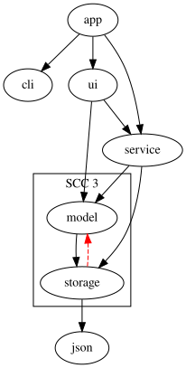

import Example from '../../../components/Example.astro';
import Api from '../../../components/Api.astro';
import Compare from '../../../components/Compare.astro';
import Gap from '../../../components/Gap.astro';
import InCode from '../../../components/InCode.astro';

:::note[In short]
- <Api ref="DotWriter.nodeAttributes(AttributeHook)" /> sets any DOT attribute of each node, by
  [node ID](../../glossary/#node-id).
- <Api ref="DotWriter.edgeAttributes(AttributeHook)" /> sets any DOT attribute of each edge, by
  [edge index](../../glossary/#edge-index).
- <Api ref="DotWriter.clusters(NodePartition, IntFunction)" /> draws the groups of a
  [partition](../../glossary/#partition-and-group) as frames.
- <Api ref="DotWriter.nodeFilter(IntPredicate)" /> leaves nodes out.
:::

## Problem

You want a picture of a graph that shows what an analysis found. A plain picture shows only the
graph. You choose the colors, line styles and frames, and the nodes to leave out, based on your data
and the results of your analyses. You need this for:

- a [cycle](../../glossary/#cycle), or the edges that close one, drawn in a color of their own;
- groups of nodes in frames, such as the [strongly connected
  components](../../glossary/#strongly-connected-component) or the classes of a package;
- nodes that only crowd the picture and are left out, such as a package of helpers that many
  packages use.

## Example

The example graph `dependencies` models the dependencies between the eight packages of a small
program. It has an edge from each package to each package it uses. The array `names` holds the names
of the packages:



`model` and `storage` use each other, so they lie on a cycle. They form an SCC (strongly connected
component) of their own: a group of nodes that reach each other, and that no further node can join.
See [Find the groups of nodes that reach each other](../../sccs/find-mutual-dependencies/). The
drawing should frame that SCC and draw the edge that closes the cycle dashed and red. It should also
leave out the package of helpers `util`, which four other packages use.

## Solution

<Example java="guide/ShowingGraphs.java#dotStyled" />

The partition passed to
<Api ref="DotWriter.clusters(NodePartition, IntFunction)" label="clusters" /> has a group for every
SCC, but only the group of the SCC with a cycle has nodes. Every other package is in no group and
stands outside any frame, and a group without nodes gets no frame. <Api ref="EdgeTypes.of(Graph)" />
classifies the edges in a [depth-first search](../../glossary/#depth-first-search). Its one [back
edge](../../glossary/#tree-back-forward-and-cross-edge) is `storage -> model`, which closes the
cycle. The writer returns this text:

```text
digraph {
  subgraph cluster_3 {
    label="SCC 3";
    4 [label="model"];
    5 [label="storage"];
  }
  0 [label="app"];
  1 [label="cli"];
  2 [label="ui"];
  3 [label="service"];
  6 [label="json"];
  0 -> 1;
  0 -> 2;
  0 -> 3;
  2 -> 3;
  2 -> 4;
  3 -> 4;
  3 -> 5;
  4 -> 5;
  5 -> 4 [style="dashed", color="red"];
  5 -> 6;
}
```

Graphviz draws it like this, with the SCC in its frame and without `util` and its edges:



## Good to know

- **The hook gets a map** with the label already in it, and adds or replaces attributes. The writer
  escapes the values and keeps their order.
- **Undirected graphs.** <Api ref="DotWriter.undirected()" /> writes a `graph` with `--` edges
  instead of a `digraph` with `->`, for graphs that stand for undirected ones. The edges `a -> b`
  and `b -> a` then become one edge.
- **Frames in Graphviz** are subgraphs whose name starts with `cluster`. The writer names them by
  group ID.
- **All frames alike.** The writer writes the attributes of the graph before the frames, and
  Graphviz passes them on to every frame:
  <Api ref="DotWriter.graphAttribute(String, String)" label="graphAttribute" /> with `color` and
  `blue` draws every frame blue.
- **In Mermaid**, the same works. See [Highlight nodes, edges and groups in
  Mermaid](../mermaid-styled/).

<Gap>
Give one frame attributes of its own:
<Api ref="DotWriter.clusters(NodePartition, IntFunction)" label="clusters" /> takes only a label per
frame, so frames in the colors of the groups they stand for cannot be written with it.
</Gap>
