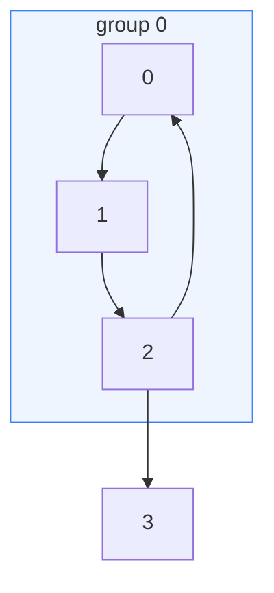
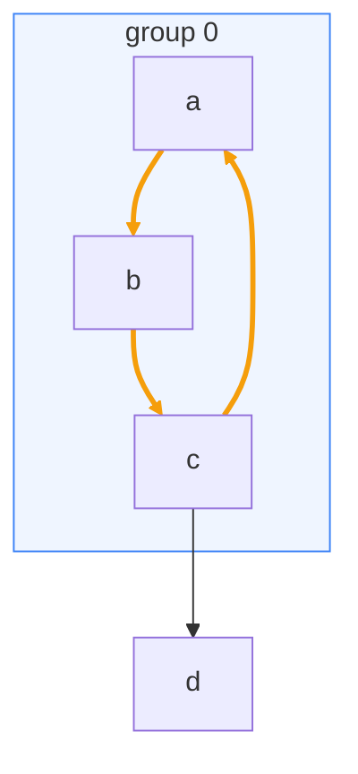

import Api from '../../../components/Api.astro';
import ChapterProblems from '../../../components/ChapterProblems.astro';
import Compare from '../../../components/Compare.astro';
import InCode from '../../../components/InCode.astro';

A picture of a graph shows at a glance what a list of edges hides, for example where the
[cycles](../glossary/#cycle) are, which nodes many edges lead to, or what an analysis found.
Graphviz and Mermaid are two widespread tools for such pictures.

## Problems in this chapter

<ChapterProblems />

The examples of this chapter use the steps that build a small program, the dependencies between its
packages, and the rules of a small grammar.

## Text and pictures

For logs and tests, text is enough. An [adjacency list](../glossary/#adjacency-list) shows a graph
in one line per node with its [out-nodes](../glossary/#out-node-and-in-node). For a picture,
Graphity writes the text that one of two tools draws:

- **Graphviz** is a program that lays out a graph and draws it as SVG, PNG or PDF. It reads a small
  text language called DOT and handles large graphs.
- **Mermaid** draws flowcharts from a short text inside Markdown, and many viewers render it without
  any extra tool, for example GitHub, many wikis and this guide. It draws graphs of up to a few
  hundred nodes well; for larger ones, use Graphviz.

## Writers

<Api ref="DotWriter" /> writes DOT, and <Api ref="MermaidWriter" /> writes Mermaid. A writer is
configured once and can write any number of times. The graph holds no data, so every label and style
comes from a function that receives a [node ID](../glossary/#node-id) or an [edge
index](../glossary/#edge-index) and reads your arrays, such as names or the results of an analysis.
The frames come from a [partition](../glossary/#partition-and-group) of the nodes into groups, with
a label for each group ID. The writers call a frame a cluster. Your data decides what the picture
shows. Here, the labels come from an array of names, and the frame comes from the partition in the
table below. The color of the edges comes from the result of an analysis that found the edges on a
cycle:

<Compare
  before="The graph with its node IDs and the group of the partition"
  after="Names, the group of the partition and the edges on a cycle"
  legend={{ inputGroup: 'Group of the partition' }}
>

</Compare>

| node ID | 0 | 1 | 2 | 3 |
|---|---|---|---|---|
| name (the label) | a | b | c | d |
| group of the partition (the frame) | 0 | 0 | 0 | none |

The writers are in libraries of their own:
<InCode java="graphity-dot" rust="graphity-dot" ts="@kobayami/graphity-dot" csharp="Graphity.Dot" /> and
<InCode java="graphity-mermaid" rust="graphity-mermaid" ts="@kobayami/graphity-mermaid" csharp="Graphity.Mermaid" />.
<InCode java="graphity" rust="graphity-all" ts="@kobayami/graphity" csharp="Graphity.All" />
includes both.
