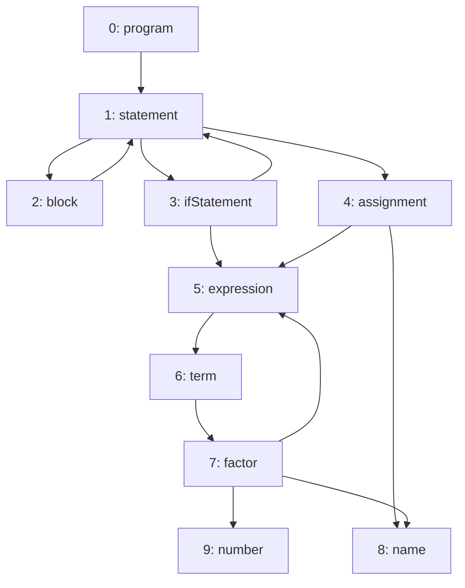
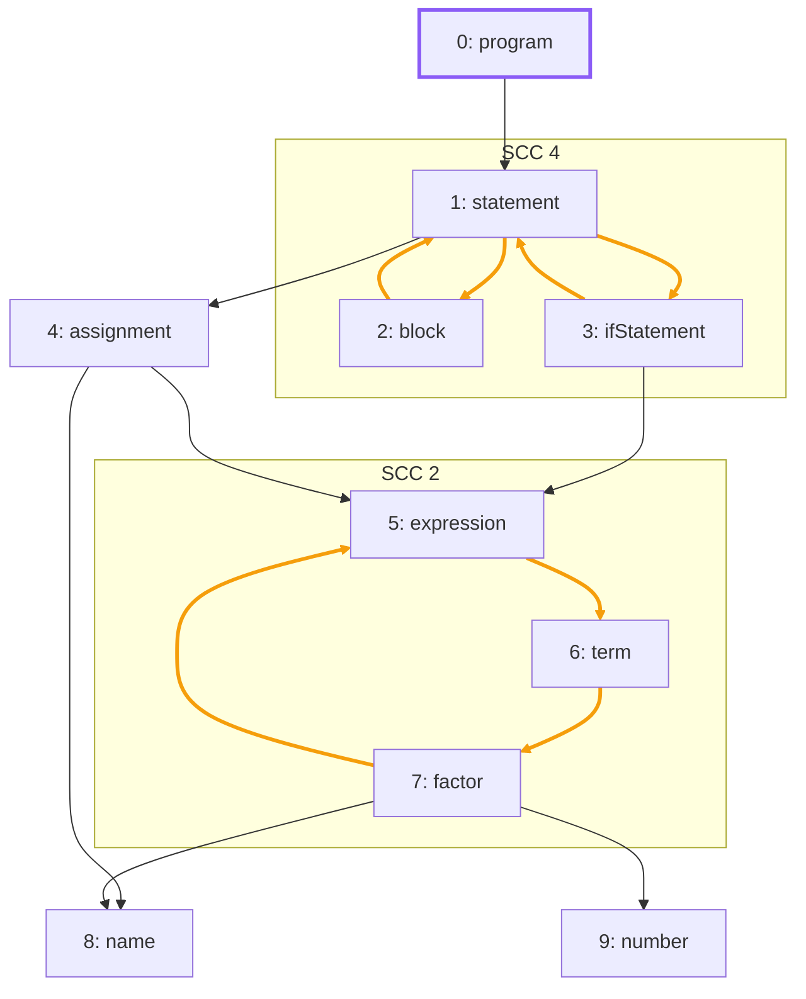

import Example from '../../../components/Example.astro';
import Api from '../../../components/Api.astro';
import Compare from '../../../components/Compare.astro';
import Gap from '../../../components/Gap.astro';
import InCode from '../../../components/InCode.astro';

:::note[In short]
- <Api ref="MermaidWriter.classDef(String, String)" /> defines a style class.
- <Api ref="MermaidWriter.nodeClass(IntFunction)" /> gives each node a class, by [node
  ID](../../glossary/#node-id).
- <Api ref="MermaidWriter.edgeStyle(IntFunction)" /> gives each edge a style, by [edge
  index](../../glossary/#edge-index).
- <Api ref="MermaidWriter.clusters(NodePartition, IntFunction)" /> draws the groups of a
  [partition](../../glossary/#partition-and-group) as frames.
:::

## Problem

You want a flowchart in Markdown that shows what an analysis found. A plain flowchart shows only the
graph. You choose the style classes, styles and frames, and the nodes to leave out, based on your
data and the results of your analyses. You need this for:

- a pull request or a report in which the nodes an analysis found have a color of their own;
- groups of nodes in frames, such as the [strongly connected
  components](../../glossary/#strongly-connected-component) or the classes of a package;
- the edges that lie on a [cycle](../../glossary/#cycle), drawn in a color of their own.

## Example

The grammar of a small programming language has a rule for each construct of the language:

```text
program     = { statement } ;
statement   = block | ifStatement | assignment ;
block       = "{" { statement } "}" ;
ifStatement = "if" "(" expression ")" statement ;
assignment  = name "=" expression ";" ;
expression  = term { "+" term } ;
term        = factor { "*" factor } ;
factor      = number | name | "(" expression ")" ;
```

`name` and `number` are rules for single tokens. The example graph `rules` models the rules of this
grammar. It has an edge from each rule to each rule it uses. The array `names` holds the names of
the rules:



The rules that use each other, directly or through other rules, lie in a common SCC (strongly
connected component). See [Find the groups of nodes that reach each
other](../../sccs/find-mutual-dependencies/). Every other rule is an SCC of its own, without a
cycle. The drawing should frame the SCCs with a cycle and draw the edges that lie on a cycle in
orange. It should also outline in purple the rule where a parser starts, which is `program`. These
are the colors of the pictures of this guide.

## Solution

<Example java="guide/ShowingGraphs.java#mermaidStyled" />

Rendered, the text looks like this. The picture below is Graphity's output, unchanged:



The two SCCs with a cycle stand in their frames. Every edge between two rules of the same SCC is
orange, since such an edge lies on a cycle. The frames have Mermaid's default style, not the colors
of the guide's frames, as the writer cannot give a frame a class. Good to know shows how to add one.

## Good to know

- **Frames only where you want them.** The partition passed to
  <Api ref="MermaidWriter.clusters(NodePartition, IntFunction)" label="clusters" /> decides. Here,
  only the groups of the SCCs with a cycle have nodes. Every other rule is in no group
  (<InCode java="-1" rust="NONE" ts="-1" csharp="-1" />), and a group without nodes gets no frame.
- **A class for the frames anyway.** The writer names each frame `c` and its group ID, such as
  `c2`. Define the class with
  <Api ref="MermaidWriter.classDef(String, String)" label="classDef" /> and append a line such as
  `class c2,c4 group` to the text. Mermaid then draws those frames in that class.
- **Leaving nodes out.** <Api ref="MermaidWriter.nodeFilter(IntPredicate)" /> leaves out nodes and
  their edges. See [Highlight nodes, edges and groups in Graphviz](../graphviz-styled/) for an
  example.
- **Undirected.** <Api ref="MermaidWriter.undirected()" /> draws the edges without arrowheads, in
  the [undirected reading](../../glossary/#undirected-reading): the edges `a -> b` and `b -> a`
  become one.

<Gap>
Give a frame a class or a style: <Api ref="MermaidWriter" /> draws its frames in Mermaid's default
style only, so frames in the colors of the groups they stand for cannot be written with it.
</Gap>
