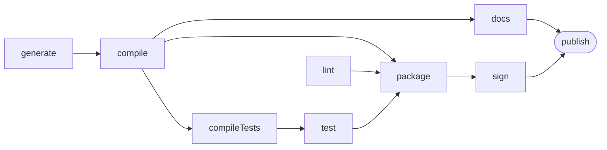

import Example from '../../../components/Example.astro';
import Api from '../../../components/Api.astro';
import Compare from '../../../components/Compare.astro';
import Gap from '../../../components/Gap.astro';
import InCode from '../../../components/InCode.astro';

:::note[In short]
- <Api ref="MermaidWriter.of(Graph)" /> starts a writer for a Mermaid flowchart.
- <Api ref="MermaidWriter.direction(MermaidWriter.Direction)" /> sets the direction, such as left to
  right.
- <Api ref="MermaidWriter.nodeLabel(IntFunction)" /> takes the label of each node from your data, by
  [node ID](../../glossary/#node-id).
- <Api ref="MermaidWriter.nodeShape(IntFunction)" /> sets the shape of each node.
- <Api ref="MermaidWriter.writeToString()" /> returns the text.
:::

## Problem

You want a picture of a graph in a place where people read Markdown. Mermaid draws flowcharts from a
short text inside Markdown. Many viewers render it without any extra tool, GitHub among them. You
need this for:

- a pull request or an issue that shows the graph a change affects;
- a wiki page or a README that documents how the modules of a system depend on each other;
- a report in Markdown with the result of an analysis.

## Example

The example graph `steps` models the nine steps that build and publish a small program. It has an
edge `a -> b` if step `b` may start only after step `a`. The array `names` holds the names of the
steps. The graph should be drawn from left to right, with the names of the steps on the nodes. The
last step is `publish`. It should be drawn as a stadium, which is a box with round ends.

## Solution

<Example java="guide/ShowingGraphs.java#mermaid" />

The writer names each node by its node ID after an `n`, such as `n8`, and shows the label in it.
Rendered, the text looks like this. The picture below is Graphity's output, unchanged:

## Good to know

- **Into Markdown.** Put the text in a code block marked `mermaid`.
- **Into a file.** <Api ref="MermaidWriter.write(Appendable)" /> writes the text to any
  <InCode java="Appendable" rust="io::Write" ts="TextSink" csharp="TextWriter" />, such as a <InCode java="Writer" rust="BufWriter" ts="WriteStream" csharp="StreamWriter" /> on a
  file.
- **Labels are escaped** for Mermaid. Characters that Mermaid would read as markup become entity
  codes, so that a label `0: program` is written as `0#58; program` and still shows as `0: program`.
  Depending on its version, Mermaid itself still changes a few labels, such as asterisks it reads
  as emphasis. The API documentation of <Api ref="MermaidWriter" /> lists them.
- **Edge labels** come from <Api ref="MermaidWriter.edgeLabel(IntFunction)" />, by [edge
  index](../../glossary/#edge-index).
- **Size.** Mermaid draws graphs of up to a few hundred nodes well. For larger ones, see [Draw a
  graph with Graphviz](../graphviz/).
- **Colors and frames.** See [Highlight nodes, edges and groups in Mermaid](../mermaid-styled/).
